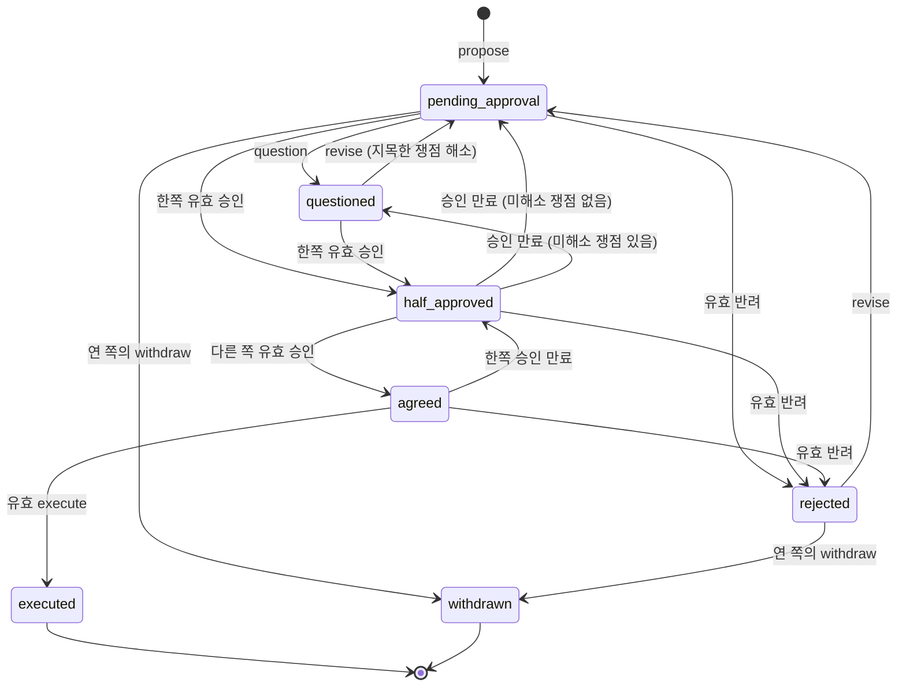

# 설계 문서 — ACCORD v2

## 개요

v2 는 `accord.py` 한 파일 안에서 세 가지를 한다. v1 경계 구멍 P1–P10 봉합, 사람이 직접 만든 SSH 서명(SSHSIG)의 검증, 협의별 승인 만료. 2인 구조, 표준 라이브러리만, 실행면 없음, 승인·반려는 사람만, 추가 전용 원장 + `derive()` 재계산은 그대로다.

설계의 중심은 **판정 함수 하나(`judge`)** 다. 수신(ingest), 기록 명령(CLI), 원장 재생(derive)이 모두 이 함수로 행 하나를 판정한다.

- 수신·기록 명령: 판정 → 통과하면 원장에 추가, 아니면 거부 (원장 불변)
- 재생: 판정 → 통과하면 상태에 반영, 아니면 셈에서 빼고 경고

v1 구멍의 뿌리는 두 가지였다. 검증 전에 기록한 것(P2), 수신 때와 재생 때 규칙이 달랐던 것(P1·P4·P8·P9·P10). 판정 함수를 하나로 두면 둘 다 구조적으로 사라진다.

### 다시 열지 않는 결정

- 범위: v1 구멍 봉합(P1–P10) + SSH 서명 + 협의별 승인 만료. 2인 구조 유지.
- 서명: 사람이 직접 `ssh-keygen -Y sign -n accord` 를 돌린다. `accord.py` 는 검증만 한다. 키 종류는 `ssh-ed25519`, `sk-ssh-ed25519@openssh.com`.
- 키를 등록한 상대만 서명 필수. 미등록 상대의 전언은 v1 처럼 "검증 불가 전언".
- 만료: 판본마다 승인 유효기간(기본 72시간)을 두고 지문에 넣는다.
- 요구사항 소개의 "세부 기본값" 전부 (허용 오차 5분, 1–720시간, 종결 상태 규칙, 낡은 전언 거부 등).

### 이 문서가 정하는 것

| 항목 | 결정 |
| --- | --- |
| 봉투 새 필드 | `approval_ttl_h`, `resolves`, `signed{statement, signature}`, `recorded_at`(원장 전용) |
| 미니 검증기 | `minimum`·`maximum` 추가, `pattern` 끝의 `$` 를 문자열 끝으로만 해석 |
| 정규 승인 문장 | 승인 5줄 / 반려 6줄, 둘째 줄 표지 `accord/2` |
| 지문 | v1 공식과 v2 공식(`approval_ttl_h` 포함). 봉투에 필드가 있는지로 고른다 |
| 판정 | `judge(cfg, keys, ctx, row, at)` 하나. 시각은 인자로만 받는다 |
| 시계 | 모듈 함수 `clock()` 하나. 평가 시각은 초 단위로 자른다 |
| Ed25519 | 공인자 없는 검사(인코딩 비교), S < L, RFC 8032 엄격 디코딩 |
| 설정 | `me`·`peer` 에 `pubkey`(없거나 null 이면 미등록). v1 설정 그대로 읽힘 |
| CLI | `withdraw`, `revise --resolves`, `--ttl-hours`, `init --pubkey/--peer-pubkey`, `request-approval --out/--reason`, `relay --reject` 플래그화 |

## 아키텍처

```
 공유 버스 봉투 ──► 봉투 해석 ───────┐
 사람 줄(+서명 블록) ──► 사람 줄 해석 ─┼──► 행(row) ──► judge(cfg, keys, ctx, row, at)
 CLI 기록 명령 ──► 봉투 생성 ────────┘                     │            │
                                                          통과          거부
                               ctx = replay(그 협의의 원장 행)  ▼            ▼
                                                     append(row)   AccordError (원장 불변)

 derive(thread, at) = replay: 행마다 judge(…, 그 행의 기록 시각)
                              → 통과: apply(ctx) / 실패: excluded·misrecorded
                    → state_at(ctx, at) → 결과 dict
```

`accord.py` 안의 절 순서 (한 파일 유지):

1. 상수·시계·시각 형식
2. 스키마 검증 (미니 검증기)
3. 저장소 (설정, 원장, `append`, `read_ledger`)
4. 지문·판본 내용 정규화
5. SSH 바이트 형식·공개키 해석·키 지문
6. Ed25519_Verifier
7. Sig_Verifier (SSHSIG)
8. 정규 승인 문장 (생성·해석·사람 입력 분리)
9. 판정 파이프라인 (`Ctx`, `judge`, `apply`, `replay`, `state_at`, `derive`)
10. 기록 (`record`, `emit`)
11. 출력 (`print_state`)
12. 명령과 `main`

`append()` 는 판정 없이 한 줄을 쓰는 저수준 함수로 남긴다. 시험이 원장에 행을 심을 때 쓴다(기존 `test_forged_row_in_ledger_counts_as_misrecorded`). CLI 와 ingest 는 `append()` 를 직접 부르지 않고 반드시 `record()` 를 거친다.

## 구성요소와 인터페이스

### 1. 시계와 시각

```python
SKEW = timedelta(minutes=5)                      # 허용 오차
DEFAULT_TTL_H, TTL_MIN_H, TTL_MAX_H = 72, 1, 720

def clock():
    """현재 UTC 시각(tz-aware). 이 모듈이 시각을 얻는 유일한 곳이다.
    시험은 accord.clock 을 바꿔 끼운다. 명령행 인자·환경 변수로 바꾸는 길은 없다."""
    return datetime.now(timezone.utc)

def eval_time():
    """판정에 쓰는 평가 시각. 초 단위로 잘라서, 같은 값을 recorded_at 으로 남긴다."""
    return clock().astimezone(timezone.utc).replace(microsecond=0)

def now():                                        # v1 이름 유지
    return fmt_utc(eval_time())
```

- 모든 호출부는 `clock` 을 호출 시점에 모듈 전역 이름으로 찾는다. 기본 인자(`at=clock()`)나 import 시점 바인딩을 두지 않는다. 그래야 `accord.clock = …` 교체가 모든 경로에 먹는다.
- 시험이 넣는 시계도 tz-aware UTC 를 돌려야 한다.
- 평가 시각을 초 단위로 자르는 이유: 만료 시각·서명 시각·기록 시각이 모두 정수 초라서, 자른 값으로 판정하고 같은 값을 `recorded_at` 에 남기면 재생 판정이 수신 판정과 초 경계에서도 같다.

시각 형식은 `YYYY-MM-DDTHH:MM:SSZ` 하나다.

```python
_UTC_RE = re.compile(r"[0-9]{4}-[0-9]{2}-[0-9]{2}T[0-9]{2}:[0-9]{2}:[0-9]{2}Z")

def fmt_utc(dt):  return dt.strftime("%Y-%m-%dT%H:%M:%SZ")
def parse_utc(s):
    """형식이 맞고 실재하는 시각이면 tz-aware datetime, 아니면 None."""
    if not isinstance(s, str) or not _UTC_RE.fullmatch(s):
        return None
    try:
        return datetime.strptime(s, "%Y-%m-%dT%H:%M:%SZ").replace(tzinfo=timezone.utc)
    except ValueError:
        return None
```

`\d` 대신 `[0-9]` 를 쓴다. 파이썬 `re` 의 `\d` 는 전각 숫자 같은 유니코드 숫자도 받는다. 이 문서의 모든 정규식이 같은 원칙을 따른다.

### 2. 봉투 스키마 (`contracts/envelope.schema.json`)

`additionalProperties: false` 는 최상위·`sender`·`signed` 모두 유지한다. 바뀌는 속성만 적는다.

| 속성 | v1 | v2 |
| --- | --- | --- |
| `accord` | `{"const": "1"}` | `{"enum": ["1", "2"]}` |
| `rev` | `{"type": "integer"}` | `{"type": "integer", "minimum": 1}` |
| `ts` | `{"type": "string"}` | `{"type": "string", "pattern": "^[0-9]{4}-[0-9]{2}-[0-9]{2}T[0-9]{2}:[0-9]{2}:[0-9]{2}Z$"}` |
| `issue_id` | `{"type": "string"}` | `{"type": "string", "pattern": "^Q-[0-9a-f]{6}$"}` |
| `approval_ttl_h` | 없음 | `{"type": "integer", "minimum": 1, "maximum": 720}` |
| `resolves` | 없음 | `{"type": "array", "items": {"type": "string", "pattern": "^Q-[0-9a-f]{6}$"}}` |
| `signed` | 없음 | 아래 |
| `recorded_at` | 없음 | `ts` 와 같은 형식 |

```json
"signed": {
  "type": "object",
  "additionalProperties": false,
  "required": ["statement", "signature"],
  "properties": {
    "statement": {"type": "string", "minLength": 1},
    "signature": {"type": "string", "minLength": 1}
  }
}
```

- 문장과 서명 블록을 한 객체로 묶는 이유: 미니 검증기가 `dependentRequired` 없이도 `required` 만으로 "둘 다 있거나 둘 다 없거나" 를 강제한다.
- `ts` 에 형식을 거는 이유: `recorded_at` 이 없는 v1 행은 `ts` 를 기록 시각으로 쓰므로 읽을 수 있어야 한다. v1 의 `now()` 는 항상 이 형식을 썼고, 기존 시험의 `ts` 값도 이 형식이다.
- `issue_id` 형식: v1 CLI 는 `Q-` + 16진 6자리만 만들었다. `resolves` 항목과 같은 형식으로 묶어 `--resolves` 인자 검사를 단순하게 한다.
- `accord` 값은 판정에 쓰지 않는다. 지문 공식은 `approval_ttl_h` 유무로 고르고(요구사항 17.5·17.6), 나머지 규칙은 버전과 무관하다. `"1"`·`"2"` 만 허용할 뿐이다.

**미니 검증기 확장 (두 곳만):**

```python
    if isinstance(inst, (int, float)) and not isinstance(inst, bool):
        if "minimum" in schema and inst < schema["minimum"]:
            errs.append(f"{path}: {schema['minimum']} 이상이어야 한다")
        if "maximum" in schema and inst > schema["maximum"]:
            errs.append(f"{path}: {schema['maximum']} 이하여야 한다")

def _pattern_ok(pat, s):
    """JSON Schema(ECMA-262) 의 `$` 는 문자열 끝이다. 파이썬 re 의 `$` 는 끝 줄바꿈
    앞에서도 맞으므로("T-12345678\n" 통과) 패턴 끝의 `$` 를 `\Z` 로 바꿔 검사한다."""
    if pat.endswith("$") and not pat.endswith("\\$"):
        pat = pat[:-1] + r"\Z"
    return re.search(pat, s) is not None
```

`type: integer` 검사는 v1 그대로 bool 과 실수(`72.0`, `1e2`)를 거부한다. 합의 대상 계약 3종(`doc_review`, `schedule`, `code_change`)은 바꾸지 않는다. `$` 수정은 그 계약의 패턴에도 똑같이 적용된다.

**필드-타입 정합 (스키마가 아니라 `judge` 가 검사):** v2 필드는 정해진 타입에만 올 수 있다. v1 필드(`text`, `evidence`, `human_id` 등)에는 제한을 새로 걸지 않는다. v1 이 만든 행이 그대로 통과해야 하기 때문이다.

| 필드 | 올 수 있는 타입 |
| --- | --- |
| `approval_ttl_h` | propose, revise |
| `resolves` | revise |
| `signed` | approve, reject, approve_relay, reject_relay |
| `recorded_at` | 원장 행에만. 받은 봉투에 있으면 거부 ("기록 시각은 받는 쪽이 적는다") |

### 3. 원장 행 형식

원장 한 줄 = 봉투 JSON 한 덩어리 + `recorded_at`. v1 SPEC §7 이 적은 `{at, dir, kind, body}` 감싸기는 쓰지 않는다 (구현은 처음부터 봉투를 그대로 썼다).

```json
{"accord":"2","thread":"T-976094ed","rev":2,"ts":"2026-09-22T12:32:11Z",
 "sender":{"party":"partner","kind":"agent"},"type":"revise","subject":"code_change",
 "payload":{…},"approval_ttl_h":72,"resolves":["Q-ada146"],"state_hash":"fe719bf8",
 "recorded_at":"2026-09-22T12:32:14Z"}
```

- 버스에 올리는 봉투에는 `recorded_at` 이 없다. `emit()` 은 `recorded_at` 을 뺀 봉투를 출력하고, 행은 `recorded_at` 을 붙여 추가한다.
- 받은 봉투는 필드 값을 하나도 바꾸지 않고 `recorded_at` 만 더한다. 받은 accord `"1"` 봉투도 `"1"` 그대로 남는다. 예외 하나: propose·revise 에 `state_hash` 가 없으면 v1 처럼 계산해 채운다 (값을 바꾸는 게 아니라 없는 필드를 더하는 것).
- 이 에이전트가 만드는 행(CLI 봉투, 사람 줄 기록)은 `accord: "2"`, `ts = recorded_at = 평가 시각` 이다.
- **기록 시각** = `recorded_at`, 없으면(v1 행) `ts`. 둘 다 못 읽으면 그 행은 재생에서 빠진다.

`read_ledger()` 는 JSON 으로 읽히지 않거나, 객체가 아니거나, `thread` 문자열이 없는 줄을 건너뛰고 그 수를 센다. 그런 줄은 어느 협의에도 속하지 않으므로 전체 `status` 가 경고 한 줄("원장에 읽을 수 없는 줄 N건")로만 알린다. v1 은 이런 줄 하나로 모든 조회가 죽었다.

### 4. 지문과 판본 내용

```python
def state_hash(thread, rev, subject, payload, ttl_h=None):
    """사람이 대조하는 8자리. ttl_h 가 None 이면 v1 공식, 아니면 v2 공식."""
    body = {"thread": thread, "rev": rev, "subject": subject, "payload": payload}
    if ttl_h is not None:
        body["approval_ttl_h"] = ttl_h
    canon = json.dumps(body, ensure_ascii=False, sort_keys=True, separators=(",", ":"))
    return hashlib.sha256(canon.encode("utf-8")).hexdigest()[:8]

def version_hash(row):                 # propose·revise 행의 지문
    return state_hash(row["thread"], row["rev"], row["subject"], row["payload"],
                      row.get("approval_ttl_h"))

def effective_ttl(row):                # 필드가 없는 판본은 72시간으로 본다 (17.6)
    return row.get("approval_ttl_h", DEFAULT_TTL_H)
```

두 공식을 정확히 적으면:

```
JSON(o) = json.dumps(o, ensure_ascii=False, sort_keys=True, separators=(",", ":")) 의 UTF-8 바이트

v1: state_hash = sha256(JSON({thread, rev, subject, payload})).hexdigest()[:8]
v2: state_hash = sha256(JSON({approval_ttl_h, payload, rev, subject, thread})).hexdigest()[:8]
```

- 봉투에 `approval_ttl_h` 가 있으면 v2, 없으면 v1. 기존 시험의 `accord.state_hash(th, 1, subject, payload)` 네 인자 호출은 v1 공식 그대로다.
- `approval_ttl_h` 는 정수로 검증된 값만 들어오므로 `72` 처럼 한 가지 표기로만 직렬화된다.
- 유효기간만 바꿔도 v2 정규 JSON 이 달라지므로 지문이 바뀐다. 누구도 지문을 유지한 채 유효기간을 바꿀 수 없다 (17.8).

**판본 내용 정규화 (요구사항 7.7):**

```python
def normalize(v):
    """문자열 값의 앞뒤 공백을 지우고 연속 공백을 한 칸으로. 키는 건드리지 않는다."""
    if isinstance(v, str):
        return " ".join(v.split())
    if isinstance(v, list):
        return [normalize(x) for x in v]
    if isinstance(v, dict):
        return {k: normalize(x) for k, x in v.items()}
    return v

def content_key(subject, payload, ttl_h):
    return json.dumps({"subject": subject, "payload": normalize(payload),
                       "approval_ttl_h": ttl_h},
                      ensure_ascii=False, sort_keys=True, separators=(",", ":"))
```

- 내용 없는 revise ⟺ `content_key(새 판본) == content_key(직전 판본)`. 유효기간은 `effective_ttl` 값으로 비교한다. 그래서 v1 식 revise(필드 없음, 72로 봄)가 72시간 판본을 이으면 유효기간은 같은 것으로 본다.
- `str.split()` 의 공백은 유니코드 공백(NBSP, U+3000 포함)이다. 폭 없는 문자(U+200B 등)는 공백이 아니다. 문서의 "공백 정규화까지만 한다" 한계가 이것이다.

### 5. 설정과 공개키 등록

v2 설정은 v1 설정에 `pubkey` 두 개를 더한 것이다.

```json
{
  "me":   {"party": "myoungsoo", "human_id": "100000001", "bot": "",
           "pubkey": "ssh-ed25519 AAAAC3NzaC1lZDI1NTE5AAAAI… myoungsoo@laptop"},
  "peer": {"party": "partner", "human_id": "900000001", "pubkey": null},
  "bus":  {"kind": "telegram_group", "chat_id": "-1001234567890"}
}
```

- `pubkey` 가 없거나 `null` 이면 키 미등록이다. v1 설정은 두 키가 없으므로 그대로 "둘 다 미등록" 으로 읽힌다.
- 저장값은 받은 한 줄의 앞뒤 공백만 지운 것이다. 키 지문은 저장하지 않고 매번 계산한다.
- `load_config()` 는 등록된 키를 해석해 `keys = {"me": PubKey | None, "peer": PubKey | None}` 를 만든다. 설정 속 키가 해석되지 않으면(누가 파일을 고쳤을 때) 모든 명령을 거부한다: "설정의 공개키를 읽을 수 없다 — init 을 다시 한다". 읽지 못한 키로 판정을 이어 가지 않는다.
- init 은 모든 검증을 끝낸 뒤에만 설정을 쓴다. 키 하나라도 거부되면 설정 파일은 바이트 단위로 그대로다.

**공개키 한 줄 해석 (요구사항 12.3·12.4):**

```python
SUPPORTED_KEY_TYPES = ("ssh-ed25519", "sk-ssh-ed25519@openssh.com")

class PubKey(NamedTuple):
    ktype: str; blob: bytes; pk: bytes; application: bytes; comment: str
```

`parse_pubkey_line(line)` 는 이 순서로 검사하고, 실패하면 `AccordError` 를 낸다.

1. 앞뒤 공백을 지우고 공백으로 최대 3토막(`종류 base64 [주석]`). 2토막 미만이면 형식 오류.
2. `base64.b64decode(tok, validate=True)`. 실패하면 형식 오류.
3. blob 의 첫 SSH string 을 읽는다. 못 읽으면 형식 오류. 앞 토막과 다르면 "base64 본체의 키 종류가 앞에 적힌 종류와 다르다".
4. 종류가 `SUPPORTED_KEY_TYPES` 에 없으면 12.4 거부: "지원하지 않는 키 종류 'ssh-rsa' — 지원: ssh-ed25519, sk-ssh-ed25519@openssh.com". 이름은 blob 이 확인해 준 뒤에만 출력한다.
5. 종류별 나머지: `ssh-ed25519` 는 `string pk`, sk 는 `string pk` + `string application`. pk 가 32바이트가 아니거나 남는 바이트가 있으면 형식 오류.
6. pk 를 Ed25519 점으로 디코딩한다(8절). 실패하면 "곡선 위의 점이 아니다".

받은 값은 거부 사유에 다시 찍지 않는다(4번의 종류 이름만 예외). 사용자가 실수로 개인키를 넘길 수 있기 때문이다. 받은 문자열에 `PRIVATE KEY` 가 보이면 사유에 "개인키로 보인다 — 공개키(.pub 한 줄)를 준다. 받은 값은 저장하지도 출력하지도 않았다" 를 붙인다. `--pubkey` 는 문자열만 받고 파일 경로는 받지 않는다. 그래서 `accord.py` 에는 키 파일을 여는 코드가 아예 없다 (요구사항 1.3).

**키 지문 (`ssh-keygen -l` 과 같은 형식, 12.5):**

```python
def key_fingerprint(blob):
    return "SHA256:" + base64.b64encode(hashlib.sha256(blob).digest()).decode().rstrip("=")
```

sk 키는 application 까지 포함한 blob 전체의 해시다. `ssh-keygen -l` 도 같다.

### 6. 정규 승인 문장

사람이 서명하는 대상이다. 승인은 5줄, 반려는 6줄이다.

```
승인 T-976094ed fe719bf8
accord/2
rev 2
사람 100000001
시각 2026-09-22T12:40:00Z
```

```
반려 T-976094ed fe719bf8
accord/2
rev 2
사람 100000001
시각 2026-09-22T12:40:00Z
사유 그 시간은 배포 창이다
```

| 줄 | 문법 (`re.fullmatch`) | 뜻 |
| --- | --- | --- |
| 1 | `승인` 또는 `반려`, 공백, `T-[0-9a-f]{8}`, 공백, `[0-9a-f]{8}` | 사람 줄 형식의 첫 줄. 동사·협의 번호·지문 |
| 2 | `accord/2` | 프로토콜 표지. 문장 형식의 판번호다 |
| 3 | `rev ([1-9][0-9]*)` | 판본 번호 |
| 4 | `사람 (\S+)` | 사람 id (텔레그램 user id 는 숫자다) |
| 5 | `시각 ` 뒤에 `_UTC_RE` 형식 (`YYYY-MM-DDTHH:MM:SSZ`) | 서명 시각. `parse_utc` 가 실재 시각으로 읽어야 한다 |
| 6 | `사유 (\S(?:.*\S)?)` | 반려만. 비어 있지 않고 앞뒤 공백 없음 |

- 구분자는 공백 한 칸만. 탭·두 칸·줄 끝 공백은 형식 오류다. 동사는 `승인`·`반려` 만 받는다(서명 문장에서는 v1 의 `approve`/`reject` 별칭과 대소문자 무시를 쓰지 않는다).
- 승인은 정확히 5줄, 반려는 정확히 6줄. 빈 줄·줄 추가·순서 바뀜은 형식 오류다 (14.12).
- 문장의 지문은 현재 판본의 지문이므로 협의 번호·rev·내용·유효기간을 모두 묶는다. rev 줄은 요구사항 13.1 이 정한 중복 결속이다.
- 이름공간 `accord` 가 이 문장을 다른 용도의 SSH 서명(git 커밋 서명 등)과 가른다.

**생성 (`make_statement`):** 줄을 LF 로 잇고 마지막에 LF 하나를 붙인다. 이 바이트가 request-approval 이 출력하고 `--out` 이 쓰는 바이트다.

```python
STMT_MARK = "accord/2"

def make_statement(verb, thread, fp, rev, human_id, at, reason=None):
    lines = [f"{verb} {thread} {fp}", STMT_MARK, f"rev {rev}",
             f"사람 {human_id}", f"시각 {fmt_utc(at)}"]
    if verb == "반려":
        lines.append(f"사유 {reason or ''}")      # 틀은 '사유 ' 로 끝난다
    return "\n".join(lines) + "\n"
```

**해석 (`parse_statement`):** `re.split(r"\r?\n", text)` 로 줄을 나누고, 마지막 원소가 빈 문자열이면 하나만 뗀다(마지막 줄바꿈 하나 허용). 그다음 줄마다 위 문법으로 `fullmatch`. 실패하면 `StatementError(사유)`. 결과는 `Statement(verb, thread, fp, rev, human_id, at, reason, lines)`.

**줄 끝 허용 (14.11):** 서명 검증에 쓰는 후보 바이트는 해석된 줄로 다시 만든 네 가지다.

```python
def statement_candidates(lines):
    return tuple((eol.join(lines) + tail).encode("utf-8")
                 for eol in ("\n", "\r\n") for tail in ("", eol))
```

줄 내용은 엄격 문법으로 이미 고정됐으므로, 네 후보는 줄 끝 형식과 마지막 줄바꿈만 다르다. 받은 문장이 LF·CRLF 를 섞어 썼으면 해석은 되지만 어느 후보와도 서명이 맞지 않아 무효다. BOM 이 붙은 파일에 서명했으면 역시 무효다. 이 둘은 거부 사유에 "문장 파일을 `request-approval --out` 이 쓴 그대로 서명했는지 확인 (PowerShell 5.1 의 `>`·`Set-Content` 는 UTF-16·BOM·ANSI 로 쓴다)" 로 안내한다.

**사람 입력 분리 (`split_human_input`):** ingest 가 받은 텍스트(UTF-8, 앞의 BOM 은 뗌)를 문장과 서명 블록으로 가른다.

1. `text.splitlines(keepends=True)` 에서 `strip()` 한 내용이 `-----BEGIN SSH SIGNATURE-----` 인 첫 줄 i 를 찾는다. 없으면 서명 없는 입력이다.
2. i 뒤에서 `-----END SSH SIGNATURE-----` 인 첫 줄 j 를 찾는다. 없으면 "서명 블록의 끝 표지가 없다".
3. j 뒤에 공백 말고 다른 내용이 있으면 거부: "서명 블록 뒤에 다른 내용이 있다".
4. `statement = "".join(lines[:i]).strip()`, `signature = "".join(lines[i:j+1]).strip()`.

`statement` 는 받은 바이트에서 앞뒤 공백(문장과 블록 사이 빈 줄 포함)만 뗀 것이다. 줄 안의 내용과 줄 끝(CRLF 포함)은 그대로 남는다. 이 두 문자열이 원장 행의 `signed` 에 바뀌지 않고 들어가고(15.5), relay 가 그대로 싣는다(16.1). 재생과 상대 쪽 검증은 같은 해석·같은 후보로 같은 결론을 낸다.

### 7. Sig_Verifier (SSHSIG)

```python
def verify_sshsig(armored: str, candidates: tuple[bytes, ...], key: PubKey) -> tuple[bool, str]:
    """서명 블록이 등록 키로 후보 가운데 하나에 대해 검증되면 (True, ""), 아니면 (False, 사유).
    어떤 입력에도 예외를 밖으로 내지 않는다."""
```

내부의 모든 형식 오류는 `SigError` 하나로 올리고, `verify_sshsig` 가 그것만 잡아 `(False, 사유)` 로 바꾼다. 읽기 도구 `_Wire` 는 `u8()`, `u32()`, `string()`(길이가 남은 바이트보다 크면 `SigError`), `done()`(남는 바이트가 있으면 `SigError`)만 가진다. `base64` 오류(`binascii.Error`)도 `SigError` 로 감싼다. 인덱스·구조체 예외가 새어 나올 경로를 코드에 두지 않는다.

검사 순서:

1. **armor** — BEGIN·END 사이 줄마다 `strip()` 해 이어 붙이고 `b64decode(validate=True)`. 줄 폭·줄 앞뒤 공백은 상관없다 (14.1).
2. **blob 구조** — `"SSHSIG"` 6바이트, `uint32` 버전 = 1, `string publickey`, `string namespace`, `string reserved`, `string hash_alg`, `string signature`, 남는 바이트 없음. 하나라도 어긋나면 "SSHSIG 구조로 읽히지 않는다" (14.2).
3. **이름공간** — 정확히 `b"accord"`. 아니면 "이름공간이 accord 가 아니다 (받은 값 …)" (14.3).
4. **reserved** — 빈 문자열이어야 한다. `ssh-keygen` 은 항상 빈 값을 쓰고, OpenSSH 도 서명 대상에는 빈 값을 넣어 검증한다.
5. **해시** — `b"sha512"` 또는 `b"sha256"` (14.4).
6. **키 종류** — publickey blob 의 첫 string 이 `SUPPORTED_KEY_TYPES` 에 없으면 "지원하지 않는 키 종류 '…' — 지원: …" (14.6). 5절의 blob 해석을 그대로 쓴다.
7. **등록 키 대조** — publickey blob 이 등록 키 blob 과 바이트 단위로 같아야 한다 (14.5). 다르면 "등록된 키가 아닌 키의 서명이다 (서명 키 SHA256:…, 등록 키 SHA256:…)".
8. **서명 구조** — `string sigtype`(= 키 종류), `string raw`(64바이트). sk 는 이어서 `byte flags`, `uint32 counter`. 남는 바이트 없음.
9. **사용자 존재** — sk 는 `flags & 0x01` 이어야 한다. 아니면 "보안키 서명에 사용자 존재 표시가 없다" (14.9). 카운터는 검사하지 않는다.
10. **서명 검증** — 후보 `m` 마다:
    - `signed_data = b"SSHSIG" + S(b"accord") + S(b"") + S(hash_alg) + S(H(m))` (`S` 는 SSH string, `H` 는 `hashlib.sha512`/`sha256` 의 raw digest)
    - ssh-ed25519: `ed25519_verify(pk, signed_data, raw)` (14.7)
    - sk: `msg = sha256(application) + bytes([flags]) + counter.to_bytes(4, "big") + sha256(signed_data)` 로 `ed25519_verify(pk, msg, raw)` (14.8)
    - 하나라도 참이면 유효. 모두 거짓이면 "서명이 문장과 맞지 않는다" + 6절의 인코딩 안내.

**캐시:** 재생은 `derive` 때마다 서명 행을 다시 검증한다. `functools.lru_cache` 로 `(등록 키 blob, 후보 튜플, armored)` 를 키로 검증 결과를 프로세스 안에서만 기억한다. 순수 함수의 메모이제이션이라 판정을 바꾸지 않고, 파일에 남지 않는다 (요구사항 1.7). 설정이 바뀌면 키 blob 이 달라져 캐시가 자연히 갈린다.

### 8. Ed25519_Verifier (RFC 8032, 순수 파이썬)

```python
_P = 2**255 - 19
_L = 2**252 + 27742317777372353535851937790883648493
_D = -121665 * pow(121666, _P - 2, _P) % _P
_SQRT_M1 = pow(2, (_P - 1) // 4, _P)
# 기준점 B: y = 4/5, x 는 짝수. 확장 좌표 (X, Y, Z, T), x = X/Z, y = Y/Z, xy = T/Z

def ed25519_verify(pk: bytes, msg: bytes, sig: bytes) -> bool:
    if len(pk) != 32 or len(sig) != 64:
        return False
    A = _decode(pk)
    if A is None:
        return False                     # 디코딩할 수 없는 공개키 (14.10)
    Rb = sig[:32]
    if _decode(Rb) is None:
        return False                     # 디코딩할 수 없는 R (14.10)
    S = int.from_bytes(sig[32:], "little")
    if S >= _L:
        return False                     # S ≥ L 거부 — 서명 가변성 차단 (14.10)
    k = int.from_bytes(hashlib.sha512(Rb + pk + msg).digest(), "little") % _L
    return _encode(_add(_mul(S, _B), _mul(k, _neg(A)))) == Rb
```

- **점 디코딩 (§5.1.3)**: 32바이트 → `y` = 하위 255비트, `x_0` = 최상위 비트. `y ≥ p` 면 실패(비정규 인코딩 거부). `x² = (y²−1)/(d·y²+1)`, `x = (x²)^((p+3)/8)`. `x² ≠` 목표면 `x ← x·√−1`, 그래도 아니면 실패. `x = 0` 인데 `x_0 = 1` 이면 실패. `x mod 2 ≠ x_0` 면 `x ← p − x`.
- **덧셈**: a = −1 비틀린 에드워즈 곡선의 확장 좌표 통합 덧셈식(RFC 8032 §5.1.4). 배가도 같은 식을 쓴다. 이 곡선에서 완전(complete) 공식이라 예외 경우가 없고, 코드가 짧아 틀릴 곳이 적다.
- **스칼라 곱**: 왼쪽부터 double-and-add. `_neg(X, Y, Z, T) = (−X, Y, Z, −T)`.
- **인코딩**: `Z` 역원 한 번(`pow(Z, p−2, p)`), `y | (x & 1) << 255` 의 32바이트 little-endian.

**공인자 선택 — 공인자 없는 검사(cofactorless), 인코딩 비교.** RFC 8032 §5.1.7 은 `[8][S]B = [8]R + [8][k]A` 를 적되 `[S]B = R + [k]A` 로 검사해도 된다고 한다. 여기서는 `R' = [S]B − [k]A` 를 인코딩해 서명의 R 바이트와 비교한다.

- OpenSSH 가 쓰는 참조 구현(`crypto_sign_ed25519_open`)도 R' 를 인코딩해 바이트로 비교한다. 그래서 `ssh-keygen -Y verify` 가 받는 서명(S < L)은 여기서도 받는다.
- R 을 먼저 엄격하게 디코딩하므로 받아들이는 R 인코딩은 모두 정규형이다. 따라서 바이트 비교는 점 비교와 같다.
- 한 번에 서명 하나만 검증한다(일괄 검증 없음). 공인자 유무가 결과를 가르는 경우는 작은 위수 성분을 일부러 넣은 서명뿐이고, 그런 서명을 만들 수 있는 쪽은 이미 개인키를 가진 쪽이다.
- 공개키가 작은 위수 점인지는 따로 보지 않는다. 정상 키(`[a]B`, a 는 8의 배수로 조정된 스칼라)는 그런 점이 될 수 없다. 설정의 키를 바꿀 수 있는 쪽은 어차피 등록 키 자체를 바꿀 수 있다.

**상수 시간이 아니다.** 파이썬 정수 연산은 상수 시간이 아니다. 검증기가 다루는 값(공개키, 서명, 메시지)은 모두 공개 값이라 시간 차로 새는 비밀이 없다. 시험 전용 서명기도 상수 시간이 아니므로 실제 키에 쓰면 안 된다 — 시험 파일 머리 주석에 적는다.

**비용:** 검증 한 번에 스칼라 곱 두 번, CPython 에서 수 ms–수십 ms. 7절의 캐시로 재생 비용을 줄인다.

### 9. 판정 파이프라인

**재생 문맥 `Ctx`** — 협의 하나를 원장 순서대로 재생하며 쌓는 값. 파일에 저장하지 않는다.

| 필드 | 뜻 |
| --- | --- |
| `rows_seen` | 이 협의 번호로 앞서 나온 행 수 (유효·무효 모두) |
| `opened`, `opener`, `subject` | 유효 propose 여부, 협의를 연 party, 협의의 subject |
| `cur`, `cur_hash`, `cur_ttl`, `cur_key` | 현재 판본 행, 현재 지문, 유효기간, `content_key` |
| `issues`, `resolved` | 쟁점 번호 → question 행(순서 유지), 해소된 번호 집합 |
| `approvals` | party → `Approval` (현재 판본에 대한 것만) |
| `stale` | 마지막 revise 가 기록될 때 유효하던 승인의 party (v1 키 `stale_approvals`) |
| `rejected`, `my_reject` | 현재 판본의 유효 반려 행, 그중 내 사람 것 (relay --reject 용) |
| `rejects`, `executed`, `exec_hash` | 유효 반려 행 전체, 유효 실행 기록, 실행된 지문 |
| `withdrawn`, `sent_relays`, `contentless` | 철회 행, 발신 기록 전언, 내용 없는 revise 의 rev 목록 |
| `excluded`, `misrecorded` | 셈에서 뺀 행 `{row, code, reason}`, 권한 없는 승인 행(v1) |

`Approval = {party, source, approved_at, basis, expires_at, row}`. `source` 는 `attested`(내 사람, 서명 없음) · `signed`(내 사람, 서명) · `relayed`(검증 불가 전언) · `verified`(검증된 전언). `basis` 는 `signed_at` 또는 `recorded_at`. `expires_at = approved_at + cur_ttl 시간`.

**흐름 (코드 뼈대):**

```python
def replay(cfg, keys, rows):
    ctx = Ctx()
    for r in rows:
        at = recorded_time(r)                  # recorded_at, 없으면 ts. 못 읽으면 None
        v = judge(cfg, keys, ctx, r, at)
        if v.ok:
            apply(ctx, r, v, at)
        elif v.code == "misrecorded":
            ctx.misrecorded.append(r)
        else:
            ctx.excluded.append({"row": r, "code": v.code, "reason": v.reason})
        ctx.rows_seen += 1
    return ctx

def record(cfg, keys, row, at):
    """CLI 와 ingest 가 원장에 쓰는 유일한 길. 판정을 모두 통과해야 추가한다."""
    ctx = replay(cfg, keys, read_ledger(row["thread"]))
    row = dict(row, recorded_at=fmt_utc(at))
    v = judge(cfg, keys, ctx, row, at)
    if not v.ok:
        raise AccordError(v.reason)            # 원장·설정은 손대지 않았다
    append(row)
    return row

def derive(thread, at=None):
    at = eval_time() if at is None else at
    cfg, keys = load_config_and_keys()
    rows = read_ledger(thread)
    if not rows:
        raise AccordError(f"{thread}: 원장에 없는 협의다")
    ctx = replay(cfg, keys, rows)
    if not ctx.opened:
        raise AccordError(f"{thread}: 손상된 협의 — 유효한 propose 가 없다 ({손상 사유})")
    return summarize(ctx, rows, at)
```

`judge` 는 `(cfg, keys, ctx, row, at)` 만 보는 순수 함수다. 시계를 읽지 않고, 파일을 읽지 않고, 뒤에 오는 행을 보지 않는다. 수신 때 `at` = 평가 시각 = 남기는 `recorded_at` 이고, 재생 때 `at` = 그 `recorded_at` 이다. 앞선 행은 추가 전용이라 똑같다. 그래서 설정이 그대로면 수신 판정과 재생 판정이 같다 (11.1, 11.4).

**판정 규칙 — 공통 (모든 행, 이 순서로):**

| # | 규칙 | 실패 코드 | 거부 사유 요지 | 요구사항 |
| --- | --- | --- | --- | --- |
| J1 | 봉투 스키마 통과 | `schema` | "봉투 계약 위반: …" | 2.3 |
| J2 | 기록 시각을 읽을 수 있다 | `time` | "기록 시각을 읽을 수 없다" | 11.1 |
| J3 | v2 필드가 허용 타입에만 있다 | `field` | "'resolves' 는 revise 에만 온다" 등 | 2.3 |
| J4a | kind=human 이면 type ∈ {approve, reject} | `sender` | "사람 발신 행인데 승인·반려가 아니다" | 1.4 |
| J4b | kind=human 이면 party = 내 party, human_id = 내 사람 id | approve: `misrecorded`, reject: `authority` | v1 문구 ("상대편 사람이다", "등록되지 않은 사람") | 11.5, 15.4 |
| J4c | kind=agent 이면 type ∉ {approve, reject} | `sender` | "'approve' 는 사람만 발화할 수 있다" (v1 문구) | 1.4 |
| J4d | party ∈ {내 party, 상대 party} | `party` | "등록되지 않은 상대 '…' 의 메시지다" (v1 문구) | — |
| J5 | propose 면 `rows_seen = 0`, 아니면 `opened` | `thread` | "이미 있는 협의 번호다" / "원장에 없는 협의다" | 4.1, 3.3 |
| J6 | withdrawn 이 아니다. executed 면 type ∈ {execute, approve_relay} 이고 state_hash = 실행된 지문 | `terminal` | "철회된 협의다" / "실행된 협의다 — 실행된 지문의 execute·승인 전언만 받는다" | 9.5, 5.7 |
| J7 | propose: rev = 1 · revise: rev = 현재 rev + 1 · 그 밖: rev = 현재 rev · subject = 협의 subject | `rev`, `subject` | revise 는 "rev 가 맞지 않는다 (기대 3, 받은 99)" | 4.2–4.5 |
| J8 | 지문: propose·revise 는 재계산값과 같다(없으면 채운 값). approve·approve_relay·reject_relay·execute 는 state_hash 필수, 현재 지문과 같다. 그 밖은 있으면 같다 | `hash`, `stale` | "지문이 본문과 맞지 않는다" / 전언은 "낡은 판본에 대한 전언이다 (현재 …)" / 사람 줄은 v1 의 "지문 불일치" | 17.8, 6.2, 5.2 |

J4 는 v1 의 거부 순서(사람 봉투 → 사람 전용 타입 → 미등록 party)를 유지한다. 그래서 기존 시험의 거부 경로가 그대로다.

**판정 규칙 — 타입별:**

| # | 타입 | 규칙 | 실패 코드 | 요구사항 |
| --- | --- | --- | --- | --- |
| J9 | propose | payload 가 subject 계약을 통과한다 | `payload` | — |
| J10 | question | issue_id 가 있고 그 협의에서 처음 쓰인다 | `issue` | 7.5 |
| J11 | revise | payload 계약 통과. resolves 의 모든 번호가 앞서 제기된 쟁점이다 | `payload`, `issue` | 7.3 |
| J12 | execute | `state_at(ctx, at)` ∈ {agreed, executed}. 아니면 "합의 전 실행 기록이다 (상태 …)" | `execute` | 5.1, 5.4 |
| J13 | withdraw | 발신 party = 협의를 연 party | `withdraw` | 9.3 |
| J14 | approve (사람 행) | rejected 가 아니다 ("반려된 판본이다 — revise 로 새 판본을 올린 뒤 승인한다"). 서명 정책(내 키) | `after_reject`, `sig_mine`, `future`, `expired` | 10.2, 15.x |
| J15 | reject (사람 행) | 서명 정책(내 키). 사유 = 서명 문장의 사유 줄 또는 v1 줄의 나머지(없으면 "(사유 없음)") | `sig_mine`, `future` | 15.x |
| J16 | 전언, 상대 발신 | human_id = 상대 사람 id. approve_relay 는 rejected 가 아니다. 서명 정책(상대 키) | `relay_human`, `after_reject`, `sig_peer`, `future`, `expired` | 6.1, 10.2, 16.x |
| J17 | 전언, 내 발신 | human_id = 내 사람 id. 승인: `at` 에 유효한 내 승인이 있고 `signed` 가 그 승인 행의 것과 같다. 반려: `my_reject` 가 있고 text·`signed` 가 그 행의 것과 같다 | `relay_own` | 6.3–6.5, 16.1 |

**서명 정책 (J14–J16 공통).** K = 해당 사람의 등록 키 (사람 행은 `keys["me"]`, 상대 전언은 `keys["peer"]`).

| # | 조건 | 결과 | 요구사항 |
| --- | --- | --- | --- |
| S1 | K 없음, 사람 행 | `signed` 가 있으면 거부: "검증할 내 사람 공개키가 등록돼 있지 않다 — init --pubkey 로 등록한다". 없으면 서명 없는 승인·반려 (승인 시각 = 기록 시각) | 15.6, 2.6 |
| S1' | K 없음, 상대 전언 | `signed` 는 판정에 쓰지 않는다 (행에는 그대로 남음). 검증 불가 전언, 승인 시각 = 기록 시각 | 16.6 |
| S2 | K 있음, `signed` 없음 | 사람 행: "내 사람 키가 등록돼 있어 서명이 필요하다 — request-approval 로 문장을 받아 서명한다". 전언: "상대 키가 등록돼 있어 서명 없는 전언은 세지 않는다" | 15.2, 16.3 |
| S3 | 문장 해석 | `parse_statement` 실패면 거부 (사유 포함) | 14.12 |
| S4 | 결속 | 동사(approve·approve_relay ↔ 승인, reject·reject_relay ↔ 반려), thread, rev, 지문(= 행의 state_hash = 현재 지문), 사람 id(사람 행은 `sender.human_id`, 전언은 `human_id`)가 문장과 같다. 반려 계열은 행의 text = 문장의 사유 | 15.3, 16.4 |
| S5 | 서명 | `verify_sshsig(signature, statement_candidates(lines), K)` 가 참 | 14.x, 15.2, 16.2 |
| S6 | 미래 시각 | 서명 시각 ≤ `at` + 5분. 아니면 "서명 시각 …Z 가 이 쪽 시각 …Z 보다 5분 넘게 미래다" | 19.3, 19.4 |
| S7 | 만료 (승인 계열만) | `at` < 서명 시각 + 현재 유효기간. 아니면 "이미 만료된 승인이다 (만료 …Z)" | 18.5 |

통과하면 승인 시각 = 서명 시각, `basis = signed_at`, `source` 는 사람 행이면 `signed`, 전언이면 `verified`. 반려에는 만료가 없다. 반려 전언의 사유는 서명 문장의 사유와 같아야 한다 — 검증한 내용과 다른 겉 필드는 받지 않는다 (S4 의 text 결속은 16.4 를 반려 사유까지 넓힌 이 문서의 결정이다).

**반영 (`apply`):**

| 타입 | 효과 |
| --- | --- |
| propose | `opened`, `opener`, `subject`, 현재 판본 설정 |
| question | `issues[issue_id]` 추가 |
| revise | 내용 없는 revise 면 `contentless` 에 rev 추가·해소 목록 무시, 아니면 해소 목록의 번호를 `resolved` 에 더한다. `stale` = `at` 에 유효하던 승인의 party. `approvals` 비움, `rejected`·`my_reject` 비움, 현재 판본 교체 (7.2, 7.6, 7.8, 10.1) |
| approve | `approvals[me]` 갱신 |
| approve_relay (상대) | `approvals[peer]` 갱신 |
| reject, reject_relay (상대) | `rejected` 설정(사람 행이면 `my_reject` 도), `rejects` 추가, `approvals` 비움 |
| 전언 (내 발신) | `sent_relays` 추가. 승인·반려로 세지 않는다 (6.6, P10) |
| execute | `executed` 추가, `exec_hash` = 현재 지문 |
| withdraw | `withdrawn` 설정 |

같은 판본에 같은 party 의 승인이 여러 번 기록되면 승인 시각이 가장 늦은 것을 센다. 같은 서명 문장을 다시 넣어도 결과가 같고(멱등), 서명 문장의 시각은 5분 넘게 미래일 수 없으므로 늘릴 수 있는 폭이 정해져 있다.

**상태 계산 (`state_at`)** — 우선순위 순서:

```python
def state_at(ctx, t):
    if ctx.withdrawn:  return "withdrawn"
    if ctx.executed:   return "executed"        # 만료와 무관 (5.6)
    if ctx.rejected:   return "rejected"        # 다음 유효 revise 까지 (10.1)
    valid = [a for a in ctx.approvals.values() if t < a.expires_at]    # 18.1
    if len(valid) >= 2: return "agreed"
    if valid:           return "half_approved"
    return "questioned" if open_issues(ctx) else "pending_approval"
```

`approvals` 에는 현재 판본의 승인만 있고 서로 다른 party 키로 모이므로, "서로 다른 두 party 의 유효 승인" 이 그대로 `len(valid) >= 2` 다. withdrawn·executed·rejected 는 판정 규칙상 동시에 성립할 수 없다(J6, J12, J14). 순서는 방어용이다.

**재생 경고 (11.2 등).** 뺀 행은 코드별로 묶어 건수와 사유를 한 줄씩 붙인다.

| 코드 | 경고 문장 (요지) | 요구사항 |
| --- | --- | --- |
| `misrecorded` | v1 문장 그대로: "권한 없는 승인 기록 N건이 원장에 있다 — …" (`excluded` 에는 넣지 않는다) | 11.5 |
| `execute` | "무효 실행 기록 N건 — 합의 전이거나 지문이 다른 execute 행이다. 셈에서 뺐다" | 5.5 |
| `withdraw` | "협의를 연 쪽이 아닌 withdraw N건 — 셈에서 뺐다" | 9.4 |
| `after_reject` | "반려 뒤 같은 판본에 기록된 승인 N건 — 셈에서 뺐다" | 10.3 |
| `relay_human` | "상대 사람 id 가 아닌 전언 N건 — 셈에서 뺐다" | 6.7 |
| `sig_mine` | "내 사람 키가 등록돼 있는데 서명이 없거나 검증되지 않는 내 사람 행 N건" | 15.7 |
| `sig_peer` | "상대 키가 등록돼 있는데 서명이 없거나 검증되지 않는 상대 전언 N건" | 16.7 |
| `future` | "서명 시각이 기록 시각보다 5분 넘게 미래인 행 N건" | 19.4 |
| 그 밖 | "수신 규칙을 어긴 행 N건을 셈에서 뺐다: <코드별 첫 사유>" | 11.2 |

그 밖의 경고:

- **합의 착시 (v1 문장 그대로)** — agreed·executed 이고 유효 question 이 0건 (8.4).
- **미해소 쟁점 합의** — agreed·executed 이고 미해소 쟁점이 1건 이상: "미해소 쟁점 2건(Q-ada146, Q-0c1d2e)이 열린 채 합의됐다 — 쟁점을 덮은 합의인지 사람이 확인할 것". "합의 착시" 문구를 넣지 않는다 (8.1, 8.2).
- **내용 없는 revise** — `contentless` 의 rev 마다: "내용이 바뀌지 않은 revise(rev 3) — 쟁점을 해소하지 못한다. 해소 목록은 적용하지 않았다" (7.6). 협의 이력으로 계속 남는다.
- **검증 불가 전언 (v1 문장 그대로)** — `relayed_approvals` 가 비어 있지 않을 때. 끝에 "(상대 키를 init --peer-pubkey 로 등록하면 서명된 전언만 센다)" 를 덧붙인다. 기존 시험은 "전언" 포함만 본다.
- **code_change 롤백·검증 비어 있음 (v1 그대로)**.

### 10. 상태 기계



그림에 다 적지 않은 규칙:

- 상태는 `(ctx, 평가 시각)` 의 함수다. 원장 행이 없어도 시간이 흐르면 agreed → half_approved → pending/questioned 로 내려간다 (18.2).
- revise 는 종결 상태가 아닌 모든 상태에서 받고(양쪽 party 모두 가능, v1 과 같음), 모든 승인을 무효로 한 뒤 쟁점 유무에 따라 pending_approval 또는 questioned 로 간다. rejected 에서도 같다.
- withdraw 는 종결 상태가 아닌 모든 상태에서 협의를 연 party 만 할 수 있다.
- question 은 종결 상태가 아닌 모든 상태에서 받는다. rejected 에서 question 이 와도 rejected 다. agreed 에서 question 이 오면 agreed 를 유지하고 미해소 쟁점 경고가 붙는다.
- rejected 에서 받는 것: question, revise, 연 쪽의 withdraw, reject_relay, 내 사람의 반려 줄(이미 반려됐어도 내 사람 반려를 기록해 전달할 수 있어야 한다). 승인 줄·approve_relay 는 거부한다 (10.2, 10.5).
- executed 에서 받는 것: 실행된 지문의 execute(양쪽이 각자 증거를 남김)와 approve_relay(늦은 전언). 내 approve_relay 도 J17 에 따라 `at` 에 내 승인이 유효해야 나간다 — 실행 뒤 전언을 늦게 보내려면 만료 전에 보낸다.
- 순서가 뒤바뀐 수신: 상대의 execute 가 상대 승인 전언보다 먼저 오면 이 쪽은 아직 agreed 가 아니라 거부한다(J12). 전언을 받은 뒤 같은 execute 를 다시 ingest 하면 기록된다.

### 11. CLI 변경

| 명령 | v2 인자 | 동작 |
| --- | --- | --- |
| `init` | `--pubkey "<한 줄>"`, `--peer-pubkey "<한 줄>"` (선택) | 5절 해석. 전부 통과해야 설정을 쓴다. 두 사람의 등록 여부와 `SHA256:` 지문 출력 (12.x) |
| `propose` | `--ttl-hours N` (선택, 기본 72) | 새 협의 번호(원장에 없는 번호가 나올 때까지 다시 뽑음), rev 1, `approval_ttl_h` 항상 실음 |
| `revise` | `--resolves Q-… [Q-…]`, `--ttl-hours N`, `--note` | rev = 현재 + 1. 유효기간 미지정이면 직전 판본의 유효기간(v1 판본이면 72). `--resolves` 는 중복을 지우고, 제기되지 않은 번호가 있으면 거부 (7.1, 7.4, 17.3) |
| `question` | 그대로 | 쟁점 번호 `Q-` + `sha256(thread·text·시각·urandom)[:6]`, 협의 안에서 겹치면 다시 뽑음 |
| `request-approval` | `--out FILE`, `--reason TEXT` (선택) | 아래 |
| `relay` | `--reject` (값 없는 플래그) | 승인: `at` 에 유효한 내 승인이 있어야 한다. 반려: 현재 판본의 내 사람 반려가 있어야 하고, 사유는 그 행의 사유. 둘 다 그 행의 `signed` 를 그대로 싣는다 (6.3–6.5, 16.1) |
| `withdraw` | `--thread T`, `--reason TEXT` (선택) | 협의를 연 party 만. 사유는 `text` 로 싣는다 (9.1, 9.2) |
| `ingest` | 그대로 | 입력은 `utf-8-sig` 로 읽어 앞의 BOM 을 뗀다. 봉투는 `recorded_at` 이 있으면 거부, 메아리는 v1 처럼 무시(rc 0), 나머지는 `record()` |
| `execute` | 그대로 | `state_at(now)` 가 agreed·executed 가 아니면 거부. 만료를 반영한다 (5.3, 18.6) |
| `status` | 그대로 | 아래 |

- `--ttl-hours` 는 문자열로 받아 코드에서 `^[0-9]+$` 과 1–720 을 검사한다. argparse 의 `type=int` 를 쓰면 오류가 "거부:" 형식으로 나오지 않기 때문이다.
- v1 의 `relay --reject "<사유>"` 는 에이전트가 사유를 지어낼 수 있는 구멍(P9)이었다. `--reject` 는 `nargs="?"` 로 받되 값이 붙어 오면 "사유는 내 사람이 기록한 반려에서 가져온다 — --reject 에 사유를 주지 않는다" 로 거부한다. argparse 오류로 죽지 않고 "거부:" 로 끝나게 하려는 것이다.
- 기록 명령은 평가 시각을 한 번만 잡아 `ts`, `recorded_at`, 명령 자체의 판정(예: relay 의 승인 유효 여부)에 같은 값을 쓴다.

**request-approval 출력.** 먼저 `협의 … · rev … · 상태 …(만료 반영) · 승인 유효 N시간` 과 미해소 쟁점을 출력한다 (13.5, 18.6). 그다음은 상태와 키 등록에 따라 갈린다.

- rejected: "반려된 판본이다 — revise 로 새 판본을 올린 뒤 승인을 요청한다" 만 출력한다. 문장은 없다 (10.4).
- executed·withdrawn: "종결된 협의다" 만 출력한다.
- 내 키 미등록: v1 의 승인 한 줄(`승인 <thread> <지문>`)과 반려 형식, 그리고 "내 사람 공개키가 등록돼 있지 않아 이 승인은 서명 없이 기록된다" (13.4).
- 내 키 등록: 서명 시각 = 평가 시각으로 만든 승인 문장, 사유 자리를 비운 반려 문장 틀(마지막 줄이 `사유 ` 로 끝남)을 `make_statement` 바이트 그대로 출력한다 (13.2). 이어서 안내를 출력한다 (13.3, 13.6):

```
서명은 사람이 직접 한다 (에이전트는 서명할 수 없다):
    ssh-keygen -Y sign -f <개인키 경로> -n accord <문장 파일>
<문장 파일>.sig 가 생긴다. 문장과 서명 블록(-----BEGIN SSH SIGNATURE----- … -----END SSH SIGNATURE-----)을
함께 채팅에 붙인다. 문장 파일은 --out 으로 받는다 — PowerShell 5.1 의 > 와 Set-Content 는
UTF-16·BOM·ANSI 로 써서 서명이 맞지 않는다.
```

- `--out FILE`: 승인 문장(`--reason` 이 있으면 반려 문장)을 `open(FILE, "w", encoding="utf-8", newline="\n")` 으로 쓴다. BOM 없음, LF, 마지막 LF 하나. 원장·설정은 건드리지 않는다. 키 미등록이면 v1 한 줄을 쓴다.
- `--reason TEXT`: 반려 문장의 사유 줄을 채워 완성된 반려 문장을 출력한다. 앞뒤 공백을 지운 뒤 비어 있거나 줄바꿈이 있으면 거부. 사람이 파일을 손으로 고치지 않아도 되게 하는 편의 기능이다. 무엇에 서명하는지는 사람이 출력을 읽고 판단한다.
- 이미 유효한 내 승인이 있으면 그 만료 시각을 함께 보여 준다. 다시 서명하면 유효기간이 새로 시작된다.
- ssh-keygen 을 포함해 어떤 외부 프로그램도 부르지 않는다. 서명 명령은 텍스트일 뿐이다.

**status 출력 (협의 하나).** v1 형식에 네 가지를 더한다 (16.8, 20.1–20.3).

```
협의 T-976094ed · code_change · rev 2 · 지문 fe719bf8 · 승인 유효 72시간
상태: agreed   승인: myoungsoo, partner
  myoungsoo  내 사람 서명 승인 · 서명 시각 기준 · 만료까지 70시간 12분
  partner    검증된 전언      · 서명 시각 기준 · 만료까지 68시간 3분
합의가 풀리는 시각: 2026-09-25T10:40:00Z
만료된 승인: (없음)
무효화된 승인(판본 변경): myoungsoo
```

- 출처 표시: `attested` = "내 사람 승인(서명 없음)", `signed` = "내 사람 서명 승인", `relayed` = "검증 불가 전언", `verified` = "검증된 전언". 기준은 "서명 시각 기준" 또는 "기록 시각 기준".
- 남은 시간은 `expires_at − 평가 시각` 을 시간·분으로 내림해 쓴다.
- 만료된 승인은 party 와 만료 시각을 출력한다. agreed 면 가장 이른 `expires_at` 을 "합의가 풀리는 시각" 으로 출력한다.

**status 출력 (전체).** 협의마다 `derive` 를 부르고, `AccordError` 가 나면 그 협의만 경고 줄로 바꿔 계속한다 (3.5). 종료 코드 0.

```
T-976094ed  code_change  rev2  agreed          승인 2/2  쟁점 0 ⚠
⚠ T-00000bad 손상된 협의 — 유효한 propose 가 없다 (행 1건: 원장에 없는 협의다)
⚠ 원장에 읽을 수 없는 줄 1건 — 어느 협의에도 넣지 않았다
```

손상된 협의를 지정한 `status --thread` 는 `derive` 의 `AccordError` 그대로 거부한다 (3.6). `log` 는 형식이 깨진 행도 `.get()` 으로 읽어 죽지 않고 출력하고, `recorded_at` 이 있으면 그것을, 없으면 `ts` 를 시각으로 찍는다.

### 12. ingest 의 사람 줄 경로

1. 첫 줄이 v1 `HUMAN_RE` 에 맞으면 사람 줄이다 (서명된 입력도 첫 줄이 `승인 …`/`반려 …` 라 같은 분기로 들어온다).
2. `--from-human` 이 없으면 거부, 상대 사람 id 면 거부, 내 사람 id 가 아니면 거부 — v1 문구 그대로, 서명 여부와 무관하게 (15.4).
3. `split_human_input` 으로 서명 블록 유무를 본다.
4. 서명 없음: v1 해석(첫 줄만). 승인은 적힌 지문이 현재 지문과 같아야 하고(v1 "지문 불일치" 문구), 행에 `state_hash` = 현재 지문. 반려는 나머지가 사유, 행에 `state_hash` = 현재 지문을 더한다(v1 반려 행에는 없던 필드).
5. 서명 있음: `parse_statement` 로 문장을 읽고, 문장의 thread·rev·지문·사람 id 로 행을 만든다. `signed = {statement, signature}` 는 분리한 문자열 그대로. 반려의 `text` = 문장의 사유.
6. 만든 행을 `record()` 로 판정·기록한다. 서명 정책(S1–S7)과 현재 판본 대조(J7, J8)는 모두 `judge` 안에서 한다.

## 데이터 모델 — `derive()` 결과

v1 키는 뜻을 유지한다 (2.5).

| 키 | v2 의 값 |
| --- | --- |
| `thread`, `rev`, `subject`, `payload`, `state_hash` | 현재 판본 |
| `state` | `state_at(ctx, at)` |
| `approved_by` | `at` 에 유효한 승인의 party (정렬) |
| `stale_approvals` | 판본 변경으로 무효가 된 승인 — 마지막 revise 때 유효하던 승인의 party |
| `relayed_approvals` | 유효 승인 가운데 검증 불가 전언으로 센 party 만 |
| `misrecorded` | 권한 없는 approve 행 목록 (v1 과 같음) |
| `open_issues`, `total_questions` | 미해소 question 행 목록, 유효 question 수 |
| `rejects`, `executed` | 유효 반려 행, 유효 실행 기록 |
| `warnings`, `rows` | 경고 문장, 그 협의의 원장 행 전부(뺀 행 포함) |

v2 가 더하는 키:

| 키 | 값 |
| --- | --- |
| `evaluated_at` | 평가 시각 (`YYYY-MM-DDTHH:MM:SSZ`) |
| `approval_ttl_h` | 현재 판본의 유효기간 |
| `opener` | 협의를 연 party |
| `approvals` | 유효 승인마다 `{party, source, basis, approved_at, expires_at}` (20.4) |
| `expired_approvals` | 만료된 승인마다 `{party, source, expires_at}` (20.4) |
| `verified_relays` | 유효 승인 가운데 검증된 전언으로 센 party |
| `agreed_until` | agreed 일 때 가장 이른 `expires_at`, 아니면 None |
| `excluded` | 셈에서 뺀 행 `{row, code, reason}` (`misrecorded` 는 넣지 않는다 — 중복 계상 방지) |
| `contentless_revs` | 내용 없는 revise 의 rev 목록 |

## 오류 처리

- **거부 경로는 하나다.** 모든 거부는 `AccordError` 로 올라가 `main()` 이 `거부: <사유>` 를 표준 오류에 찍고 2 를 돌려준다. `record()` 는 판정을 통과한 뒤에만 `append()` 하고, init 은 검증을 모두 마친 뒤에만 설정을 쓴다. 그래서 거부는 언제나 원장·설정을 바이트 단위로 그대로 둔다. `request-approval --out` 은 문장 파일만 쓴다.
- **서명 오류는 예외가 아니다.** `SigError`·`StatementError` 는 모듈 안에서만 쓰고 판정 사유로 바뀐다. `verify_sshsig` 는 `(bool, 사유)` 만 돌려준다. 어떤 서명 입력도 파이썬 예외 추적을 찍지 않는다 (14.13).
- **입력 인코딩.** ingest 입력과 payload 파일은 `utf-8-sig` 로 읽는다. `UnicodeDecodeError` 는 "입력이 UTF-8 이 아니다 — PowerShell 5.1 의 `>` 는 UTF-16 으로 쓴다. `Out-File -Encoding utf8` 이나 PowerShell 7 을 쓴다" 로 거부한다. payload 의 `json.JSONDecodeError` 도 거부로 바꾼다 (v1 은 추적을 찍었다).
- **알 수 없는 예외는 숨기지 않는다.** 위 목록 밖의 예외는 버그이므로 그대로 올라간다. 판정 전에 원장을 쓰지 않으므로 이 경우에도 원장은 그대로다 (실패하면 닫힌다).

요구사항이 거부 사유에 담으라고 한 문구:

| 경우 | 사유에 들어가는 것 | 요구사항 |
| --- | --- | --- |
| 없는 협의 | "원장에 없는 협의" | 3.3 |
| revise rev 불일치 | 기대 rev, 받은 rev | 4.3 |
| 합의 전 execute | "합의 전 실행 기록" | 5.1 |
| 낡은 지문 전언 | "낡은 판본에 대한 전언" | 6.2 |
| rejected 에서 승인 | revise 로 새 판본을 올린 뒤 승인하라는 안내 | 10.2 |
| 미지원 키 | 받은 종류 이름, 지원 목록 | 12.4, 14.6 |
| 서명 필요 | 서명이 필요하다는 것, request-approval 안내 | 15.2 |
| 키 없는데 서명 | init 으로 등록하라는 안내 | 15.6 |
| 상대 키 있는데 서명 없는 전언 | 상대 키가 등록돼 있어 서명 없는 전언은 세지 않는다 | 16.3 |
| 만료된 서명 승인 | 만료 시각 | 18.5 |
| 미래 서명 시각 | 서명 시각, 이 쪽 시각 | 19.3 |

## 보안 메모

서명이 닫는 것:

- 내 사람 키가 등록돼 있으면, 내 에이전트가 `--from-human` 을 지어내도 승인·반려가 기록되지 않는다. 개인키 없이는 서명을 만들 수 없다.
- 상대 사람 키가 등록돼 있으면, 상대 에이전트가 상대 사람의 승인·반려를 지어낼 수 없다. SPEC §4.1 의 "검증 불가 전언" 이 그 상대에 한해 닫힌다.
- 서명 문장은 협의 번호·rev·지문·사람 id·동사를 묶는다. 다른 협의, 다른 판본, 승인↔반려 사이로 옮겨 쓸 수 없다. 같은 문장을 다시 넣으면 같은 승인으로 센다. 만료는 서명 시각에서 시작하므로 늦게 넣어도 늘어나지 않는다.

서명이 닫지 못하는 것 (README 한계와 SPEC 에 적는다):

- 개인키가 에이전트가 읽을 수 있는 곳에 암호 없이 있으면 에이전트가 서명할 수 있다. 프로토콜은 이를 강제하지 못한다.
- 설정의 등록 키와 원장은 이 쪽 에이전트가 고칠 수 있는 파일이다. init 이 출력한 키 지문을 상대와 채팅 밖에서 대조해야 한다.
- 에이전트가 사람에게 내용과 지문을 다르게 보여 주는 것은 막지 못한다. 사람은 지문을 스스로 계산하지 못한다. 서명은 "이 사람이 이 지문을 승인했다" 를 증명할 뿐이다. 지문 8자리(32비트)는 사람이 대조하는 표식이지 충돌 저항 해시가 아니다.
- 에이전트가 사람의 서명된 반려를 버리거나 늦추는 것은 막지 못한다. 막는 것은 사람 없이 승인이 성립하는 것뿐이다.
- 보안키 카운터로 재사용을 막지 않는다. 재사용은 지문·만료가 이미 가둔다.

## Correctness Properties

*A property is a characteristic or behavior that should hold true across all valid executions of a system-essentially, a formal statement about what the system should do. Properties serve as the bridge between human-readable specifications and machine-verifiable correctness guarantees.*

### Property 1: 사람 전용 타입 차단

*For any* 봉투(나머지 필드는 무작위)에 대해, type 이 approve·reject 이거나 sender.kind 가 human 이면 ingest 는 종료 코드 2 로 거부하고, 원장 바이트와 `derive` 의 승인 목록은 변하지 않는다.

**Validates: Requirements 1.4**

### Property 2: 거부는 흔적을 남기지 않는다

*For any* 유효한 입력(봉투, 사람 줄, 기록 명령)에 수신 규칙 하나를 어기는 변형(필드 삭제·값 변경·rev·지문·subject 변경)을 가하면, 명령은 종료 코드 2 로 끝나고 표준 오류는 `거부:` 로 시작하며, 원장과 설정 파일은 바이트 단위로 명령 전과 같다.

**Validates: Requirements 3.1, 3.2, 3.4**

### Property 3: 원장은 늘기만 한다

*For any* 기록 명령·ingest 시퀀스에 대해, 각 명령 전의 원장 바이트는 명령 뒤 원장 바이트의 접두사다.

**Validates: Requirements 1.6**

### Property 4: 수신 판정과 재생 판정의 일치 (모형 기반)

*For any* 후보 행 시퀀스(상대 봉투, 내 사람 줄, 내 기록 명령, 일부는 규칙 위반)를 시계를 무작위로 전진시키며 차례로 넣었을 때, 같은 시퀀스 전체(거부된 것 포함, 각 행의 `recorded_at` = 넣은 시각)를 같은 설정의 빈 원장에 직접 심고 재생하면, 셈에 든 행은 정확히 수락된 행이고 거부된 행은 `excluded` 또는 `misrecorded` 에 코드별 경고와 함께 들어가며, 상태는 수신 쪽 원장의 `derive` 와 같다.

**Validates: Requirements 1.5, 5.4, 6.7, 9.4, 10.3, 11.1, 11.2, 15.7, 16.7, 19.4**

### Property 5: 기록된 행은 모두 유효하다

*For any* 성공한 기록 명령·ingest 시퀀스에 대해 설정이 그대로면, `derive` 의 `excluded` 와 `misrecorded` 는 비어 있고, CLI 가 만든 모든 행의 `accord` 는 `"2"` 이며 rev 는 규칙(새 협의 1, revise 현재+1, 그 밖 현재)을 따른다.

**Validates: Requirements 2.1, 4.6, 11.4**

### Property 6: 받은 필드는 바뀌지 않는다

*For any* 수락된 봉투에 대해, 추가된 행은 받은 봉투에 `recorded_at`(= 판정 시각)만 더한 것이다(propose·revise 에 `state_hash` 가 없었으면 계산값도 더함). *For any* 수락된 서명 사람 줄에 대해, 행의 `signed.statement`·`signed.signature` 는 입력에서 분리한 문자열과 같다.

**Validates: Requirements 11.3, 15.5**

### Property 7: 판본 번호 규율

*For any* 협의 상태와 봉투에 대해, 기존 협의 번호의 propose, rev ≠ 1 인 propose, rev ≠ 현재+1 인 revise, rev ≠ 현재인 그 밖의 봉투, subject 가 다른 봉투, 원장에 없는 협의 번호의 비-propose 입력은 모두 거부되고, revise 의 거부 사유에는 기대 rev 와 받은 rev 가, 없는 협의의 사유에는 "원장에 없는 협의" 가 들어간다.

**Validates: Requirements 3.3, 4.1, 4.2, 4.3, 4.4, 4.5**

### Property 8: 실행은 합의 뒤에만, 실행은 풀리지 않는다

*For any* 평가 시각에 agreed·executed 가 아닌 협의에 대해 execute 봉투와 execute 명령은 거부되고(사유 "합의 전 실행 기록"), *for any* executed 협의와 그 뒤의 어떤 평가 시각 t 에 대해서도 `derive(t)` 의 상태는 executed 다.

**Validates: Requirements 5.1, 5.3, 5.6, 18.6**

### Property 9: 종결 상태의 수신 집합

*For any* executed 협의와 새 기록 요청에 대해, 수락되는 것은 실행된 지문의 execute 와 approve_relay 뿐이다. *For any* withdrawn 협의와 새 기록 요청에 대해, 수락되는 것은 없다.

**Validates: Requirements 5.7, 9.5**

### Property 10: 전언의 권한

*For any* 상대 전언에 대해, human_id 가 없거나 상대 사람 id 와 다르면 거부되고, state_hash 가 현재 지문과 다르면 "낡은 판본에 대한 전언" 을 밝혀 거부된다.

**Validates: Requirements 6.1, 6.2**

### Property 11: 반려 전언은 기록된 반려를 옮길 뿐이다

*For any* 사유 문자열로 내 사람이 반려를 기록한 협의에 대해, `relay --reject` 가 만든 reject_relay 의 text 는 그 사유와 같고 `signed` 는 반려 행의 것과 같다. 내 사람 반려가 없으면 명령은 거부된다.

**Validates: Requirements 6.4, 6.5, 16.1**

### Property 12: 쟁점은 지목해서만 풀린다

*For any* 제기된 쟁점 집합과, 내용이 바뀐 revise 들의 해소 목록(각각 제기된 쟁점의 부분집합)에 대해, `open_issues` 의 번호 집합은 제기된 집합에서 해소 목록들의 합집합을 뺀 것과 같다. 해소 목록에 제기되지 않은 번호가 하나라도 있는 revise 는 거부된다.

**Validates: Requirements 7.2, 7.3**

### Property 13: 공백만 바꾼 revise 는 새 판본일 뿐이다

*For any* payload 에 대해 `normalize` 는 멱등이고, 문자열 값의 공백만 바꾸거나 키 순서만 바꾼 payload 와 `content_key` 가 같다. 그런 revise 는 rev 를 하나 올리고 승인을 모두 무효로 하지만 어떤 쟁점도 해소하지 않고 "내용이 바뀌지 않은 revise(rev N)" 경고를 붙인다. 유효기간만 바꾼 revise 는 내용 없는 revise 가 아니다.

**Validates: Requirements 7.6, 7.7, 7.8**

### Property 14: 미해소 쟁점 합의는 드러난다

*For any* 미해소 쟁점이 k ≥ 1 건인 채 두 party 의 유효 승인이 성립한 협의에 대해, 상태는 agreed 이고 경고에는 k 와 쟁점 번호 전부를 담은 미해소 쟁점 경고가 하나 있으며 그 경고에는 "합의 착시" 가 없다.

**Validates: Requirements 8.1, 8.2, 8.3**

### Property 15: 반려는 revise 까지 유지된다

*For any* 현재 판본에 유효 반려가 기록된 협의와, 그 뒤 revise 가 아닌 임의의 입력 시퀀스에 대해, 상태는 rejected 로 남고 승인 사람 줄과 approve_relay 는 revise 안내를 담아 거부된다.

**Validates: Requirements 10.1, 10.2**

### Property 16: 공개키 한 줄 검증

*For any* 유효한 공개키 줄에 형식 변형(토큰 삭제, base64 깨기, 내부 키 종류 바꾸기, 공개키 길이 바꾸기, 뒤에 바이트 붙이기)을 가하면 init 은 거부되고 설정 파일은 바이트 단위로 그대로다. *For any* 유효한 줄에 대해 init 이 출력하는 지문은 `"SHA256:" + 패딩 없는 base64(sha256(blob))` 이다.

**Validates: Requirements 12.3, 12.5**

### Property 17: 정규 승인 문장 왕복

*For any* (동사, 협의 번호, 지문, rev, 사람 id, 시각, 반려면 사유)에 대해 `parse_statement(make_statement(…))` 는 같은 값을 돌려주고, *for any* 구조 변형(줄 삭제·추가·교환, 값 형식 변경, 구분 공백 변경)에 대해 해석은 실패한다.

**Validates: Requirements 13.1, 14.12**

### Property 18: 서명 블록 감싸기는 내용을 바꾸지 않는다

*For any* 유효한 SSHSIG blob 과 임의의 다시 감싸기(줄 폭 1–76, 줄마다 무작위 앞뒤 공백)에 대해, armor 해석은 같은 blob 을 돌려준다.

**Validates: Requirements 14.1**

### Property 19: 검증기는 어떤 입력에도 판정만 돌려준다

*For any* 유효한 서명 블록을 자르거나 바이트 하나를 바꾼 입력, 그리고 무작위 문자열에 대해, `verify_sshsig` 는 예외 없이 `(False, 사유)` 를 돌려주고, ingest 는 추적 없이 거부한다.

**Validates: Requirements 14.2, 14.13**

### Property 20: 서명·검증 왕복

*For any* 메시지, 키 종류(ssh-ed25519, sk-ssh-ed25519@openssh.com), 해시(sha256, sha512)에 대해, 시험 서명기와 SSHSIG 조립기로 만든 이름공간 `accord` 의 서명은 등록 키로 검증된다. 보안키 서명은 flags 의 0x01 비트가 켜져 있을 때만 유효하다.

**Validates: Requirements 14.7, 14.8, 14.9**

### Property 21: Ed25519 변조 거부

*For any* 유효한 (공개키, 메시지, 서명)에 대해, 메시지·서명·공개키 중 어느 1비트를 바꿔도 검증은 실패하고, S 를 S + L 로 바꾼 서명도 실패한다.

**Validates: Requirements 14.10**

### Property 22: 줄 끝 허용 범위는 정확히 넷이다

*For any* 서명된 정규 승인 문장에 대해, LF·CRLF × 마지막 줄바꿈 유무의 네 변형은 모두 같은 문장으로 검증되고, 그 밖의 바이트 변경(글자 하나, 공백 하나, BOM)은 모두 무효다.

**Validates: Requirements 14.11**

### Property 23: 서명 문장은 그것을 실은 행에 묶인다

*For any* 올바른 키로 올바르게 서명된 문장이라도, 동사·협의 번호·rev·지문·사람 id 가운데 하나가 현재 판본(사람 줄) 또는 그 문장을 실은 전언의 type·thread·rev·state_hash·human_id·text 와 다르면 ingest 는 거부한다.

**Validates: Requirements 15.3, 16.4**

### Property 24: 두 지문 공식

*For any* (thread, rev, subject, payload)에 대해 `state_hash(…)` 는 v1 공식, `state_hash(…, ttl)` 은 v2 공식과 같고, 유효기간이 다르면 v2 정규 JSON 이 다르다. 유효기간만 바꾸고 state_hash 를 그대로 둔 봉투는 거부된다.

**Validates: Requirements 17.5, 17.6, 17.8**

### Property 25: 유효기간 계승

*For any* 직전 판본 유효기간 t(1–720)에 대해, `--ttl-hours` 없는 revise 가 만든 봉투의 `approval_ttl_h` 는 t 다.

**Validates: Requirements 17.3**

### Property 26: 만료 경계

*For any* 유효기간 h, 승인 시각 a, 평가 시각 오프셋 δ 에 대해, 승인은 δ < h 시간일 때만 유효하고 δ = h 정각부터 만료다. 상태는 유효 승인 수와 미해소 쟁점으로 정해지고(2 → agreed, 1 → half_approved, 0 → questioned/pending_approval), `derive` 결과의 `expires_at` 은 a + h 다. a 는 서명된 승인이면 서명 시각, 서명 없는 승인이면 기록 시각이며 봉투의 `ts` 를 어떻게 바꿔도 변하지 않는다.

**Validates: Requirements 18.1, 18.2, 19.1, 19.2, 20.4**

### Property 27: 미래 서명 시각 허용 오차

*For any* 서명 시각 오프셋 o(받는 쪽 평가 시각 기준)에 대해, o ≤ 5분이면 (다른 규칙을 지키는 한) 수락되고 o > 5분이면 서명 시각과 이 쪽 시각을 밝혀 거부된다.

**Validates: Requirements 19.3**

## 시험 전략

`unittest` 와 표준 라이브러리만 쓴다 (`random`, `ast`, `struct`, `base64`, `hashlib`, `contextlib.redirect_stdout/redirect_stderr`, `tempfile`). hypothesis 는 쓰지 않는다. subprocess·ssh-keygen·네트워크를 쓰지 않는다 (21.7).

**기존 18개 시험.** 한 곳만 고친다: `peer_human_relay` 가 `"rev": 1` 대신 `accord.derive(thread)["rev"]` 를 싣는다 (2.7). 나머지 단언은 그대로 통과해야 한다. 이 설계에서 확인한 근거:

- `peer_propose` 는 accord `"1"`·`approval_ttl_h` 없는 봉투라 v1 지문 공식으로 맞는다. `ts` 는 형식만 검사하고 판정에 쓰지 않으므로 고정 시각(2026-09-22)이어도 된다.
- `test_issue_raised_then_no_warning`: v1 식 revise 에는 해소 목록이 없어 쟁점이 열린 채 agreed 가 된다. 붙는 것은 미해소 쟁점 경고이고 "합의 착시" 는 없다 (8.2).
- `test_forged_row_in_ledger_counts_as_misrecorded`: 심은 행은 J4b 에서 `misrecorded` 로 가고 `excluded` 에는 안 들어가므로 `len(misrecorded) == 1` 과 v1 경고 문장이 유지된다.

**시험 전용 도우미 (`test_accord.py` 안, 머리에 "실제 키에 쓰지 말 것" 주석):**

- `TEd25519`: RFC 8032 §6 참조 코드 모양의 독립 구현(키 생성, 서명). `accord.py` 의 점 연산을 빌리지 않는다 — 두 구현이 서로를 검사하게 하려는 것이다. 상수 시간이 아니다.
- `ssh_string(b)`, `pubkey_blob(pk, sk=False, app=b"ssh:")`, `pubkey_line(seed, sk=False, comment="t@test")`.
- `sshsig(seed, message, *, namespace=b"accord", hash_alg=b"sha512", sk=False, flags=0x01, counter=1, reserved=b"", key_blob=None, sig_type=None)` → armored 문자열 (70자 줄바꿈, BEGIN/END 표지). 인자로 이름공간·해시·키·플래그를 바꿔 경계 사례를 만든다.
- `fake_rsa_line()`: `string "ssh-rsa" | string e | string n` 모양의 가짜 blob. 미지원 키 종류 거부(12.4, 14.6)에 쓴다.
- `signed_human_input(seed, statement, eol="\n", final_newline=True)`: 문장 + 빈 줄 + 서명 블록.
- 고정 시드 키 2–3개는 모듈 로드 때 한 번만 만든다 (스칼라 곱 비용).
- 시계: `self.t` 를 두고 `accord.clock = lambda: self.t`, `tearDown` 에서 원래 함수로 되돌린다. 시간 경과는 `self.t += timedelta(…)` 로만 만든다 (21.9).

**RFC 8032 벡터 (21.3, 21.6).** §7.1 의 TEST 1·2·3 을 원문에서 그대로 옮긴다. 시험 서명기가 비밀키에서 같은 공개키와 같은 서명을 내는지 먼저 확인한다 — 옮겨 적기 실수도 여기서 잡힌다. 그다음 `accord.ed25519_verify` 가 세 벡터를 받고, 메시지·서명·공개키의 1비트 변조와 S + L 서명을 거부하는지 본다.

**구문 트리 검사 (21.8).** `ast.parse` 로 `accord.py` 를 읽는다.

- 가져온 최상위 모듈 ⊆ 허용 목록 {`__future__`, `argparse`, `base64`, `binascii`, `datetime`, `functools`, `hashlib`, `json`, `os`, `re`, `struct`, `sys`, `typing`}, 그리고 `sys.stdlib_module_names` 가 있으면(3.10+) 그 안에 있어야 한다 (1.1).
- 금지: `subprocess`·`socket`·`ssl`·`urllib`·`http`·`ftplib`·`smtplib`·`asyncio`·`ctypes`·`multiprocessing` 가져오기, `eval`·`exec`·`compile`·`__import__` 이름 호출, `os.system`·`os.popen`·`os.exec*`·`os.spawn*`·`os.fork` 호출 (1.2).
- 서명 생성 흔적: 함수 이름에 단어 `sign` 이 토막으로 들어간 것(`sign`, `ed25519_sign`, `sign_statement` 등)이 없다. `signed`·`signature` 는 된다 (1.3의 구조 검사. 개인키를 읽는 경로가 없다는 것은 `--pubkey` 가 문자열만 받는 설계로 보장한다).

**원장 심기 (21.2).** `accord.append(row)` 로 판정을 건너뛰고 행을 심은 뒤 `derive` 가 그 행을 빼고 알맞은 코드의 경고를 붙이는지 본다. 심는 행: 합의 전 execute, 비개설자 withdraw, 반려 뒤 승인 전언, 상대 사람 id 가 아닌 전언, 서명 바이트 한 개를 바꾼 서명 승인, 기록 시각보다 10분 미래인 서명 시각, rev 를 건너뛴 revise, 없는 협의의 question, JSON 이 아닌 줄.

**무작위 반복 시험 (속성 시험).** `random.Random(시드)` 로 입력을 만든다. 속성마다 최소 100회 돌리고, 반복마다 `self.subTest(seed=…)` 로 실패한 시드를 드러내 재현할 수 있게 한다. 시험 메서드 위에 태그 주석을 단다.

```python
# Feature: accord-v2, Property 13: 공백만 바꾼 revise 는 새 판본일 뿐이다
def test_prop_whitespace_revise_is_contentless(self):
    for i in range(100):
        rng = random.Random(0xACC0 + i)
        with self.subTest(seed=0xACC0 + i):
            ...
```

- 생성기: payload 의 문자열 값에 무작위 공백(스페이스, 탭, NBSP, U+3000, 줄바꿈)을 넣고 빼기, 키 순서 섞기, 유효기간 1–720, 무작위 쟁점 집합과 부분집합, 무작위 rev·지문·subject 변형, 무작위 비트 위치.
- Property 4(모형 기반)는 반복마다 명령 6–12개짜리 시퀀스를 만든다. 서명이 끼는 변형은 반복당 서명 2개 이하로 둔다.
- 서명 비용: 서명·검증 한 번에 수 ms–수십 ms. 고정 키 재사용과 검증 캐시로 전체 시험을 60초 안에 끝내는 것을 목표로 둔다. 더 걸리면 반복 수가 아니라 시퀀스 길이를 줄인다.

**예시·경계 시험 (요구사항 21.1, 21.4, 21.5).**

| 묶음 | 시험 |
| --- | --- |
| P1–P10 | 구멍 대응표의 시나리오를 그대로 재현해 거부 + 원장 불변, 또는 경고를 확인. P9 는 반려 줄 없는 `relay --reject`, P10 은 내 relay 뒤 `relayed_approvals` 에 내가 없고 틀린 경고가 없음 |
| 서명 | 유효한 서명 승인, 키 등록 뒤 서명 없는 승인 거부, 다른 키 서명 거부, 이름공간 불일치, 문장 변조, 미지원 키(init·검증 각각), sk 플래그 켜짐·꺼짐, 검증된 전언은 경고 없음, 키 등록 상대의 서명 없는 전언 거부, 키 미등록 상대의 검증 불가 전언, 줄 끝·마지막 줄바꿈 허용, 원장 행 서명 변조의 재생 무효, 키 없는데 서명 블록 거부, sha256·sha512 둘 다 |
| 만료 | 기본 72시간, 지정 유효기간, 유효기간의 지문 포함, 필드 없는 봉투의 v1 지문, 만료 1초 전 유효·정각 만료, 만료로 agreed → half_approved, 만료 뒤 execute 거부, 허용 오차 안(5분)·밖(5분 1초)의 미래 서명 시각, 이미 만료된 서명 승인 거부, status 의 남은 시간·합의가 풀리는 시각 |
| CLI 출력 | 시계를 고정하고 `redirect_stdout` 으로 request-approval 문장 바이트, `--out` 파일 바이트(BOM 없음·LF·마지막 LF), init 의 키 지문, status 의 전언 표시·만료 표시, 전체 status 의 손상 협의 경고 줄과 rc 0 |
| 불변식 | 구문 트리 검사, 명령 뒤 HOME 에 `config.json`·`ledger.jsonl` 말고 파일이 없음(1.7), 서명 경로 입력에 `Traceback` 이 표준 오류에 없음 |

**실행 (21.10).** `python3 test_accord.py` 와 `python3 -W error::ResourceWarning test_accord.py` 가 모두 통과해야 한다. 파일은 전부 `with open(...)` 으로 열고 닫는다. 새 시험 수는 구현 뒤 세어 README 에 적는다 (22.7).

## 문서 갱신 계획

**SPEC.md → "ACCORD 규격 v2"** (22.1–22.3)

- 머리: v1 대비 바뀐 점 요약, v1 구현은 v2 봉투를 못 받으므로 양쪽을 함께 올린다는 호환 메모.
- §1 계층: 그대로. L1 에 "서명(선택)" 을 더한다.
- §2 봉투: `accord` "1"·"2", v2 필드 표(`approval_ttl_h`, `resolves`, `signed`, `recorded_at`), 필드-타입 정합, `recorded_at` 은 원장 전용.
- §3 지문: v1·v2 공식, 선택 규칙, 판본 내용·정규화·내용 없는 revise.
- §4 승인 경계: 서명 없는 사람 줄(v1)과 서명된 사람 줄, 정규 승인 문장 형식·문법·줄 끝 허용, 서명 요구(내 키 등록 시), 판정 규칙 J1–J17·S1–S7 요약. §4.1 전언: 검증된 전언과 검증 불가 전언 정책. §4.2 서명 검증: SSHSIG 구조, 검사 순서, Ed25519(S < L, 엄격 디코딩, 공인자 없는 검사), 보안키 사용자 존재.
- §5 상태 기계: 새 그림, 우선순위, 반려 유지, 실행 조건, 종결 상태의 수신 집합, 만료에 따른 하강.
- §6 경고: 합의 착시(그대로), 미해소 쟁점 합의, 내용 없는 revise, 뺀 행 경고.
- §7 원장: 행 = 봉투 + `recorded_at` (v1 의 `{at, dir, kind, body}` 서술을 고친다), 기록 시각, 재생 일관성, 손상된 협의.
- §8 만료: 유효기간, 승인 시각 기준(서명 시각/기록 시각), 허용 오차 5분, 평가 시각.
- §9 실행면 없음: 서명을 만들지 않고 개인키를 읽지 않는다는 것을 더한다.
- §10 P1–P10 봉합 규칙 표.
- §11 미구현: 서명·만료를 지우고, 3인 이상 정족수와 키 등록 이상의 신원 보증(키 교체·폐기 포함)을 남긴다.

**README.md** (22.4–22.7)

- 승인 경계 절: 서명된 승인 흐름을 v1 한 줄 옆에 둔다. 지문 설명에 유효기간을 더한다.
- "코드가 실제로 거부하는 것들" 표: P1–P10 행과 서명·만료 경계 행(서명 없는 승인, 다른 키, 이름공간, 문장 변조, 미지원 키, sk 사용자 존재, 서명 없는 전언, 만료된 승인, 미래 서명 시각)을 더한다.
- 5분 실습 v2: 양쪽 init 에 자기 키와 상대 키를 모두 등록(`--pubkey "$(cat ~/.ssh/id_ed25519.pub)"`, PowerShell 은 `--pubkey (Get-Content $HOME\.ssh\id_ed25519.pub)`), 출력된 키 지문을 채팅 밖에서 대조, `propose --ttl-hours 48`, `question` → `revise --resolves Q-…`, `request-approval --out stmt.txt` → 사람이 `ssh-keygen -Y sign -f ~/.ssh/id_ed25519 -n accord stmt.txt` → 문장과 `stmt.txt.sig` 를 붙여 ingest, `relay` → 상대 쪽 "검증된 전언", `status` 의 만료 표시, `execute`, 별도 예시로 `withdraw`. `ssh-keygen -Y` 는 OpenSSH 8.1 이상, 보안키는 8.2 이상이 필요하다는 메모.
- 정직한 한계: 22.6 의 일곱 항목을 그대로 적고, 보안 메모의 "지문 8자리는 대조 표식" 한 줄을 더한다. 기존 "서명이 없다" 류 문장은 고친다.
- 시험 절과 파일 목록의 시험 개수를 실제 수로 고친다.

`examples/` 의 payload 는 바꾸지 않는다.

## 요구사항 추적

| 요구사항 | 설계 위치 |
| --- | --- |
| 1 불변식 | 개요, 5절(문자열 키만), 8절, 오류 처리, 시험(구문 트리) |
| 2 v1 호환 | 2절(스키마), 3절(행 형식), 4절(v1 공식), 5절(v1 설정), 데이터 모델, 시험(기존 18개) |
| 3 기록 전 검증 | 9절 `record`, 오류 처리, 11절 status |
| 4 협의·판본 번호 | J5, J7, 11절(propose·revise) |
| 5 실행 | J6, J12, `state_at`, 10절 |
| 6 전언 권한 | J8, J16, J17, apply(발신 기록 전언) |
| 7 쟁점 해소 | 4절(정규화), J10, J11, apply(revise), 11절 `--resolves` |
| 8 미해소 쟁점 경고 | 재생 경고 |
| 9 철회 | J6, J13, 11절 `withdraw` |
| 10 반려 유지 | J14, J16, `state_at`, 10절, request-approval |
| 11 재생 일관성 | 9절 전체, 1절(초 단위 평가 시각), 재생 경고 |
| 12 공개키 등록 | 5절 |
| 13 정규 승인 문장 | 6절, 11절 request-approval |
| 14 SSHSIG·Ed25519 | 6절(줄 끝), 7절, 8절 |
| 15 내 사람 서명 | 12절, S1–S7 |
| 16 서명된 전언 | J16, J17, S1'–S7, 11절 relay·status |
| 17 유효기간과 지문 | 2절, 4절, 11절 `--ttl-hours` |
| 18 만료 판정 | 1절, `state_at`, S7 |
| 19 승인 시각 기준 | 3절(기록 시각), S6, apply |
| 20 만료 표시 | 11절 status, 데이터 모델 |
| 21 시험 | 시험 전략, Correctness Properties |
| 22 문서 | 문서 갱신 계획 |
