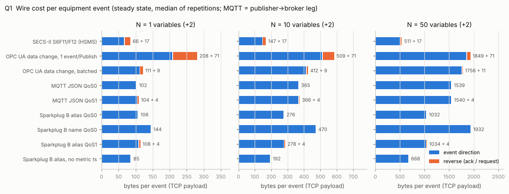
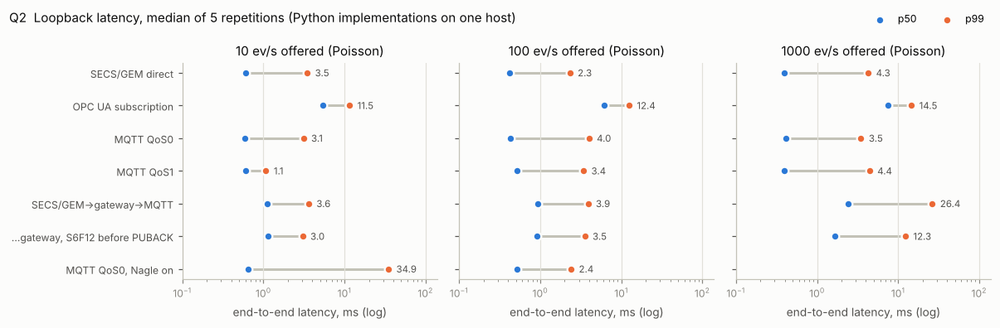
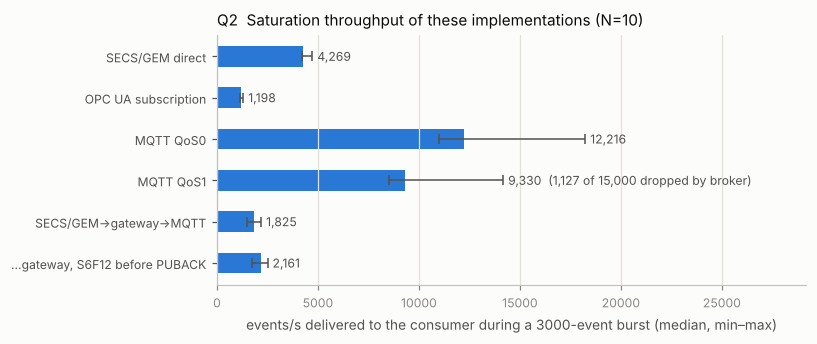
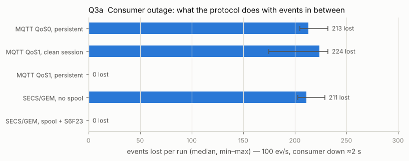
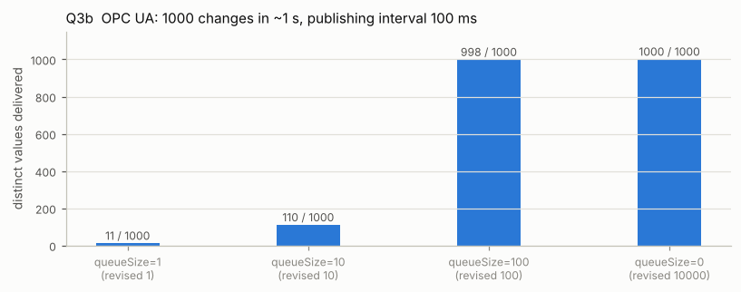
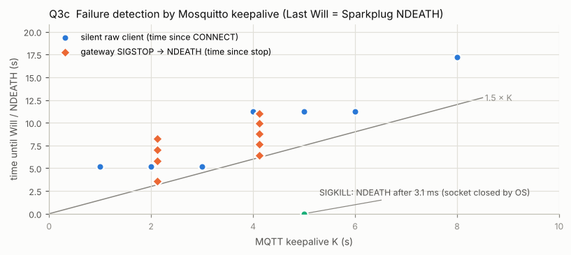

# 장비 연결 프로토콜 실측 — SECS/GEM(HSMS) · OPC UA · MQTT(Sparkplug B) · SECS/GEM→MQTT 게이트웨이

반도체 장비 데이터를 팹 IoT 쪽으로 꺼내는 길 셋을, 같은 장비 이벤트로 한 대의 루프백에서 잰다. 현실 구성은 장비가 SECS/GEM 을 말하고 엣지 게이트웨이가 그것을 MQTT(Sparkplug B)로 다시 내보내는 것이라, 그 경로도 함께 잰다.

핵심 한 줄: **바이트와 지연은 구현과 설정이 정하고, 장애 때 무엇이 사라지는가는 프로토콜과 "ACK 를 어디서 돌려주는가"가 정한다.**

## 질문

1. **와이어 효율** — 변수 N 개(N = 1, 10, 50; float64 센서값·정수 카운터·짧은 문자열)를 실은 장비 이벤트 하나가 회선에서 몇 바이트인가. 방향별로, 연결 설정은 따로.
2. **지연과 처리량** — 이벤트 생성 → 소비자 도착 지연의 p50/p95/p99 (10·100·1000 ev/s)와 최대 지속 가능 속도. 대상: SECS/GEM 직결, OPC UA 구독, MQTT QoS0·QoS1(브로커 경유), SECS/GEM→게이트웨이→MQTT.
3. **팹에서 중요한 의미론** (구현이 아니라 프로토콜이 정하는 것)
   - (a) 소비자가 2 초 죽어 있을 때 손실·중복·역순: MQTT QoS0 vs QoS1(영속 세션), SECS/GEM 스풀 없음 vs 스풀.
   - (b) OPC UA 데이터 변경 병합: queueSize=1 vs >1 에서 중간 값이 얼마나 사라지는가.
   - (c) Sparkplug B 상태 인지: 게이트웨이가 갑자기 죽었을 때 NDEATH(Last Will)가 보이기까지의 시간, 재연결 뒤 재탄생.
   - (d) (추가) 게이트웨이가 장비에 S6F12 를 언제 돌려줘야 하는가.

## 구성

```
 [SECS/GEM 직결]  장비 시뮬레이터 ──HSMS: S6F11 (W-bit)──▶ GEM 호스트
                  (HSMS passive)   ◀────────── S6F12 ─────── (HSMS active)

 [OPC UA 구독]    장비 OPC UA 서버 ──PublishResponse (데이터 변경)──▶ OPC UA 클라이언트
                  (asyncua)        ◀──────── PublishRequest ──────── (SecurityMode None)

 [MQTT]           Sparkplug 엣지 노드 ──DDATA──▶ Mosquitto 2.0.18 ──DDATA──▶ 호스트 앱
                  (Will = NDEATH)     ◀─PUBACK─  (QoS1 일 때)     ◀─PUBACK─  (구독 spBv1.0/FAB1/#)

 [현실 구성]      장비 시뮬레이터 ──HSMS──▶ 게이트웨이 ─────────────MQTT QoS1──▶ Mosquitto ──▶ 호스트 앱
                  (GEM, 스풀)     ◀S6F12──  GEM 호스트 + Sparkplug 엣지 노드
                                            기본: 브로커 PUBACK 을 받은 뒤 S6F12

 Q1: 위 모든 TCP 연결 사이에 바이트 계수 릴레이를 끼운다.
     클라이언트 ──▶ [CountingRelay: 방향별 · 단계(connect/app_setup/steady)별 바이트] ──▶ 서버
 Q2·Q3: 역할마다 별도 OS 프로세스, 같은 호스트의 루프백.
```

## 방법

### 이벤트

- 모든 프로토콜이 같은 이벤트를 나른다: `EventSeq`(uint32) + `EventTimeNs`(uint64, 생산자 프로세스의 `time.monotonic_ns()`, 리눅스 CLOCK_MONOTONIC 이라 같은 호스트의 프로세스끼리 비교할 수 있다) + 변수 N 개. 표의 N 은 변수 수이고, 매 이벤트에 2 개가 더 붙는다.
- 변수 형식은 `i % 10` 으로 정한다: 0–5 float64 센서값(랜덤워크, 소수 넷째 자리 반올림), 6–8 uint32 카운터, 9 11자 ASCII ID(로트.슬롯 / 레시피.스텝). N=10 이면 F8 6·U4 3·A 1, N=50 이면 30·15·5.
- 모든 값이 매 이벤트 바뀐다. 그래서 변화 기반 보고(OPC UA 데이터 변경, Sparkplug report-by-exception)도 N+2 개를 다 싣는다. 변화 기반 보고의 이점은 이 측정에서 빠진다.
- 이름은 계층형(`PM1/AI/Pressure_00` 같은 14–21자, 평균 17.6자)으로, JSON 키·Sparkplug 메트릭 이름·OPC UA 문자열 NodeId 에 그대로 쓴다. SECS 는 VID(U4), Sparkplug 별칭은 정수다. MQTT 토픽은 Sparkplug 41자, JSON 25자(`fab/FAB1/EQP-ETCH01/event`), JSON 은 공백 없는 압축형이다.

### 구현

- **HSMS / SECS-II** (`eqp/hsms.py`, `eqp/secs2.py`): 표준 라이브러리 asyncio 로 직접 짰다. 4바이트 길이 + 10바이트 헤더, select.req/rsp, linktest, separate, reject, system bytes, W-bit, T3·T6·T7·T8. 단일 세션이고 제어 메시지의 SessionID 는 0xFFFF 다. SECS-II 형식 코드는 8진(L=00, B=10, BOOLEAN=11, A=20, I8=30, I1=31, I2=32, I4=34, F8=40, F4=44, U8=50, U1=51, U2=52, U4=54), 형식 바이트 = 코드<<2 | 길이 바이트 수(1–3).
- **GEM** (`eqp/gem.py`): S1F13/14, S2F33/35/37 로 동적 이벤트 보고를 정의하고 S6F11/12 로 보고한다. S1F3/4(현재값), S6F23/24(스풀 요청)도 있다. 장비는 미결 트랜잭션을 1 개만 둔다(S6F12 를 받아야 다음 S6F11). 데이터 아이템 형식(ACKC6, COMMACK, DRACK, RSDC 등)은 secsgem 0.3.0 의 정의를 따랐다.
- **스풀링(단순화)**: 통신이 끊긴 동안 S6F11 을 FIFO 에 쌓는다. 재연결 뒤 호스트가 S6F23(RSDC=0)을 보내면 쌓인 순서대로 보내고, 그동안 새 이벤트는 스풀 뒤에 붙는다. 보냈지만 S6F12 를 못 받은 S6F11 은 스풀 맨 앞에 되돌린다. 그래서 전달은 최소 한 번이고 호스트는 DATAID(=seq)로 중복을 걸러야 한다. E30 의 스풀 상태 모델을 그대로 옮긴 것은 아니다.
- **secsgem 교차 검증**: secsgem 0.3.0 은 Python 3.13 에서 설치·임포트·부호화가 됐다. 항목 부호화, N=10 S6F11 본문 전체, HSMS 데이터·제어 프레임이 이 구현과 바이트 단위로 같다(`tests/test_secs2.py`, `tests/test_hsms.py`). 실험 경로에서는 secsgem 을 쓰지 않는다.
- **OPC UA**: asyncua 2.1.0 서버·클라이언트, SecurityPolicy None. 변수마다 노드를 둔 태그 모델이다. 한 이벤트 = 서버 쪽 쓰기 N+2 번(변수 → EventTimeNs → EventSeq 순)이고, 값마다 SourceTimestamp 와 ServerTimestamp 를 넣었다. 구독은 CreateSubscription/CreateMonitoredItems 를 직접 불러 서버가 돌려준 revised 값을 기록한다. asyncua 클라이언트는 PublishRequest 를 한 번에 하나만 걸어 두고 다음 요청에 ACK 를 싣는다.
- **MQTT**: Mosquitto 2.0.18(apt) + paho-mqtt 1.6.1, MQTT 3.1.1. paho 1.6.1 은 TCP_NODELAY 를 켜지 않는다(소스 확인). Mosquitto 는 `set_tcp_nodelay true` 로 켰다(기본값은 false 로 알고 있다, 미확인). 둘 다 끈 경우는 Q2 에 민감도 행으로 따로 쟀다. 그 밖의 브로커 설정은 설정 파일에 명시했다: `persistence false`, `max_inflight_messages 20`, `max_queued_messages 1000`, `queue_qos0_messages false`(모두 Mosquitto 기본값과 같은 값으로 알고 있다, 미확인).
- **Sparkplug B**: PyPI 패키지 pysparkplug 0.6.1 안의 Tahu `sparkplug_b.proto` 생성 코드로 페이로드를 직접 만든다(전송은 paho). 토픽은 `spBv1.0/FAB1/{NBIRTH|DBIRTH|DDATA|NDEATH}/<엣지>[/<장비>]`. DBIRTH 는 메트릭마다 이름·별칭·자료형·값·시각, DDATA 는 별칭(또는 이름)·값·메트릭별 시각을 싣고 자료형은 뺐다. 메트릭별 시각은 Tahu 파이썬 도우미 `addMetric` 이 늘 넣는 방식을 따랐다(그 도우미 사본을 PyPI 패키지 mqtt-spb-wrapper 안에서 확인). NBIRTH 는 seq 0 과 bdSeq 를 싣고, CONNECT 의 Will 은 같은 bdSeq 의 NDEATH 다. 소비자는 별칭 표를 미리 안다고 두었다.
- **게이트웨이** (`eqp/gateway.py`): 장비 쪽은 GEM 호스트(보고 정의 → S1F3 로 현재값 → MQTT 연결 → NBIRTH/DBIRTH → S6F23), MQTT 쪽은 Sparkplug 엣지 노드다. S6F11 하나가 DDATA 하나(QoS1)가 된다. 기본은 브로커 PUBACK 을 받은 뒤 S6F12 를 돌려준다(`ack=puback`). 비교용으로 받자마자 돌려주는 `ack=receipt` 도 있다. bdSeq 는 파일로 이어 가 재시작해도 증가한다.

### 측정

- **Q1**: 모든 연결이 `eqp/relay.py` 의 계수 릴레이를 지난다. 릴레이가 0.12 초 이상 조용해진 뒤 단계를 바꾼다(connect → app_setup → steady → teardown). steady 에서 이벤트 50 개(OPC UA 묶음은 100 개)를 보내고 방향별 바이트를 이벤트 수로 나눈다. TCP 페이로드만 센다(TCP/IP 헤더, 순수 ACK 세그먼트는 릴레이에 보이지 않는다). OPC UA 는 이벤트 간격(30 ms)을 publishing interval(10 ms)보다 길게 둬 응답 하나에 이벤트 하나가 실리는 경우와, 100 ms interval 에 10 ms 간격으로 써서 여러 이벤트가 묶이는 경우를 따로 쟀다. MQTT 는 발행자↔브로커와 브로커↔구독자 두 구간을 각각 잰다. Q1 은 한 프로세스 안에서 돈다(바이트 수는 타이밍과 무관하다).
- **Q2**: 역할마다 별도 프로세스. 지연 = 소비자가 이벤트를 디코드한 직후의 `time.monotonic_ns()` − `EventTimeNs`. 반복마다 프로세스를 새로 띄워 r10(2.5 s) → r100(2 s) → r1000(2 s) → burst(3000 개)를 차례로 돈다. 도착은 시드를 고정한 포아송(지수 간격)이다. 처음에 고정 주기로 쟀더니 OPC UA publishing 루프와 위상이 맞물려 지연이 거의 일정하게 찍혀서 바꿨다. burst 는 생산자가 쉬지 않고 3000 개를 만들고, 소비자 쪽 전달률 (받은 수 − 1) / (첫 수신 ~ 마지막 수신)을 이 구현 조합의 최대 지속 가능 속도로 본다. N=10, OPC UA publishing interval 10 ms, queueSize 1000.
- **Q3a**: 100 ev/s, 6 초 스트림. t=1.5 s 에 소비자를 SIGKILL 하고 t=3.5 s 에 새 소비자(같은 MQTT client id / 같은 HSMS 호스트 역할)를 띄운다. 소비자는 받은 이벤트를 `os.write` 로 바로 기록해 SIGKILL 뒤에도 남긴다. 두 소비자의 기록을 합쳐 seq 로 손실·중복·역순을 센다.
- **Q3b**: 변수 하나를 1 ms 간격으로 1000 번 바꾼다(값 = 0..999). publishing interval 100 ms, 요청 queueSize 1·10·100·0, discardOldest=true. 반복마다 네 구독이 같은 쓰기를 동시에 본다.
- **Q3c**: 장비(스풀 켬) → 게이트웨이(keepalive K) → Mosquitto → 호스트 앱. 100 ev/s 로 흐르는 중 t=1 s 에 게이트웨이를 SIGKILL(crash: OS 가 소켓을 닫는다) 또는 SIGSTOP(hang: 소켓은 열린 채 침묵)한다. hang 은 NDEATH 를 본 뒤 멈춘 프로세스를 죽이고 새로 띄운다(watchdog 역할). 호스트 앱이 NDEATH·NBIRTH 를 받은 시각과 bdSeq 를 기록한다. 별도로, CONNECT 만 하고 아무것도 보내지 않는 원시 MQTT 소켓(K = 1–6, 8)으로 브로커가 침묵을 검출하는 시점을 쟀다.
- **Q3d**: Q3c 구성에서 게이트웨이↔브로커 사이에 릴레이를 두고, t=1 s 부터 2 초간 블랙홀(양방향 폐기, 소켓 유지) → t=3 s 에 게이트웨이 SIGKILL 과 함께 구간 복구 → t=3.5 s 에 새 게이트웨이. `ack=receipt` 와 `ack=puback` 을 비교한다. 장비 스풀은 두 경우 모두 켜 둔다.
- **반복**: 모든 구성 5 회. 표는 반복 간 중앙값 [최소–최대]. 시드는 구성 이름·반복 번호의 crc32 로 고정했다. Q2 는 반복 우선 순서(반복 0 의 모든 구성 → 반복 1 …)로 돌려, 같은 기계에서 함께 돈 다른 작업의 부하 변동이 한 구성에 몰리지 않게 했다. 반복마다 1분 부하 평균을 기록한다. Q3a, Q3c(hang), Q3d 의 반복은 각자 독립된 브로커·프로세스로 동시에 돌렸다(손실 계수와 초 단위 시간이라 CPU 경합 영향이 작다). hang 반복은 1.2 초씩 엇갈려 시작해 브로커 점검 주기의 서로 다른 위상을 표본했다.

## 결과

수치는 `results.json`(2026-10-10T17:47:39Z 실행, 구성마다 반복 5회) 그대로다. 값은 반복 간 중앙값이고 [ ] 는 최소–최대다. 전체 표와 퍼짐은 `results.md` 에 있다.

### Q1. 이벤트 하나의 와이어 비용



이벤트 방향(장비·서버·발행자 → 소비자) 바이트/이벤트, 정상 상태. MQTT 는 발행자→브로커 구간 값이고, 브로커→구독자 구간도 같은 값이다. 반복 간 차이는 JSON 이 ±5 B 안, 나머지는 3 B 안이다.

| 구성 | N=1 | N=10 | N=50 | 변수 하나당 (N 10→50) | 역방향 B/이벤트 |
| --- | ---: | ---: | ---: | ---: | --- |
| SECS-II S6F11 / HSMS | 66.0 | 147.0 | 511.0 | 9.1 | 17.0 (S6F12) |
| OPC UA 데이터 변경, 응답 하나에 이벤트 하나 | 208.0 | 509.0 | 1,849.0 | 33.5 | 71.0 (PublishRequest) |
| OPC UA 데이터 변경, 묶음 (응답당 8.33 / 8.33 / 6.67 이벤트) | 111.2 | 412.2 | 1,755.5 | 33.6 | 8.5 / 8.5 / 10.7 |
| MQTT JSON QoS0 | 101.7 | 365.0 | 1,539.3 | 29.4 | 0 |
| MQTT JSON QoS1 | 103.7 | 366.5 | 1,539.6 | 29.3 | 4.0 (PUBACK) |
| Sparkplug B DDATA 별칭 QoS0 | 106.0 | 276.0 | 1,032.0 | 18.9 | 0 |
| Sparkplug B DDATA 이름 QoS0 | 144.0 | 470.0 | 1,932.0 | 36.5 | 0 |
| Sparkplug B DDATA 별칭 QoS1 | 108.0 | 278.0 | 1,034.0 | 18.9 | 4.0 (PUBACK) |
| Sparkplug B 별칭, 메트릭 시각 없음 | 85.0 | 192.0 | 668.0 | 11.9 | 0 |

한 번 드는 설정 바이트(양방향 합):

| 구성 | 연결 | 응용 설정 N=1 / 10 / 50 |
| --- | ---: | --- |
| SECS/GEM | 28 (select.req/rsp) | 263 / 317 / 557 (S1F13, S2F33 ×2, S2F35, S2F37) |
| OPC UA | 1,509 (HEL/ACK, OPN, CreateSession, ActivateSession) | 863 / 1,933 / 6,699 (CreateSubscription, CreateMonitoredItems, 초기값) |
| MQTT JSON (발행자 구간) | 36–37 | 없음 |
| Sparkplug B (발행자 구간) | 102–109 (Will 포함 CONNECT) | 256 / 618 / 2,240 (NBIRTH + DBIRTH) |

- N=10 에서 SECS-II 147 B 에 비해 Sparkplug 별칭 276 B(1.9배), JSON 365 B(2.5배), Sparkplug 이름 470 B(3.2배), OPC UA 509 B(3.5배)다.
- 변수 하나를 더할 때마다 SECS-II 9.1 B, Sparkplug 별칭 18.9 B(메트릭 시각을 빼면 11.9 B), JSON 29.4 B, OPC UA 33.5 B, Sparkplug 이름 36.5 B 가 는다. Sparkplug 의 메트릭 시각은 메트릭마다 7 B 라 N=50 에서 364 B(1,032 → 668)다. 별칭 대신 이름을 쓰면 N=50 에서 이벤트당 900 B(1,032 → 1,932)가 는다.
- OPC UA 는 응답 하나에 이벤트 하나면 응답 고정비를 이벤트마다 낸다. 묶으면 N=1 에서 208 B → 111.2 B, 역방향 PublishRequest 는 71 B → 8.5 B 로 준다. 변수당 비용(33.5 / 33.6 B)은 묶어도 그대로다.
- QoS1 은 구간마다 PUBLISH 에 패킷 ID 2 B, 반대 방향에 PUBACK 4 B 를 더한다.

### Q2. 지연과 처리량 (루프백, N=10)





단위 ms (포화 처리량만 ev/s). 절대값은 이 파이썬 구현들을 한 대에서 돌린 값이지 프로토콜의 한계가 아니다.

| 구성 | 10 ev/s p50 / p99 | 100 ev/s p50 / p99 | 1000 ev/s p50 / p99 | 포화 처리량 ev/s |
| --- | --- | --- | --- | ---: |
| SECS/GEM 직결 | 0.60 / 3.47 | 0.42 / 2.32 | 0.39 / 4.28 | 4,269 [4,187–4,726] |
| OPC UA 구독 (publishing 10 ms) | 5.42 / 11.53 | 6.08 / 12.44 | 7.52 / 14.55 | 1,198 [1,155–1,306] |
| MQTT QoS0 | 0.59 / 3.11 | 0.43 / 3.98 | 0.41 / 3.48 | 12,216 [10,994–18,236] |
| MQTT QoS1 | 0.60 / 1.07 | 0.52 / 3.41 | 0.39 / 4.44 | 9,330 [8,496–14,175] ※ |
| SECS/GEM → 게이트웨이 → MQTT QoS1 (PUBACK 뒤 S6F12) | 1.11 / 3.61 | 0.93 / 3.88 | 2.43 / 26.38 | 1,825 [1,502–2,190] |
| 같은 경로, 받자마자 S6F12 | 1.15 / 3.04 | 0.91 / 3.54 | 1.66 / 12.29 | 2,161 [1,736–2,508] |
| MQTT QoS0, Nagle 켬 (TCP_NODELAY 끔) | 0.64 / 34.85 | 0.52 / 2.40 | – | – |

※ burst 에서 브로커가 15,000 건 중 1,127 건을 버렸다(반복별 0, 81, 11, 829, 206 건, Mosquitto 로그의 "dropped" 알림 4 회). 다른 구성의 burst 손실은 0 이다.

- 10·100·1000 ev/s 블록에서는 모든 구성의 손실·중복·역순이 0 이다.
- SECS/GEM 직결과 MQTT 는 p50 이 0.39–0.60 ms 다. OPC UA 는 publishing interval 이 지연을 정한다: 10 ms interval 에서 p50 5.42–7.52 ms, p99 11.53–14.55 ms.
- 게이트웨이 경로는 홉이 둘이라 p50 0.91–2.43 ms 다. 1000 ev/s 는 포화(1,825 ev/s)에 가까워 p99 가 26.38 ms [8.80–64.92] 로 커진다.
- 포화 처리량 순서(OPC UA 1,198 < 게이트웨이 1,825 < SECS/GEM 직결 4,269 < MQTT QoS1 9,330 < QoS0 12,216 ev/s)는 구현을 반영한다. OPC UA 는 이벤트 하나에 서버 쓰기 12 번(파이썬)이고, SECS/GEM 은 미결 트랜잭션 1 개라 왕복 시간이 곧 상한이다. 게이트웨이가 S6F12 를 받자마자 주면 18 % 더 처리한다(2,161 / 1,825).
- Nagle: 클라이언트와 브로커 모두 TCP_NODELAY 를 끄면 10 ev/s 에서 p99 가 34.85 ms [31.83–40.89] 다. 켜면 3.11 ms 다. 100 ev/s 에서는 이 꼬리가 보이지 않았다.

### Q3a. 소비자가 2 초 죽어 있을 때



| 구성 | 손실/반복 | 손실 합 / 생성 합 | 중복 | 역순 |
| --- | ---: | ---: | ---: | ---: |
| MQTT QoS0, 영속 세션 | 213 [205–232] | 1,081 / 3,000 | 0 | 0 |
| MQTT QoS1, clean 세션 | 224 [175–232] | 1,065 / 3,000 | 0 | 0 |
| MQTT QoS1, 영속 세션 | 0 | 0 / 3,000 | 0 | 0 |
| SECS/GEM, 스풀 없음 | 211 [203–229] | 1,079 / 3,000 | 0 | 0 |
| SECS/GEM, 스풀 + S6F23 | 0 | 0 / 3,000 | 0 | 0 |

- 실제 정지(SIGKILL → 새 소비자 준비)는 구성별 중앙값 2.12–2.34 s 다. 잃은 쪽은 반복마다 seq 연속 구간 하나, 곧 정지 동안 생긴 이벤트 전부를 잃었다.
- 영속 세션 QoS1 은 브로커가 쌓아 둔 메시지를 새 소비자가 붙자마자 보냈다(준비 뒤 26 ms [14–51] 안에 모두 도착). GEM 스풀은 S6F23 뒤 42 ms [39–43] 안에 모두 왔다. 둘 다 순서가 지켜졌다.
- clean 세션 QoS1 은 QoS0 와 같은 만큼 잃었다. QoS 는 연결이 있을 때의 전달 보장이고, 소비자가 없는 동안 메시지를 붙잡는 것은 영속 세션이다.

### Q3b. OPC UA 데이터 변경 병합



| 요청 queueSize | 서버가 돌려준 값 | 받은 값 / 1000 | 사라진 값 |
| ---: | ---: | ---: | ---: |
| 1 | 1 | 11 | 98.9 % |
| 10 | 10 | 110 | 89.0 % |
| 100 | 100 | 998 [993–998] | 0.2 % [0.2–0.7] |
| 0 | 10000 | 1,000 | 0.0 % |

- 1 ms 간격 쓰기 1000 번(실제 쓰기 속도 1,000/s), publishing interval 100 ms 라 데이터 응답은 11 번이다. 응답마다 큐에 남은 마지막 queueSize 개만 간다(discardOldest). queueSize=1 이면 interval 마다 마지막 값 하나만 남아 1000 개 중 989 개가 사라졌다.
- queueSize=100 은 interval 당 변화 수(약 100)와 같아, 지터로 몇 개가 넘쳤다.
- 요청 0 은 asyncua 서버가 10000 으로 바꿔 아무것도 잃지 않았다. asyncua 클라이언트의 문서 문자열은 이 값을 "0 or 1 for default queue size (shall be 1 - no queuing)" 라고 적는다. 규격의 기본이 1 이라면(미확인) 규격대로 구현한 서버에서 같은 요청은 queueSize=1 처럼 동작한다.
- 클라이언트는 값이 사라진 것을 알 수 없었다. asyncua 서버는 큐가 넘쳐도 상태 코드에 표시하지 않는다(서버 코드 확인). 규격은 이때 Overflow 비트를 세우게 한다(미확인).

### Q3c. Sparkplug B NDEATH 와 재탄생



| 장애 | keepalive | 장애 → NDEATH | 새 프로세스 시작 → NBIRTH | 손실 합 / 생성 합 | 중복 |
| --- | ---: | ---: | ---: | ---: | ---: |
| SIGKILL (crash) | 5 s | 3.1 ms [1.5–7.0] | 169 ms [145–178] | 0 / 2,250 | 0 |
| SIGSTOP (hang) | 2 s | 7.01 s [3.61–8.41] | 240 ms [142–439] | 0 / 4,500 | 0 |
| SIGSTOP (hang) | 4 s | 8.81 s [6.39–10.99] | 482 ms [174–758] | 0 / 8,000 | 0 |

침묵 소켓 탐침(CONNECT 뒤 아무것도 보내지 않음, K마다 3 개): Mosquitto 2.0.18 은 K=1·2·3 을 모두 CONNECT 뒤 5.215–5.217 s, K=4·5·6 을 11.230 s, K=8 을 17.249 s 에 끊고 Will 을 냈다.

- 프로세스가 죽으면 OS 가 소켓을 닫고 브로커가 곧바로 Will 을 낸다. NDEATH 까지 3.1 ms 다.
- 프로세스가 멈추거나 망이 끊겨 소켓이 열린 채 침묵하면 keepalive 가 유일한 검출 수단이다. MQTT 3.1.1 은 keepalive 의 1.5 배 동안 아무 패킷도 없으면 서버가 연결을 끊게 한다. 측정한 NDEATH 는 그보다 늦었다: K=2(1.5K = 3 s)에서 3.61–8.41 s, K=4(6 s)에서 6.39–10.99 s.
- 탐침 결과는 "1.5×K 를 넘긴 뒤, 약 6.0 s 간격으로 오는 다음 점검 시점"과 맞는다(5.215 → 11.230 → 17.249 s). 그래서 검출 지연은 1.5×K 와 1.5×K + 약 6 s 사이에 퍼진다. 내부 원인은 확인하지 않았다.
- 모든 반복에서 NDEATH 의 bdSeq(0)는 직전 NBIRTH 와 같았고 새 게이트웨이는 bdSeq 1 로 재탄생했다. NDEATH 와 NBIRTH 사이 DDATA 는 0 건이고, 장비 스풀 덕에 전 구간 손실이 0 이다.

### Q3d. 게이트웨이의 S6F12 시점

| 게이트웨이가 S6F12 를 보내는 때 | 손실/반복 | 손실 합 / 생성 합 | 중복 |
| --- | ---: | ---: | ---: |
| S6F11 을 디코드하자마자 | 184 [172–221] | 954 / 2,500 | 0 |
| 브로커 PUBACK(QoS1)을 받은 뒤 | 0 | 0 / 2,500 | 0 |

- 받자마자 S6F12 를 주면 장비는 이벤트를 넘겼다고 보고 지운다. 2 초 블랙홀 동안 paho 는 QoS1 PUBLISH 를 비행 창(20 개)만큼 내보내고(블랙홀로 들어간 바이트 5,500–5,540 B, DDATA 20 개 분량) 나머지는 프로세스 메모리에 쌓았다. 게이트웨이가 죽자 둘 다 사라졌다. 손실은 반복마다 seq 연속 구간 하나다.
- PUBACK 뒤에 주면 흐름이 장비의 미결 S6F11 하나(블랙홀로 들어간 바이트 276 B, DDATA 1 개)에서 멈춘다. 장비가 큐에 최대 260–294 건을 들고 있다가, 게이트웨이가 죽자 스풀로 옮기고 새 게이트웨이의 S6F23 에 내보냈다.

## 해석

**데이터 종류마다 길을 나눈다.**

- 이산 이벤트(로트 시작·종료, 웨이퍼 이동, 알람, 레시피 변경, 상태 전이)는 건마다 의미가 있고 순서가 중요하다. 소비자가 2 초 죽어 있을 때 이것을 지킨 것은 GEM 스풀(S6F23)과 MQTT QoS1 + 영속 세션뿐이었다(손실 0, 역순 0). QoS0, clean 세션 QoS1, 스풀 없는 GEM 은 정지 구간을 통째로 잃었다(반복당 175–232 건).
- 이런 이벤트를 OPC UA 에서 "값이 바뀌는 변수"로 모델링하면 안 된다. queueSize=1 에서 1000 번의 변화 중 11 번만 보였다. 큐를 키우면 잡을 수 있지만, 넘쳐도 알려 주지 않는 서버가 있고(asyncua), 같은 요청(queueSize 0)이 서버에 따라 1 이 될 수도 10000 이 될 수도 있다. OPC UA 로 이벤트를 내야 한다면 이벤트(EventNotifier) 모델이 맞는 자리다 — 이 실험에서는 재지 않았다.
- 연속 측정값(FDC 트레이스 등)은 "마지막 값"이 의미 있고 일부 손실이 허용되는 경우가 많다. 그렇다면 OPC UA 데이터 변경이나 Sparkplug DDATA QoS0 가 맞다. 값 하나하나가 필요한 트레이스라면 publishing interval·queueSize 를 데이터 속도에 맞춰야 하고, 그러지 않으면 소리 없이 솎아진다(Q3b).
- Sparkplug 규격은 NDATA/DDATA 를 QoS0 로 보내게 한다(미확인). 그렇다면 Sparkplug 의 손실 대처는 재전송이 아니라 seq 공백 감지 → 재탄생 요청이고, 건 단위로 회수해야 하는 이벤트에는 게이트웨이의 저장 후 전송이나 별도의 QoS1 경로가 필요하다. 이 실험의 게이트웨이는 S6F12 를 PUBACK 에 묶으려고 DDATA 를 QoS1 로 보냈다.

**바이트는 이름을 어디에 두느냐의 문제다.** SECS-II 는 이름·형식을 보고 정의(S2F33/35)에, Sparkplug 별칭은 DBIRTH 에 한 번 둔다. JSON 과 Sparkplug 이름 모드는 매 메시지에 싣는다. OPC UA 는 이름 대신 ClientHandle 을 싣지만 값마다 시각 두 개(16 B)를 붙인다. 그 결과가 변수당 9.1–36.5 B 의 차이다. N=50 이벤트를 초당 1000 개 보내도 SECS 0.51 MB/s, OPC UA 1.85 MB/s 다(계산). 장비 한 대 링크에서 이 차이가 병목이 될 가능성은 낮고, 바이트가 문제 되는 곳은 장비 수백 대가 모이는 브로커나 무선 백홀 쪽일 것이다(추론). 설정 비용은 OPC UA 가 가장 크고(세션 1,509 B + 구독 최대 6,699 B), Sparkplug 의 탄생 메시지(최대 2,240 B)는 재연결·재탄생 때마다 다시 든다.

**지연은 OPC UA 에서만 프로토콜 설정이 지배한다.** 루프백에서 SECS/GEM·MQTT 는 p50 1 ms 안쪽, OPC UA 는 10 ms interval 에서 p50 5.42–7.52 ms 다. 알림은 다음 publishing 주기를 기다리므로 interval 을 늘리면 지연도 그만큼 는다(추론). 게이트웨이는 홉 하나만큼 더한다(p50 0.91–2.43 ms).

**QoS1 의 ACK 는 구간별이다.** PUBACK 은 "브로커가 받았다"이지 "소비자가 받았다"가 아니다. 구독자 큐가 `max_queued_messages`(1000)를 넘자 Mosquitto 는 이미 PUBACK 을 준 메시지를 버렸다(burst 15,000 건 중 1,127 건). 끝에서 끝까지의 보장은 소비자 쪽 seq 공백 감시로만 확인된다.

**상태 인지는 keepalive 만큼만 빠르다.** 게이트웨이 프로세스가 죽으면 NDEATH 는 3.1 ms 만에 왔지만, 멈추면 1.5×K 에 브로커 점검 간격(Mosquitto 2.0.18 에서 약 6 s)이 더해졌다(K=4 에서 최대 10.99 s). 그동안 호스트 앱은 마지막 값을 살아 있는 값으로 본다. keepalive 를 수십 초로 두면 이 공백도 그만큼 길어진다(추론).

### 게이트웨이 설계 권고

1. **S6F12 는 이벤트를 넘긴 뒤에 돌려준다.** 브로커 PUBACK, 또는 게이트웨이 디스크 큐에 기록한 뒤다. 받자마자 돌려주면 MQTT 쪽 2 초 장애 + 게이트웨이 재시작에서 반복당 172–221 건이 사라졌고 장비는 이를 모른다. 대가는 처리량이다(이 구현에서 포화 1,825 대 2,161 ev/s).
2. **장비 스풀을 켜고 재연결 순서를 고정한다.** HSMS select → S1F13 → 보고 정의 → S1F3 현재값 → MQTT CONNECT(Will = NDEATH, bdSeq+1) → NBIRTH/DBIRTH → S6F23. 그래야 스풀된 이벤트가 탄생 메시지 뒤에 나간다.
3. **전달은 최소 한 번이므로 소비자가 중복을 거른다.** 키는 DATAID 나 이벤트 seq 다. 이번 반복들에서 중복은 0 건이었지만, S6F11 을 보낸 뒤 S6F12 를 받기 전에 연결이 끊기면 구조상 생긴다.
4. **이벤트용 MQTT 경로는 QoS1 + 영속 세션 소비자 + 최악 backlog 보다 큰 브로커 큐.** clean 세션이면 QoS1 이어도 정지 구간을 통째로 잃는다(Q3a). 큐 상한을 넘으면 QoS1 도 버려진다(Q2 burst).
5. **멈춘 게이트웨이는 외부 watchdog 이 죽인다.** 죽는 순간 OS 가 소켓을 닫아 NDEATH 가 ms 안에 나간다(Q3c crash). keepalive 는 허용할 검출 지연에서 거꾸로 정하되 브로커의 점검 간격을 더해 계산한다. HSMS 쪽도 같아서, 장비는 linktest·T3 로만 침묵하는 호스트를 알아챈다.
6. **호스트 앱은 NDEATH 의 bdSeq 가 현재 세션 것인지 확인한다.** 늦게 도착한 옛 세션의 NDEATH 에 속지 않기 위해서다. 이번 시나리오에서는 그런 역전이 일어나지 않았다.
7. **MQTT 클라이언트와 브로커에 TCP_NODELAY 를 켠다.** 끈 상태에서 저속 이벤트의 p99 가 34.85 ms 로 튀었다(켜면 3.11 ms). paho 1.6.1 은 스스로 켜지 않는다.
8. **Sparkplug 호스트 앱은 재시작 뒤 별칭 표를 다시 배워야 한다**(재탄생 요청). 이 실험은 정적 별칭 표로 이 문제를 건너뛰었다.

## 한계

- 모든 수치는 한 대(4 vCPU)의 루프백에서 파이썬 구현(asyncua, paho-mqtt, 이 디렉터리의 HSMS/GEM)과 Mosquitto 로 잰 것이다. 실제 망의 지연·손실·MTU, 상용 GEM 드라이버·OPC UA 서버·브로커와는 다를 수 있다. Q2 의 처리량 한계는 특히 구현의 것이다.
- 같은 기계에서 다른 연구의 작업이 함께 돌았다. Q2 반복 시작 시 1분 부하 평균은 3.41–5.13(4 vCPU, 이 연구 자신의 프로세스 포함)이었다. 낮은 속도에서 가끔 보이는 수 ms–수십 ms 의 꼬리는 스케줄링 지연일 수 있다. 반복 우선 순서로 구성 간 편향은 줄였지만 꼬리 값 자체는 이 영향을 받는다.
- 보안을 껐다: OPC UA SecurityMode None, MQTT 평문·익명. 서명·암호화를 켜면 바이트와 지연이 는다(재지 않음).
- 바이트는 TCP 페이로드만이다. TCP/IP 헤더(세그먼트당 40 B 이상)와 순수 ACK 는 빠졌다. 작은 메시지를 자주 보내는 경로일수록 실제 회선 바이트가 더 커진다.
- Sparkplug(protobuf varint)와 JSON(10진 자릿수)의 크기는 값에 따라 달라진다. `EventTimeNs` 는 부팅 뒤 경과 ns 라 varint 길이가 기계의 가동 시간에 따라 바뀐다(2^42 ns, 약 73 분을 넘으면 6 B → 7 B). 그래서 같은 코드도 언제 돌리느냐에 따라 Sparkplug 메시지가 1 B 달라질 수 있다. 실제 시각(epoch ns)을 쓰면 varint 9 B, 10진 19 자리가 된다. JSON 실수는 소수 넷째 자리로 반올림해 짧다. 전체 정밀도 double 이면 JSON 이 더 길다.
- r10 은 반복당 표본이 25 개라 p99 는 사실상 최댓값이다. burst 지연은 3000 개가 한꺼번에 생겨 줄 선 시간을 포함한다.
- HSMS/GEM: 단일 세션, 다중 블록·인터리브 없음, S9 오류 메시지 없음, T5 미구현, 제어 상태·알람(S5)·트레이스(S2F23/S6F1) 없음. 스풀은 E30 의 상태 모델을 단순화했다(호스트의 S6F23 요청으로만 내보내고, 넘치면 가장 오래된 것을 버린다).
- OPC UA: 태그 모델만 쟀다. 이벤트를 구조체 변수 하나에 담는 방식과 OPC UA 이벤트 모델은 재지 않았다. asyncua 의 동작이 결과에 섞여 있다. 실제 샘플링 없이 쓰기마다 알림을 만들고(revised sampling interval 로는 publishing interval 을 돌려준다), 요청 queueSize 0 을 10000 으로 바꾸고, TimestampsToReturn 을 적용하지 않으며(알림마다 시각 두 개), 큐가 넘쳐도 표시하지 않는다(서버 코드 확인). Q3b 의 queueSize=0 결과(손실 0)는 asyncua 고유 동작이다.
- Sparkplug: STATE(주 호스트), NCMD 재탄생 요청, is_historical(저장 후 전송)은 구현하지 않았다. 소비자는 별칭 표를 미리 안다고 두었다. 게이트웨이는 DDATA 를 QoS1 로 보냈다.
- Q3c 의 시간은 Mosquitto 2.0.18 의 keepalive 처리에 묶여 있다. 다른 브로커는 다를 수 있다.
- 최소 한 번 경로(QoS1 영속 세션, GEM 스풀, PUBACK 뒤 S6F12)에서 중복은 구조상 생길 수 있지만 이번 반복들에서는 한 건도 없었다. SIGKILL 이 "받음 ~ ACK 보냄" 사이의 짧은 창에 떨어질 확률이 낮아서다. 중복이 없었다는 것이 중복이 안 생긴다는 뜻은 아니다.
- Q3a·Q3c(crash)·Q3d 의 장애는 프로세스 종료라 OS 가 소켓을 닫는다. 소켓이 열린 채 침묵하는 망 분할에서 GEM 장비가 끊김을 알아채는 시간(T3·linktest)은 재지 않았다.
- 시험 62 개는 코덱·프레임·분석 로직을 고정한다. 실험 자체의 재현성은 `run_all.py` 를 다시 돌려 확인한다(이번 실행 585.3 s).

## 재현 방법

```bash
apt-get install -y mosquitto            # 2.0.18 (Ubuntu 24.04). 서비스는 띄우지 않아도 된다
cd research/equipment_protocols
uv venv .venv --python 3.13
uv pip install --python .venv/bin/python -r requirements.txt
.venv/bin/python -m pytest              # 단위 시험
.venv/bin/python run_all.py             # results.json, results.md, figures/*.png 를 처음부터 다시 만든다
.venv/bin/python run_all.py --reps 1 --only q1   # 일부만 빠르게 (results.partial.json 만 쓴다)
```

- 포트는 모두 임의의 빈 고포트를 잡는다. 브로커는 실험마다 새로 띄우고 끝나면 내린다.
- 실행 기록(역할별 stderr, 브로커 로그, 소비자 이벤트 기록)은 임시 디렉터리에 쓰고 지운다. 남기려면 `--keep-runs DIR`.
- 지연·처리량 수치는 기계와 그 순간의 부하에 따라 달라진다. 바이트 수(Q1)와 손실·병합 계수(Q3)는 거의 그대로 재현된다.

## 파일

```
run_all.py                 한 명령으로 전체 재생성
report.py                  results.json → results.md, figures/*.png
eqp/secs2.py               SECS-II 항목 부호기/복호기 (E5 형식 코드)
eqp/hsms.py                HSMS 프레임·헤더·연결 (select/linktest/separate/reject, T3/T6/T7/T8)
eqp/gem.py                 GEM 장비 시뮬레이터(스풀) · 호스트
eqp/opcua_io.py            asyncua 서버(태그 모델) · 원시 구독 클라이언트
eqp/spb.py                 Sparkplug B 페이로드 (Tahu protobuf)
eqp/gateway.py             SECS/GEM → Sparkplug B 게이트웨이
eqp/relay.py               방향·단계별 바이트 계수 TCP 릴레이
eqp/broker.py              Mosquitto 실행기
eqp/roles.py, procs.py     역할 프로세스와 오케스트레이션
eqp/analysis.py            seq 공백·중복·역순, 백분위수
eqp/workload.py, io_util.py
experiments/q1_wire.py, q2_latency.py, q3_semantics.py
tests/                     단위 시험 (codec, HSMS, GEM, 릴레이, 분석, Sparkplug, 재조립)
results.json, results.md, figures/
```

## 참고

- SEMI E5 — SECS Message Content (SECS-II)
- SEMI E30 — GEM (Generic Model for Communications and Control of Manufacturing Equipment)
- SEMI E37 — High-Speed SECS Message Services (HSMS) Generic Services, SEMI E37.1 — HSMS Single Selected-Session Mode (HSMS-SS)
- IEC 62541 — OPC Unified Architecture (Part 4 Services, Part 6 Mappings)
- OASIS MQTT Version 3.1.1 (2014), OASIS MQTT Version 5.0 (2019)
- Eclipse Sparkplug Specification (Sparkplug B), 3.0.0; Eclipse Tahu `sparkplug_b.proto`
- 소프트웨어: Mosquitto 2.0.18, asyncua 2.1.0, paho-mqtt 1.6.1, pysparkplug 0.6.1, protobuf 7.36.2, secsgem 0.3.0 (교차 검증)

규격 원문은 이 작업에서 열람하지 않았다. 규격 내용을 근거로 든 문장 중 원문과 대조하지 못한 것은 본문에 "(미확인)"으로 표시했다.
