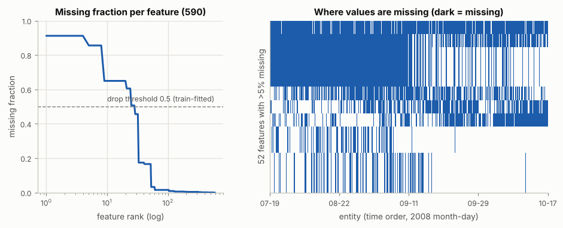
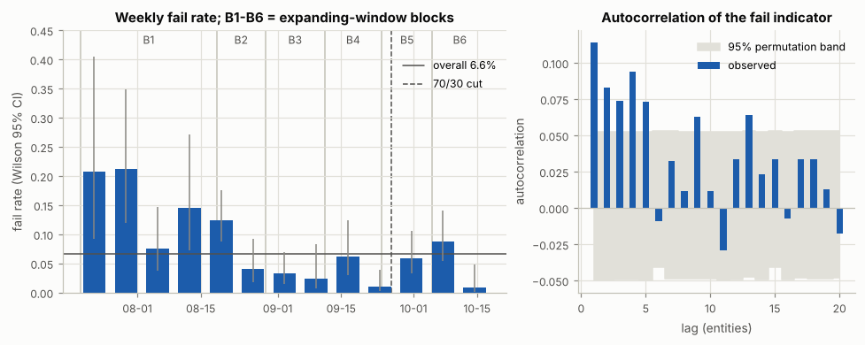
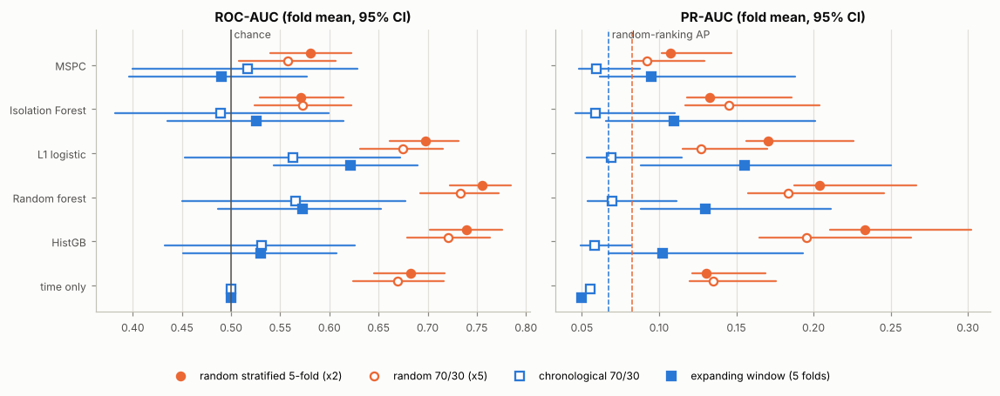
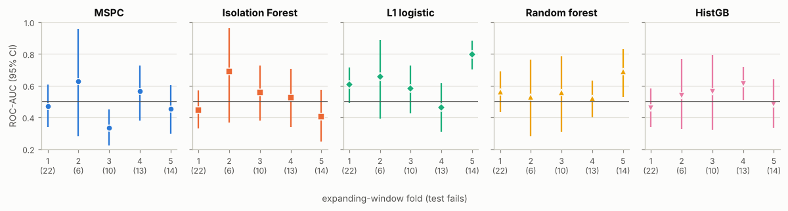
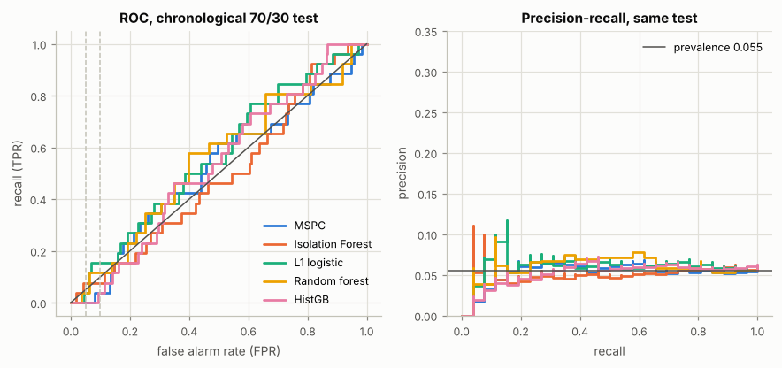
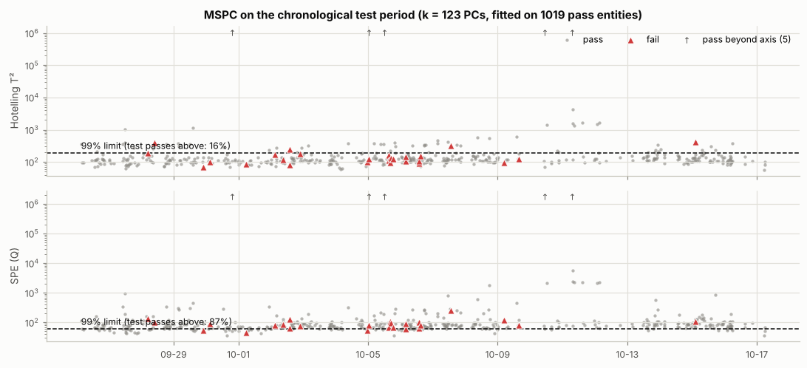
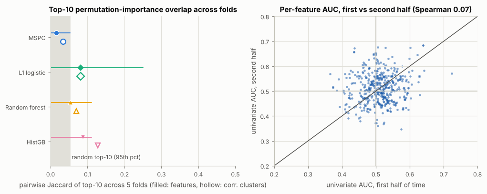
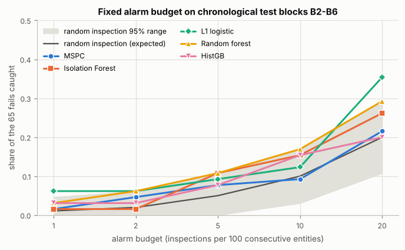

# SECOM 불량 검출(FDC) — 시간순으로 재면 신호는 약하다

UCI SECOM 은 한 반도체 공정의 생산 개체 1567개, 센서·계측 특성 590개, 사내 라인 시험의 합격/불합격과 그 시각을 담는다. 이 연구는 고전 FDC(다변량 SPC)와 기계학습 모델이 **앞으로 나올** 불량을 얼마나 잡는지 잰다. 학습은 과거로만, 시험은 그 뒤로만 한다.

핵심 한 줄: **시간을 섞어 재면 좋아 보이고, 시간순으로 재면 신호는 약하다.**

모든 수치는 `run_all.py` 가 만든 `results.md` / `results.json` 에서 그대로 옮겼다. `check_report.py` 가 이 문서의 숫자가 `results.md` 에 있는지 기계적으로 확인한다.

## 질문

| | 질문 |
| --- | --- |
| Q1 | 데이터는 어떤 모양인가 — 결측, 상수 특성, 불균형, 기간, 불량이 시간에 몰리는가 |
| Q2 | 평가 방식이 결론을 얼마나 바꾸는가 — 시간순(앞으로 학습, 뒤로 시험) vs 무작위 층화 CV. "정확도 93%" 함정 |
| Q3 | 고전 MSPC(PCA T² + SPE), Isolation Forest, L1 로지스틱, 랜덤 포레스트, HistGradientBoosting 은 시간순으로 불량을 얼마나 잡는가 |
| Q4 | 어떤 신호가 중요하고, 그 목록이 시간이 지나도 같은가 — `secom.names` 가 말하는 "수율 이탈을 일으키는 소수의 신호" 를 이 데이터로 찾을 수 있는가 |
| Q5 | 경보 예산(연속 100개당 검사 k개)이 정해져 있을 때 무작위 검사보다 몇 개를 더 잡는가 |

## 요약

- **Q1.** 불량 104/1567 (불량률 6.64%). 결측 셀 4.54%, 상수 특성 116개. 불량은 시간에 몰린다: runs 검정 z = -4.53 (순열 p = 0.0002), 주별 불량률 0.9%–21.3%. 앞 절반과 뒤 절반 사이에 특성의 82.1% 가 분포가 바뀌고, 특성만으로 시험 기간을 ROC-AUC 0.993 으로 가려낸다.
- **Q2.** 무작위 5-fold 는 ROC-AUC 를 5개 모델 평균 +0.121 부풀린다. 타임스탬프만 쓰는 기준선이 무작위 5-fold 에서 0.682 를 받는다 (시간순에서는 정의상 0.500). 모델 순위도 뒤집힌다: 무작위로는 랜덤 포레스트 0.755 · HGB 0.740 이 앞서고, 시간순(확장 창)으로는 L1 로지스틱 0.621 이 1위, 랜덤 포레스트 0.573, HGB 0.530 이다. "전부 정상" 규칙은 시간순 시험 구간에서 정확도 94.5% 로 불량 0/26 을 잡는다.
- **Q3.** 시간순 확장 창 평균 ROC-AUC 는 L1 로지스틱 0.621 [0.544, 0.690] (순열 p = 0.0020), 랜덤 포레스트 0.573 (p = 0.0250), 나머지는 우연과 구분되지 않는다 (MSPC 0.490). 단일 시간순 70/30 분할에서는 어떤 모델도 우연과 구분되지 않는다 (p 최소 0.1279). 오경보 5% 에서 재현율은 0.107–0.140 이다. MSPC 의 이론 99% 한계는 학습한 정상 자료에서도 7.8% (T²) · 8.7% (SPE) 가 넘고, 시험 구간 정상의 87.4% 가 SPE 한계를 넘는다.
- **Q4.** 순열 중요도 top-10 의 fold 간 Jaccard 는 0.016–0.088 이다 (무작위 0.012, 95 백분위 0.053). 특성별 단변량 AUC 는 앞 절반과 뒤 절반 사이에 상관이 없다 (Spearman 0.070, p = 0.1398). 앞 절반에서 BH 유의한 12개 중 뒤 절반에서도 유의한 특성은 0개다. "소수의 핵심 신호" 는 이 데이터로 확정할 수 없다. 반복해서 나오는 후보(f059, f477)만 있다.
- **Q5.** 연속 100개당 20개를 검사하면 L1 로지스틱이 불량 65개 중 23개 (35%) 를 잡는다. 같은 예산의 무작위 검사는 13.0개 [7, 19] 다. 100개당 5개에서는 어느 모델도 무작위 검사의 95% 범위를 넘지 못한다.

## 데이터

### 출처와 검증

UCI SECOM (McCann & Johnston, 2008). `secom_labels.data` 에서 −1 이 합격, 1 이 불합격이다 (`secom.names` 에는 "−1" 이 ".1" 로 깨져 있다). 개체가 웨이퍼인지 lot 인지는 `secom.names` 가 밝히지 않는다 ("production entity"). 이 문서는 "개체" 라고 쓴다.

UCI 는 이 환경의 네트워크 정책이 막는다. 파일은 공개 GitHub 사본 두 곳에서 왔다. `fetch_data.py` 는 (1) 이미 있는 파일의 sha256 · 형태(1567×590) · 라벨 수(1463/104)를 검증하고, 없으면 (2) UCI 공식 zip, (3) 두 사본의 raw.githubusercontent.com 주소 순으로 시도한다. 해시가 하나라도 다르면 쓰지 않고 실패한다. 이미 있는 파일의 해시가 다르면 덮어쓰지 않는다. 파일은 데이터로만 다룬다: 해시를 재고 텍스트로 파싱할 뿐 실행하지 않고, zip 은 경로로 풀지 않고 이름으로 읽으며, 파일을 읽는 파이썬은 `python -I` 로 돌린다. `data/` 는 `.gitignore` 로 커밋에서 뺀다.

| 파일 | sha256 | 받을 수 있는 곳 |
| --- | --- | --- |
| secom.data | `20f0e7ee434f7dcbae0eea9ffff009a2b57f42d6b0dc9a5bd4f00782c0a3374c` | 두 사본 모두 |
| secom_labels.data | `126884cf453705c9e61a903fe906f0665a3b45ce3639e621edc5c93c89627e03` | 두 사본 모두 |
| secom.names | `6d91b0b46cdee03064ee3e3112f937c1b3f7fcd9933575794ec07974e6f1ea59` | 첫 사본만 |

사본은 github.com/MarwanAhmedHelmy/secom-defect-prediction (저장소 루트) 과 github.com/LakshmiNakshatra/Predictive-Models-for-Equipment-Fault-Detection---Secom-Dataset (`data/`) 이다. 둘째 사본에는 `secom.names` 가 없다. 이 환경에서 빈 디렉터리로 `fetch_data.py` 를 돌려 UCI 실패 → 첫 사본 경로가 작동하고, 둘째 사본의 두 데이터 파일도 같은 해시임을 확인했다.

### Q1. 특성

| 항목 | 값 |
| --- | --- |
| 개체 × 특성 | 1567 × 590 |
| 불량 / 정상 | 104 / 1463 (불량률 6.64%) — 전부 정상이라고 하면 정확도 93.36% |
| 기간 | 2008-07-19 11:55:00 ~ 2008-10-17 06:07:00 (89.76일). 파일은 이미 시각순이고, 같은 시각이 33건 있다 |
| 생산 간격 | 연속 개체 간격 중앙값 37분, 최대 48.6시간, 생산일당 15.5개 (중앙값) |
| 결측 | 셀의 4.54% (41951개). 결측이 있는 특성 538개, 5% 초과 52개, 50% 초과 28개, 90% 초과 4개 (최대 91.19%). 결측 없는 행은 0개 |
| 결측의 구조 | 5% 초과 결측 특성은 8개 패턴으로 같이 빈다 (묶음 크기 12, 12, 8, 4, 4, 4, 4, 4) — 센서 묶음 단위로 값이 빠진다 |
| 결측과 불량 | 행 결측률 중앙값이 불량 4.07% vs 정상 4.07% (Mann-Whitney p = 0.3477). 결측 자체는 불량 신호가 아니다 |
| 상수 · 준상수 | 상수 116개, 두 값만 갖는 특성 6개, 최빈값 비율 ≥ 95% 인 준상수 10개 |
| 전처리 후 | 같은 규칙을 전체에 적용하면 446개가 남는다 (실제 학습에서는 학습 구간에서만 계산) |



**불량은 시간에 몰린다.** 주별 불량률은 0.9% (2008-10-11 부터 한 주) 에서 21.3% (2008-07-26 부터 한 주) 까지 움직인다 (동질성 χ² 64.6, 자유도 12, 순열 p = 1.0e-04). runs 검정은 불량/정상 연속 구간이 기대 195.2 보다 적은 173 개임을 보인다 (z = -4.53, 정규근사 p = 2.9e-06, 순열 p = 0.0002). 불량 지시변수의 lag 1 자기상관은 0.114 이고 lag 1–5 (그리고 9, 13) 가 순열 95% 띠를 넘는다 (Ljung-Box Q(10) = 70.9, 순열 p = 1.0e-04). 불량률은 앞 절반 8.56%, 뒤 절반 4.72% 다.



**센서 분포도 기간마다 다르다.** 남는 446개 특성 중 366개 (82.1%) 가 앞 절반과 뒤 절반 사이에 KS 검정으로 다르다 (BH q < 0.05). 랜덤 포레스트가 특성만으로 "시간순 시험 구간(뒤 30%)에 속하는가" 를 ROC-AUC 0.993 으로 맞힌다. 특성 공간에서 가장 가까운 이웃이 시간 순번 ±25 안에 있는 개체가 44.2% 다 (무작위면 3.17%).

이 셋이 겹치면 무작위 CV 는 "언제 만든 개체인가" 를 맞히는 모델에 점수를 준다. Q2 가 그것을 잰다.

## 방법

### 전처리 — 학습 구간에서만 적합한다

모든 모델은 sklearn `Pipeline` 하나로 묶었다. 평가 코드가 부를 수 있는 것은 학습 행에 대한 `fit` 뿐이다.

1. 특성 제거: 학습 구간에서 결측률이 0.5 를 넘거나 결측 아닌 값이 한 종류뿐인 특성을 버린다.
2. 결측 대치: 학습 구간 중앙값.
3. 표준화: 학습 구간 평균 · 표준편차.
4. HistGradientBoosting 만: 학습 구간 분위수 255 구간으로 미리 나눈다. scikit-learn 1.9.1 은 class weight 가 있으면 구간 경계를 가중 분위수로 파이썬 반복문에서 계산해 적합 한 번에 수십 초가 걸린다. 미리 나눈 입력은 HGB 의 빠른 경로를 타고, 분할 후보는 HGB 자체의 (가중치 없는) 255 분위수 구간과 같다.

새는 곳이 없음은 시험으로 고정했다 (`tests/test_leakage.py`): 대치 통계가 학습 행 중앙값과 같고 학습+시험 중앙값과는 다르다. 시험 구간에서만 멀쩡한 특성은 버려진다. 정상만 쓰는 모델의 통계는 학습 구간 정상 행에서만 나온다.

### 분할

| 이름 | 방식 |
| --- | --- |
| 시간순 70/30 | 앞 0.7 학습 (1097개, 불량 78), 뒤 시험 (470개, 불량 26, 2008-09-26 ~ 2008-10-17). 같은 시각은 한쪽에만 둔다 |
| 확장 창 (rolling origin) | 시간을 6 블록 (B1–B6) 으로 자른다. fold k 는 블록 1..k 로 학습하고 블록 k+1 로 시험한다. 시험 블록은 261개씩, 불량은 22, 6, 10, 13, 14개 |
| 무작위 층화 5-fold × 2 | 흔히 쓰는 방식. 시간을 무시한다 |
| 무작위 층화 70/30 × 5 | 시간순 70/30 과 시험 크기(470개)를 맞춘 무작위 대조 |

### 모델 — 하이퍼파라미터는 미리 고정했다

시험 fold 를 보고 고치지 않았다. 다른 값은 민감도로만 보고한다. 실제 값은 `results.md` 의 "설정" 표에 있다.

| 모델 | 학습 행 | 설정 | 점수 |
| --- | --- | --- | --- |
| MSPC | 학습 구간의 정상만 (NOC) | PCA, 누적 설명분산 0.9 까지의 PC (k = 87–125). T² 한계는 새 관측용 F 분포 (Tracy et al. 1992), SPE 한계는 Jackson–Mudholkar (1979), 수준 0.01 | max(T²/T²한계, SPE/SPE한계): 두 관리도 중 하나라도 넘으면 경보 |
| Isolation Forest | 학습 구간의 정상만 | 나무 500 | −score_samples |
| L1 로지스틱 | 학습 구간 전체 | C = 0.1, liblinear, class_weight = balanced | P(불량) |
| 랜덤 포레스트 | 학습 구간 전체 | 나무 500, max_features = sqrt, class_weight = balanced_subsample | P(불량) |
| HistGradientBoosting | 학습 구간 전체 | learning_rate 0.05, 200 회, 잎 15, min_samples_leaf 20, L2 1.0, class_weight = balanced | P(불량) |
| 시간만 쓰는 기준선 | 학습 구간의 시각과 라벨 | 시간상 가장 가까운 학습 개체 50개의 불량률 | — |

### 지표

- **ROC-AUC**, **PR-AUC** (average precision), **재현율@오경보 5% / 10%** (정상 중 경보 비율이 5%/10% 이하인 문턱 가운데 재현율 최대). 재현율@오경보는 시험 구간 라벨로 문턱을 정한 ROC 곡선 위의 점이다. 점수 순위의 성질이지 배치 가능한 문턱이 아니다. 배치 관점은 Q5 의 경보 예산과 MSPC 의 고정 한계로 본다.
- **95% CI**: 시험 fold 안에서 불량과 정상을 따로 다시 뽑는 층화 bootstrap 2000회, 퍼센타일 구간. fold 평균의 CI 는 fold 마다 다시 뽑은 값을 평균해 구한다.
- **무작위 순위 기준선과 p 값**: 라벨을 점수에 대해 1000회 섞는다. 그 평균 PR-AUC 가 "무작위 순위의 기대 PR-AUC" 이고, p 는 "무작위 순위보다 낫다" 의 단측 순열 p 다. 불량이 적으면 무작위 순위의 PR-AUC 는 불량률보다 높다 (확장 창 평균: 불량률 0.050, 무작위 순위 0.067). 그래서 PR-AUC 는 불량률이 아니라 이 값과 비교한다.
- 결정성: seed 0 고정. 랜덤 포레스트의 확률은 나무를 고정된 묶음으로 더한다 (sklearn 은 스레드가 끝나는 순서로 더해 실행마다 마지막 자리가 바뀐다).

## 결과

### Q2. 무작위 CV 는 얼마나 낙관적인가

ROC-AUC, fold 평균 [95% CI]. Δ = 무작위 − 시간순.

| 모델 | 무작위 5-fold×2 | 확장 창 (시간순) | Δ | 무작위 70/30×5 | 시간순 70/30 | Δ |
| --- | --- | --- | --- | --- | --- | --- |
| MSPC (T² or SPE) | 0.581 [0.540, 0.622] | 0.490 [0.396, 0.577] | +0.090 | 0.557 [0.508, 0.606] | 0.517 [0.400, 0.629] | +0.041 |
| Isolation Forest | 0.571 [0.529, 0.614] | 0.526 [0.435, 0.614] | +0.045 | 0.573 [0.524, 0.623] | 0.489 [0.382, 0.600] | +0.083 |
| L1 logistic | 0.698 [0.662, 0.732] | 0.621 [0.544, 0.690] | +0.077 | 0.675 [0.631, 0.715] | 0.563 [0.453, 0.672] | +0.112 |
| Random forest | 0.755 [0.723, 0.784] | 0.573 [0.487, 0.653] | +0.182 | 0.733 [0.692, 0.772] | 0.566 [0.450, 0.677] | +0.167 |
| HistGradientBoosting | 0.740 [0.702, 0.776] | 0.530 [0.451, 0.607] | +0.209 | 0.721 [0.679, 0.763] | 0.531 [0.433, 0.626] | +0.190 |
| time only (k-NN in time) | 0.682 [0.645, 0.717] | 0.500 [0.500, 0.500] | +0.182 | 0.670 [0.624, 0.717] | 0.500 [0.500, 0.500] | +0.170 |



- 무작위 5-fold 는 ROC-AUC 를 5개 모델 평균 +0.121, 무작위 70/30 은 +0.119 부풀린다. PR-AUC 로는 +0.051, +0.086 이다.
- **센서를 하나도 안 보는 기준선이 무작위 CV 에서 0.682 를 받는다.** 시간상 가까운 학습 개체 50개의 불량률만 쓰는 점수다. 무작위 CV 에서는 시험 개체의 바로 앞뒤 개체가 학습에 들어가므로, 불량이 몰린 시기를 아는 것만으로 맞힌다. 시간순에서는 모든 시험 개체가 같은 점수를 받아 정확히 0.500 이다.
- 부풀림은 유연한 모델일수록 크다: HGB +0.209, 랜덤 포레스트 +0.182, L1 로지스틱 +0.077. 특성만으로 기간을 0.993 으로 가려낼 수 있으니, 나무 모델은 센서 값에서 "시기" 를 읽어 그 시기의 불량률을 맞힐 수 있다. 부풀림이 유연한 모델에서 가장 큰 것과 맞는 설명이다 (직접 증명한 것은 아니다).
- **모델 선택이 뒤집힌다.** 무작위 5-fold 순위는 Random forest > HistGradientBoosting > L1 logistic > MSPC (T² or SPE) > Isolation Forest 이고, 확장 창 순위는 L1 logistic > Random forest > HistGradientBoosting > Isolation Forest > MSPC (T² or SPE) 다.
- PR-AUC 의 Δ 는 기준선 차이를 섞는다: 무작위 순위의 기대 PR-AUC 가 무작위 5-fold 0.082, 확장 창 0.067 이다.

**정확도 함정** (시간순 70/30 시험 구간, 불량 26개):

| 판정 규칙 | 정확도 | 균형 정확도 | 잡은 불량 | 오경보율 |
| --- | --- | --- | --- | --- |
| majority (all pass) | 94.5% | 50.0% | 0/26 | 0.0% |
| MSPC 99% limits | 16.6% | 48.6% | 22/26 | 87.4% |
| Isolation Forest (sklearn 'auto') | 94.3% | 49.9% | 0/26 | 0.2% |
| L1 logistic p>=0.5 | 90.2% | 47.7% | 0/26 | 4.5% |
| Random forest p>=0.5 | 94.5% | 50.0% | 0/26 | 0.0% |
| HistGradientBoosting p>=0.5 | 94.3% | 49.9% | 0/26 | 0.2% |

정확도 94.5% 는 아무것도 잡지 않는 규칙의 값이다. 랜덤 포레스트를 기본 문턱으로 쓰면 그 규칙과 똑같다. MSPC 의 이론 한계는 반대로 거의 모든 개체에 경보를 낸다. 정확도로는 어느 쪽 실패도 보이지 않는다.

### Q3. 시간순 성능

확장 창 5 fold 평균 (불량률 0.050):

| 모델 | ROC-AUC [95% CI] | p (AUC) | PR-AUC [95% CI] | 무작위 순위 AP | p (AP) | 재현율@오경보 5% [CI] | 재현율@오경보 10% [CI] |
| --- | --- | --- | --- | --- | --- | --- | --- |
| MSPC (T² or SPE) | 0.490 [0.396, 0.577] | 0.6144 | 0.095 [0.061, 0.188] | 0.069 | 0.0430 | 0.118 [0.033, 0.203] | 0.163 [0.058, 0.254] |
| Isolation Forest | 0.526 [0.435, 0.614] | 0.2478 | 0.110 [0.065, 0.201] | 0.068 | 0.0090 | 0.140 [0.031, 0.222] | 0.213 [0.095, 0.317] |
| L1 logistic | 0.621 [0.544, 0.690] | 0.0020 | 0.155 [0.088, 0.250] | 0.067 | 0.0010 | 0.130 [0.043, 0.230] | 0.192 [0.082, 0.292] |
| Random forest | 0.573 [0.487, 0.653] | 0.0250 | 0.130 [0.088, 0.211] | 0.067 | 0.0020 | 0.107 [0.040, 0.190] | 0.187 [0.080, 0.316] |
| HistGradientBoosting | 0.530 [0.451, 0.607] | 0.2228 | 0.102 [0.067, 0.193] | 0.069 | 0.0280 | 0.126 [0.040, 0.228] | 0.161 [0.069, 0.264] |

시간순 70/30 시험 구간 (불량률 0.055) 에서는 ROC-AUC 가 0.489 (Isolation Forest) ~ 0.566 (랜덤 포레스트) 이고 순열 p 는 모두 0.1279 이상이다. 전체 표와 fold 별 값은 `results.md` 에 있다.



- **신호는 있되 약하고 시기마다 다르다.** L1 로지스틱만 fold 평균의 CI 가 0.5 를 넘는다. 그것도 fold 별로는 0.462 (fold 4) 에서 0.796 (fold 5) 까지 움직인다. 랜덤 포레스트는 fold 5 에서만 우연과 구분된다 (0.689, p = 0.0110).
- 미리 정한 C = 0.1 은 민감도 격자에서 확장 창 성능이 가장 좋은 값이었다 (격자 0.560–0.621, 격자 평균 0.597). 조정 없이 기대할 수 있는 L1 로지스틱 성능은 0.597 근처로 보는 것이 정직하다.
- 오경보를 5% 로 묶으면 확장 창 평균 재현율은 모델에 따라 0.107–0.140 이다. 불량 10개 중 1개 남짓이다.



**MSPC.** 정상만으로 학습한 PCA 모델은 시간순에서 우연 수준이다 (확장 창 0.490, CPV 를 0.5–0.95 로 바꿔도 0.467–0.499). 이론 관리한계는 성립하지 않는다.

| 시간순 70/30 적합 | 값 |
| --- | --- |
| NOC 정상 개체 / PC 수 / 설명분산 | 1019 / 123 / 90.1% |
| 학습한 정상 자료에서 99% 한계를 넘는 비율 | T² 7.8%, SPE 8.7% (이론 1%) |
| 시험 구간 정상이 99% 한계를 넘는 비율 | T² 15.5%, SPE 87.4% |
| 시험 구간 불량 재현율 (둘 중 하나라도 넘으면) | 84.6% — 정상도 87.4% 가 경보라 의미가 없다 |

확장 창 시험 블록 B2–B6 전체에 이론 99% 한계를 그대로 쓰면 정상의 90.2% 에 경보가 울리고 불량 57/65 를 "잡는다". 학습 자료 안에서조차 한계를 넘는 비율이 이론의 8배쯤이다. 한계가 기대는 다변량 정규 가정이 이 센서 값에 맞지 않는다는 뜻이다. 시험 구간에서 SPE 가 거의 모든 개체에서 넘는 것은 정상 상태의 상관 구조가 기간마다 바뀐다는 뜻이고, 앞의 KS 검정 · 적대적 검증 결과와 맞는다.



### Q4. 신호는 어디 있고, 시간이 지나도 같은가

확장 창 각 시험 블록에서 특성 하나를 섞어 ROC-AUC 가 얼마나 떨어지는지 쟀다 (순열 중요도, 5회 평균). 각 fold 의 top-10 이 다른 fold 의 top-10 과 얼마나 겹치는지를 Jaccard 로 본다.

| 모델 | top-10 Jaccard 평균 (최소–최대) | top-10 상관군집 Jaccard | top-10 에 3 fold 이상 등장 |
| --- | --- | --- | --- |
| MSPC (T² or SPE) | 0.016 (0.000–0.053) | 0.033 | 없음 |
| L1 logistic | 0.081 (0.000–0.250) | 0.081 | f059, f460 |
| Random forest | 0.054 (0.000–0.111) | 0.070 | f059, f477 |
| HistGradientBoosting | 0.088 (0.000–0.111) | 0.127 | f033, f059, f333, f477 |

무작위로 뽑은 top-10 두 개의 Jaccard 는 평균 0.012, 95 백분위 0.053 이다. 지도학습 모델은 무작위보다 조금 더 겹치지만, 두 fold 의 top-10 이 평균 1개 남짓만 공유한다. 서로 대체되는 상관 센서 탓인지 보려고 |Spearman ρ| 군집 (1−|ρ| ≤ 0.3, 446개 특성 → 221개 군집) 단위로도 쟀다. 군집 단위로 봐도 0.033–0.127 이다.



- **L1 로지스틱이 고른 특성** (계수 ≠ 0) 은 fold 마다 39 → 127개로 늘고, 쌍별 Jaccard 는 0.275 다. 5 fold 모두에서 고른 특성은 f000, f033, f131, f143, f460, f562 다.
- **`secom.names` 의 기준선 방식** (학습 구간 단변량 |AUC−0.5| 상위 10개) 으로 고른 특성은 다음 시험 블록에서 같은 방향 AUC 가 0.475–0.651 이다 (fold 별 0.539, 0.535, 0.651, 0.475, 0.481).
- **앞 절반과 뒤 절반.** 특성별 단변량 (AUC−0.5) 의 Spearman 상관은 0.070 (p = 0.1398, 448개 특성) 이다. Mann-Whitney + BH (q < 0.05) 로 유의한 특성은 전체 21개, 앞 절반 12개, 뒤 절반 0개, 양쪽 모두 0개다. 단변량 효과가 가장 큰 특성도 |AUC−0.5| = 0.192 다.

**답: 이 데이터로는 "수율 이탈을 일으키는 소수의 신호" 를 확정할 수 없다.** 앞 시기에 불량과 같이 움직인 특성은 뒤 시기에 그러지 않는다. 여러 모델 · fold · 단변량 선별에 반복해 나오는 f059, f477 (그리고 f033, f333, f460) 은 공정 엔지니어가 들여다볼 후보일 뿐 결론이 아니다. 특성 이름과 공정 단계 정보가 없어 물리적으로 검증할 수도 없다.

### Q5. 경보 예산

확장 창 시험 블록 B2–B6 (개체 1306개, 불량 65개) 을 시간순으로 100개씩 묶고, 묶음마다 점수 상위 k개를 검사한다. 라벨을 쓰지 않으므로 실제로 할 수 있는 운영 방식이다 (100개가 쌓인 뒤 그중 의심스러운 k개를 검사). 무작위 검사는 같은 k개를 무작위로 고른다.

| 100개당 경보 | 총 경보 | 무작위 검사 기대 [95% 범위] | MSPC (T² or SPE) | Isolation Forest | L1 logistic | Random forest | HistGradientBoosting |
| --- | --- | --- | --- | --- | --- | --- | --- |
| 1 | 15 | 0.7 [0, 3] | 1 (2%, ×1.4) | 1 (2%, ×1.4) | 4* (6%, ×5.7) | 2 (3%, ×2.9) | 2 (3%, ×2.9) |
| 2 | 25 | 1.3 [0, 4] | 3 (5%, ×2.4) | 1 (2%, ×0.8) | 4 (6%, ×3.1) | 4 (6%, ×3.1) | 2 (3%, ×1.6) |
| 5 | 65 | 3.2 [0, 7] | 5 (8%, ×1.5) | 7 (11%, ×2.2) | 6 (9%, ×1.8) | 7 (11%, ×2.2) | 5 (8%, ×1.5) |
| 10 | 130 | 6.5 [2, 11] | 6 (9%, ×0.9) | 10 (15%, ×1.5) | 8 (12%, ×1.2) | 11 (17%, ×1.7) | 10 (15%, ×1.5) |
| 20 | 260 | 13.0 [7, 19] | 14 (22%, ×1.1) | 17 (26%, ×1.3) | 23* (35%, ×1.8) | 19 (29%, ×1.5) | 13 (20%, ×1.0) |

칸은 잡은 불량 수 (재현율, 무작위 기대 대비 배수). * 는 무작위 검사 95% 범위의 상한보다 많이 잡은 경우다. 25칸 중 2칸이고 둘 다 L1 로지스틱이다. 비교가 25번이므로 다중비교를 감안하면 강한 증거는 아니다.



## 해석 — 팹 FDC 와 IoT 에 주는 함의

1. **검증 방식이 결론을 정한다.** 이 데이터처럼 불량이 시기에 몰리고 센서가 시기마다 달라지면, 무작위 CV 는 "언제 만든 개체인가" 를 맞히는 것에 점수를 준다. 시간만 쓰는 기준선이 무작위 5-fold 에서 0.682 를 받는 것이 그 크기다. 무작위 CV 로 고르면 랜덤 포레스트나 HGB 를 고르는데, 둘은 시간순으로 가장 많이 떨어지는 모델이다 (Δ +0.182, +0.209). FDC · 가상계측 모델은 시간순(rolling origin)으로, 가능하면 lot · 장비 단위로 묶어 검증하고, 시간만 쓰는 기준선을 같이 보고해야 한다. `secom.names` 가 권하는 교차검증도 시간을 섞는 방식이라 같은 문제가 있다.
2. **정확도는 보고 지표가 아니다.** 불량률 6.64% 에서 "정확도 93%" 는 아무것도 하지 않는 규칙의 성적이다. 보고는 고정된 오경보율(또는 검사 예산)에서의 재현율과, 무작위 순위 기준선을 같이 둔 PR-AUC 로 한다.
3. **교과서 MSPC 는 그대로 쓸 수 없다.** 정규분포 가정의 한계는 학습 자료에서도 8배쯤 틀리고, 기간이 바뀌면 SPE 가 거의 모든 개체에서 넘는다. 실제 라인이라면 한계를 최근 자료의 경험 분위수로 다시 잡고, 이동창 · 재귀 PCA (Li et al., 2000) 처럼 모델을 갱신하고, PM 이나 레시피 변경 뒤에 기준을 다시 세운다. SECOM 에는 그 문맥(PM 기록, 장비 · 레시피 ID)이 없어 여기서 시험하지 못했다.
4. **신호는 약하고 움직인다.** 가장 나은 모델도 오경보 5% 에서 불량 10개 중 1개 남짓을 잡고, 100개당 20개를 검사해야 무작위 검사의 2배 가까이 (35% vs 기대 20%) 잡는다. 라벨이 하류 라인 시험 하나뿐이고 고장 원인이 시기마다 다르니, 590개 센서 요약값으로 미래 불량을 안정적으로 예측하기 어렵다. 이것 자체가 유효한 결론이다.
5. **수집(IoT) 쪽에서 필요한 것.** 센서 값만으로는 부족하다. 장비 · 챔버 ID, 레시피, lot, 공정 시각, PM 이력이 같이 와야 장비별 기준선, lot 단위 검증, 정비 이후 재기준화를 할 수 있다. 결측이 센서 묶음 단위로 생기므로 (같이 비는 묶음 8개) 결측 패턴은 수집 경로 장애의 감시 신호로 쓸 수 있다. 결측 자체는 불량과 무관했다 (p = 0.3477).

## 한계

- **한 공장, 한 제품, 석 달, 불량 104개다.** 확장 창 시험 블록 하나에 불량이 6–22개뿐이라 fold 별 CI 가 넓다 (fold 2 는 불량 6개).
- **라벨은 하류 라인 시험의 합격/불합격 하나다.** 고장 유형이 없으니 FDC 의 C(분류)는 할 수 없고 검출만 했다. 시각도 공정 시각이 아니라 시험 시각이다.
- **문맥이 없다.** 센서 이름, 공정 단계, 장비 · 챔버, lot, 레시피, PM 기록이 없다. lot 단위 분할, 장비별 모델, 정비 이후 재기준화 같은 실제 FDC 의 기본 조치를 시험하지 못했다. 중요 특성을 물리적으로 해석할 수도 없다.
- **결측은 중앙값으로만 채웠다.** 결측 지시변수나 HGB 자체의 결측 처리는 쓰지 않았다 (모든 모델에 같은 전처리를 쓰려고).
- **하이퍼파라미터를 조정하지 않았다.** 조정하면 조금 나아질 수 있고, 민감도 표가 그 폭을 보여준다. 조정하려면 학습 구간 안의 시간순 검증으로 해야 한다.
- **CI 와 p 는 근사다.** 같은 크기의 모의실험 (불량 14/261, 26/470, 모집단 AUC 0.612) 에서 층화 퍼센타일 95% 구간의 포함률은 AUC 89.0%–91.5%, PR-AUC 84.5%–91.0% 로 명목보다 낮다. PR-AUC 는 표본이 작으면 위로 치우친다 (모집단 0.081 일 때 표본 평균 0.112). 무작위 CV 의 CI 는 반복이 같은 행을 재사용해 더 좁다. 모델 5개 · 예산 5개를 비교하므로 p 값과 * 는 다중비교를 감안해 읽어야 한다.
- **순열 중요도는 상관된 특성끼리 중요도를 나눠 갖는다.** 그래서 상관 군집 단위로도 겹침을 쟀다. Isolation Forest 는 실행 시간 예산 때문에 중요도 분석에서 뺐다 (다섯 모델 중 점수 계산이 가장 느리다).
- **MSPC 는 정적 PCA 하나만 시험했다.** 동적 · 재귀 PCA, 장비별 모델, 경험 분위수 한계는 하지 않았다.
- **WM-811K (웨이퍼 맵) 는 시도하지 않았다.** 이 환경의 네트워크 정책이 Kaggle 과 MIR Lab 호스트를 막고, GitHub 사본은 Git LFS 객체라 이 세션에서 받을 수 없다. 합성 웨이퍼 맵으로 대신하지 않았다. 하려면 (1) Kaggle 데이터셋 다운로드 (계정 API 토큰) 나 MIR Lab 원본 호스트, 또는 GitHub LFS 저장소에 대한 접근 허용과 (2) 배포 파일의 sha256 고정이 필요하다. 흔히 도는 사본은 pandas pickle (`LSWMD.pkl`) 인데, pickle 은 읽는 순간 임의 코드를 실행할 수 있으므로 해시가 확인된 신뢰 출처의 파일만 격리된 환경에서 읽어야 한다.
- **실행 시간은 공유 CPU 의 영향을 받는다.** 이 컨테이너에서는 다른 연구가 동시에 돌았다. OpenMP 스레드가 바쁜 대기를 하면 HGB 적합이 수십 배 느려지는 것을 보았기 때문에 `run_all.py` 는 `OMP_WAIT_POLICY=PASSIVE` 를 기본으로 둔다. 결과 수치는 바뀌지 않는다.

## 재현 방법

```bash
cd research/fdc_secom
uv venv .venv --python 3.13
uv pip install --python .venv/bin/python -r requirements.txt

.venv/bin/python -I fetch_data.py                          # 있는 파일 검증, 없으면 받고 검증
.venv/bin/python -I run_all.py                             # results.json, results.md, figures/*.png (4 vCPU: 혼자 약 5분, CPU 공유 시 약 8분)
.venv/bin/python -I -m unittest discover -s tests -t .     # 시험 43개
.venv/bin/python -I check_report.py                        # 이 문서의 숫자가 results.md 에 있는지
```

같은 seed 로 두 번 돌리면 `results.json` 은 실행 시간 한 줄을 빼고 같다.

시험이 고정하는 것:

| 파일 | 내용 |
| --- | --- |
| `tests/test_data.py` | sha256 · 형태 · 라벨 수 검증, 바뀐 파일 거부, 있는 파일은 네트워크 없이 통과하고 해시가 다른 파일은 덮어쓰지 않음, 잘못된 토큰 · 라벨 줄 거부 |
| `tests/test_leakage.py` | 대치 · 표준화 · 특성 제거 · 구간화 통계가 학습 행에서만 나옴, 정상만 쓰는 모델은 정상 학습 행만 봄, 순열 중요도의 변환 공간 계산이 원 공간 계산과 같음, MSPC 한계가 정규 자료에서 1% 근처 |
| `tests/test_splits.py` | 학습 시각 < 시험 시각 (같은 시각은 갈라지지 않음), 확장 창의 학습 집합이 포개짐, 무작위 분할의 층화 |
| `tests/test_metrics.py` | 재현율@오경보 손계산 예 (동점 포함), AUC · AP 가 sklearn 과 같음, bootstrap 층화 · 결정성, 무작위 순위 AP > 불량률, 경보 예산 묶음, 랜덤 포레스트 점수의 결정성 |
| `tests/test_report.py` | 숫자 검사기 자체와, README 숫자 ⊆ results.md |

## 파일

```
README.md            이 보고서
results.md           run_all.py 가 만든 표 (모든 수치의 원본)
results.json         같은 결과의 기계용 판 (설정 · 버전 · fold 별 값 포함)
figures/*.png        그림 8개
run_all.py           전체 재생성 (한 명령)
fetch_data.py        데이터 받기 · 검증 (표준 라이브러리만)
check_report.py      README 숫자 ⊆ results.md 검사
requirements.txt     고정 버전
secom/integrity.py   해시 · 형태 · 라벨 검증 (표준 라이브러리만)
secom/data.py        로더 (시각순 정렬)
secom/splits.py      시간순 · 확장 창 · 무작위 분할
secom/preprocess.py  학습 구간 전용 전처리, HGB 사전 구간화
secom/models.py      MSPC, Isolation Forest, 지도학습 모델, 결정적 RF 점수
secom/metrics.py     AUC · AP · 재현율@오경보, bootstrap, 라벨 순열, 경보 예산
secom/characterize.py  Q1 (결측, 상수, 시간 군집, drift)
secom/evaluate.py    Q2 · Q3 · Q5, 민감도, 적대적 검증
secom/importance.py  Q4 (순열 중요도, 안정성, 단변량 선별)
secom/simulate.py    CI 포함률 모의실험
secom/plots.py       그림
secom/report.py      results.md 생성
tests/               단위 시험
```

## 참고문헌

데이터

- McCann, M., & Johnston, A. (2008). *SECOM* [데이터셋]. UCI Machine Learning Repository. https://archive.ics.uci.edu/dataset/179/secom
- Wu, M.-J., Jang, J.-S. R., & Chen, J.-L. (2015). Wafer map failure pattern recognition and similarity ranking for large-scale data sets. *IEEE Transactions on Semiconductor Manufacturing*, 28(1), 1–12. (WM-811K 출처. 이 연구에서는 쓰지 않았다)

다변량 통계적 공정관리 (MSPC)

- Hotelling, H. (1947). Multivariate quality control, illustrated by the air testing of sample bombsights. In C. Eisenhart, M. W. Hastay, & W. A. Wallis (Eds.), *Techniques of Statistical Analysis* (pp. 111–184). McGraw-Hill.
- Jackson, J. E., & Mudholkar, G. S. (1979). Control procedures for residuals associated with principal component analysis. *Technometrics*, 21(3), 341–349.
- Box, G. E. P. (1954). Some theorems on quadratic forms applied in the study of analysis of variance problems, I. *Annals of Mathematical Statistics*, 25(2), 290–302. (SPE 한계의 대체 근사)
- Tracy, N. D., Young, J. C., & Mason, R. L. (1992). Multivariate control charts for individual observations. *Journal of Quality Technology*, 24(2), 88–95.
- MacGregor, J. F., & Kourti, T. (1995). Statistical process control of multivariate processes. *Control Engineering Practice*, 3(3), 403–414.
- Nomikos, P., & MacGregor, J. F. (1995). Multivariate SPC charts for monitoring batch processes. *Technometrics*, 37(1), 41–59.
- Qin, S. J. (2003). Statistical process monitoring: basics and beyond. *Journal of Chemometrics*, 17(8–9), 480–502.
- Wise, B. M., Gallagher, N. B., Butler, S. W., White, D. D., & Barna, G. G. (1999). A comparison of principal component analysis, multiway principal component analysis, trilinear decomposition and parallel factor analysis for fault detection in a semiconductor etch process. *Journal of Chemometrics*, 13(3–4), 379–396. (권 · 쪽 미확인)
- Li, W., Yue, H. H., Valle-Cervantes, S., & Qin, S. J. (2000). Recursive PCA for adaptive process monitoring. *Journal of Process Control*, 10(5), 471–486. (권 · 쪽 미확인)

모델

- Liu, F. T., Ting, K. M., & Zhou, Z.-H. (2008). Isolation forest. In *Proceedings of the 8th IEEE International Conference on Data Mining (ICDM)*, 413–422.
- Tibshirani, R. (1996). Regression shrinkage and selection via the lasso. *Journal of the Royal Statistical Society: Series B*, 58(1), 267–288.
- Breiman, L. (2001). Random forests. *Machine Learning*, 45(1), 5–32.
- Friedman, J. H. (2001). Greedy function approximation: a gradient boosting machine. *Annals of Statistics*, 29(5), 1189–1232.
- Ke, G., Meng, Q., Finley, T., Wang, T., Chen, W., Ma, W., Ye, Q., & Liu, T.-Y. (2017). LightGBM: a highly efficient gradient boosting decision tree. *Advances in Neural Information Processing Systems 30*. (HistGradientBoosting 의 바탕)

평가와 검정

- Tashman, L. J. (2000). Out-of-sample tests of forecasting accuracy: an analysis and review. *International Journal of Forecasting*, 16(4), 437–450.
- Bergmeir, C., & Benítez, J. M. (2012). On the use of cross-validation for time series predictor evaluation. *Information Sciences*, 191, 192–213.
- Roberts, D. R., et al. (2017). Cross-validation strategies for data with temporal, spatial, hierarchical, or phylogenetic structure. *Ecography*, 40(8), 913–929.
- Saito, T., & Rehmsmeier, M. (2015). The precision-recall plot is more informative than the ROC plot when evaluating binary classifiers on imbalanced datasets. *PLoS ONE*, 10(3), e0118432.
- Efron, B., & Tibshirani, R. J. (1993). *An Introduction to the Bootstrap*. Chapman & Hall.
- Wald, A., & Wolfowitz, J. (1940). On a test whether two samples are from the same population. *Annals of Mathematical Statistics*, 11(2), 147–162.
- Ljung, G. M., & Box, G. E. P. (1978). On a measure of lack of fit in time series models. *Biometrika*, 65(2), 297–303.
- Benjamini, Y., & Hochberg, Y. (1995). Controlling the false discovery rate: a practical and powerful approach to multiple testing. *Journal of the Royal Statistical Society: Series B*, 57(1), 289–300.
