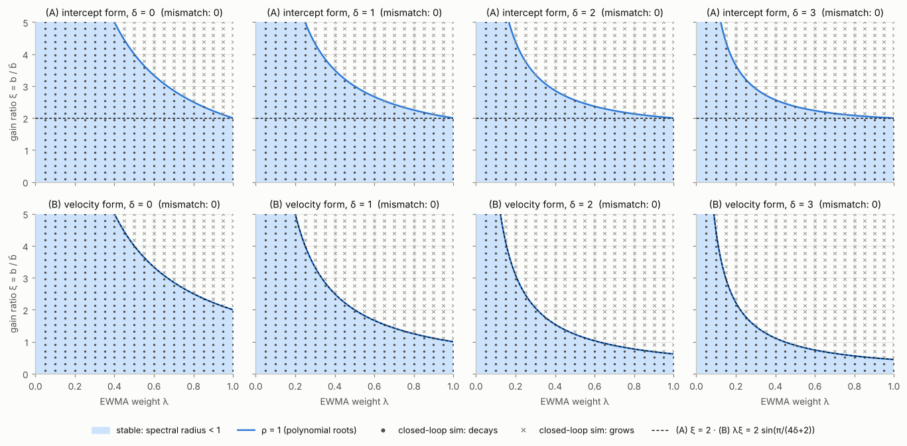
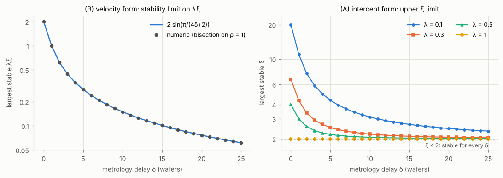
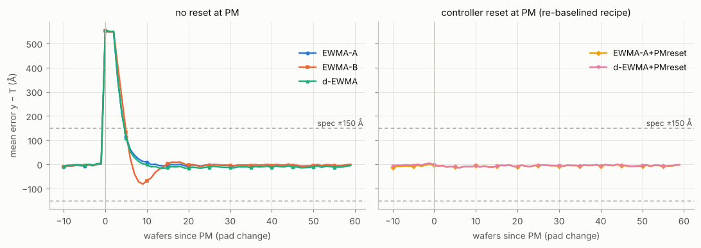
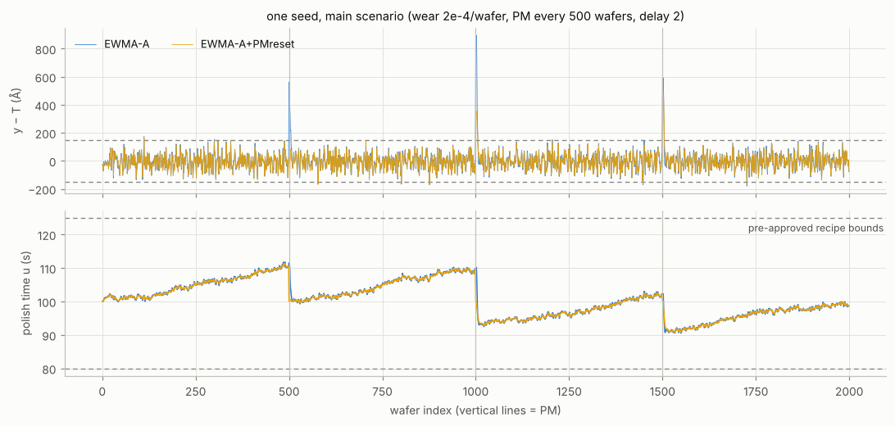
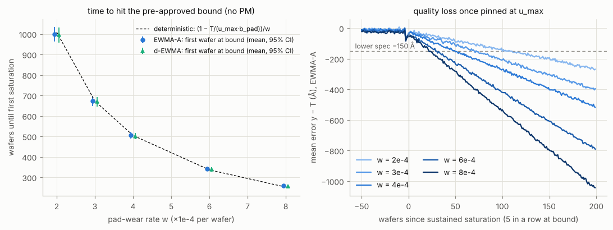
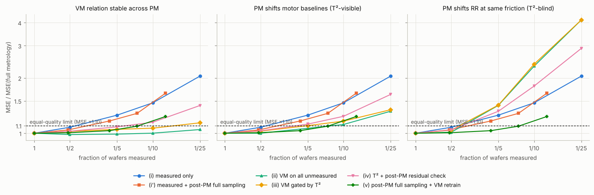
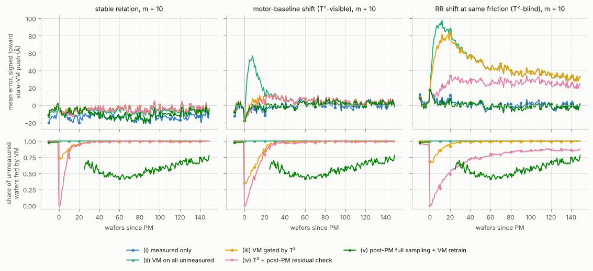

<!-- run_all.py 가 report_template.tmpl 에서 생성한 파일이다. 직접 고치지 말고 템플릿을 고친 뒤 다시 생성한다. -->
# R2R(EWMA) 제어 + 가상 계측(VM) — 산화막 CMP 시뮬레이션 (연구 #2)

공정 하나를 끝까지 쓴다: **산화막 CMP**. 레시피는 연마시간 하나다.

```
y_k  = RR_k · u_k + e_k        제거량 (Å) = 제거율 (Å/s) × 연마시간 (s) + 잡음
목표 T = 5,000 Å,  명목 RR = b̂ = 50 Å/s,  명목 u = 100 s,  규격 T ± 150 Å
```

이 문서의 숫자는 전부 `run_all.py` 가 만든 결과(`results.json`)에서 채워진다. 손으로 옮긴 숫자는 없다.
본문의 정성적 주장(어느 쪽이 크다, 안정이다 등)도 `r2r/report.py` 의 `claims()` 가 결과로 다시 확인한다 — 틀리면 생성이 실패한다.

**요약**

- **Q1.** 두 기대식 모두 맞다 (시점 규약 하나를 정하면). 절편형 (A) 은 0 < ξ < 2 이면 지연 δ 가 얼마든 안정이다. 속도형 (B) 의 안정 조건 λξ < 2·sin(π/(4δ+2)) 은 δ 가 늘면 빠르게 좁아진다. (B) 는 (A) 를 "계측된 웨이퍼의 레시피 대신 최신 레시피로 갱신"하게 구현한 것과 대수적으로 같다.
- **Q2.** 현실적 패드 마모(드리프트 1.0 Å/wafer, 백색 잡음 약 46 Å)에서 d-EWMA 와 EWMA 의 차이는 MSE 의 2 % 미만이다 (짝 비교 ΔMSE: 리셋 없이 38 [36, 40], PM 리셋과 함께 -37 [-42, -32] Ų). 성능을 가르는 것은 PM 처리다 — PM 때 상태·레시피를 기준값으로 되돌리면 MSE 가 41 % 준다. 경계 포화 시점은 결정론 예측과 맞고, 지속 포화부터 첫 규격 이탈까지는 마모 2e-4/wafer 에서 38.9 [33.9, 44.3] 장이다. 연구 #1 의 사람 승인이 들어갈 시간이다.
- **Q3.** PM 뒤에도 특징→제거율 관계가 유지되면 VM 으로 계측을 1/25 로 줄여도 MSE 비가 1.05 [1.03, 1.06] 이다. PM 이 관계를 센서에 안 보이게 바꾸면 VM 은 계측만 쓰는 것보다 나쁘고 (m=25 에서 4.13 배 vs 2.05 배), T² 게이트는 이를 못 막는다. PM 뒤 25 장 전수 계측 + VM 재학습을 넣으면 세 시나리오 모두 계측 13.5 % 에서 동등 품질이다 (구간 상한 기준으로는 23.2 %).

## 질문

- **Q1.** 모델 이득 불일치 ξ = b/b̂ 와 계측 지연 δ 에서 EWMA R2R 은 언제 안정한가. 두 형태 — (A) 절편 추정형, (B) 속도(적분)형 — 의 폐루프 특성다항식을 유도하고, 스펙트럼 반경으로 안정 영역을 구하고, 시뮬레이션으로 확인한다.
- **Q2.** 마모 드리프트(선형) + IMA(1,1) + PM 스텝에서 EWMA 와 d-EWMA 는 어떻게 다른가. 레시피는 사전 승인 범위 [u_min, u_max] 와 변경 한도 |Δu| ≤ Δmax 안에서만 움직인다. 경계 포화가 언제 오고, 포화 중 품질이 얼마나 나빠지는가.
- **Q3.** 1/m 장만 계측(지연 있음)할 때 VM 이 비계측 웨이퍼를 메우면 계측을 얼마나 줄일 수 있는가. PM 뒤 VM 이 낡는 경우, 신뢰지수로 거른 VM 과 거르지 않은 VM 은 어떻게 다른가.

## 모델·가정

### 공정과 외란

| 항목 | 값 | 뜻 |
| --- | --- | --- |
| 목표 제거량 T | 5,000 Å | 산화막 CMP, 웨이퍼 한 장 = 한 run |
| 명목 제거율 b0 = 모델 이득 b̂ | 50 Å/s (3,000 Å/min) | y = RR·u + e |
| 명목 연마시간 T/b̂ | 100 s | 레시피 u = 연마시간 |
| 규격 | T ± 150 Å (±3 %) | 품질은 참값 y 로 잰다 |
| 사전 승인 레시피 범위 | [80, 125] s | RR 40~62.5 Å/s 까지 보상 |
| 웨이퍼당 최대 변경 Δmax | 5 s | R2R 한 번에 움직일 수 있는 양 |
| 패드 마모 (선형) | RR 상대 −2e-4 / wafer | PM 주기 500 장에 −10 % |
| PM (패드 교체) | 500 장마다 | 새 패드 RR = b0·(1+s), s ~ N(0, 0.03²) |
| IMA(1,1) (제거율) | θ = 0.85, σ_a = 0.3 Å/s | u=100 s 에서 백색 30 Å, 랜덤워크 4.5 Å/wafer |
| 하강압·정반속도 요동 | 0.4 %, 0.3 % | Preston RR ∝ P·V, FDC 로 보인다 |
| 관측 불가 백색 잡음 e | σ = 25 Å | 입고 막두께 등, VM 도 못 본다 |
| 계측 잡음 | σ = 10 Å | 제어기·VM 학습에만 들어간다 |
| 계측 지연 δ (기준) | 2 wafer | 웨이퍼 k−δ 의 계측이 웨이퍼 k+1 레시피 전에 도착 |
| run 길이 | 2,000 wafer | PM 3회 (500·1000·1500), 처음 100 장은 지표에서 제외 |
| Monte Carlo | 평가 100 seed, 튜닝 50 seed (겹치지 않음) | seed = 독립 반복 한 번 |

- 제거율: `RR_k = (b_pad · (1 − w·n_k) + W_k) · (1 + ΔP_k + ΔV_k)`. n_k 는 마지막 PM 뒤 웨이퍼 수, W_k 는 IMA(1,1) (`W_k = W_{k−1} + a_k − θ a_{k−1}`, PM 과 무관하게 이어진다).
- PM 때 제거율이 닳은 패드 값에서 새 패드 값으로 뛴다. 평균 +10 %, u ≈ 111 s 에서 약 +556 Å 스텝이다.
- 경계 포화(pinned): 레시피가 경계에 붙어 있고 제어기는 그 바깥을 원하는 웨이퍼. 지속 포화: 5장 연속. 변경 한도 사건: Δmax 가 실제로 묶인 웨이퍼 (경계가 먼저 묶인 경우는 뺀다).

### 시점 규약 (δ)

웨이퍼 k 를 연마한 뒤, 웨이퍼 k+1 의 레시피를 정하기 전에 웨이퍼 k−δ 의 계측이 도착한다. δ = 0 이면 직전 웨이퍼의 계측을 바로 쓴다. Q1·Q2·Q3 이 모두 이 규약을 쓴다.

### 제어기

```
(A) 절편형   â ← λ(y_{k−δ} − b̂·u_{k−δ}) + (1−λ)â,     u_{k+1} = (T − â)/b̂      (u_{k−δ} = 그 웨이퍼에 실제 쓴 레시피)
(B) 속도형   u_{k+1} = u_k − (λ/b̂)(y_{k−δ} − T)                               (u_k = 직전 웨이퍼의 실제 레시피)
d-EWMA       ε = y_{k−δ} − b̂u_{k−δ},  a ← λ1·ε + (1−λ1)a,  D ← λ2(ε − a_이전) + (1−λ2)D,  u_{k+1} = (T − a − D)/b̂
제약         u = clip(clip(u_cmd, u_prev ± Δmax), u_min, u_max)
```

- d-EWMA 는 Butler–Stefani(1994)·Del Castillo(1999) 꼴의 표준형이다. 지연 보정은 넣지 않았다.
- **PM 리셋** 변형: PM 웨이퍼에서 추정 상태를 0 으로, 레시피를 기준값 100 s 로 되돌린다. 이것은 승인된 기준 레시피로의 재기준화라서 Δmax 의 대상이 아니다. 이전 패드 웨이퍼의 늦게 도착한 계측은 새 패드 상태를 갱신하지 않는다(문맥 전환).
- 모든 제어기는 튜닝 seed 50개에서 MSE 가 가장 작은 값으로 고정한 뒤, 겹치지 않는 평가 seed 100개로 잰다. 평가는 같은 seed 의 같은 외란을 모든 제어기가 공유한다(짝 비교).

### VM 과 신뢰지수 (Q3)

- **특징 20개** (웨이퍼마다 FDC 요약값): 정반·캐리어 모터 전류, 패드 평균·최고 온도, 초기 온도 상승률, 정반 전력, 진동(약함) — 마찰·발열 계열로 제거율과 이어진다. 하강압·정반·헤드 속도, 헤드 2구역 압력 — Preston 입력. 컨디셔너 토크, 패드 수명 카운터 — 패드 상태. 슬러리 유량·온도·pH, 링 압력, 습도(느린 AR(1)), 드레서 속도 — 무관하거나 약하다. 센서 잡음은 마찰 계열을 합쳐 한 웨이퍼의 제거율을 0.4 % (1σ) 로 읽을 수 있게 잡았다. 관측 불가 잡음 e(25 Å)는 VM 도 못 본다.
- **모델**: 망각 가중 릿지(망각 0.97 → 유효 기억 약 33 표본, α = 0.05, 번인 구간 척도로 표준화, 표본 20개부터 사용). 목표는 계측 제거율 y_meas/u, 예측은 ŷ = RR̂·u. 계측 웨이퍼가 도착할 때마다 다시 푼다(계측 웨이퍼로만 학습). VM 은 지연 0 — 연마 직후 다음 레시피에 쓸 수 있다. 계측 웨이퍼는 VM 을 쓰지 않고 실제 계측(지연 δ)을 기다린다.
- **신뢰지수 T²** = zᵀ(S + αI)⁻¹z — 학습 분포 대비 입력의 새로움(릿지 예측 분산과 같은 꼴). 문턱 = 정상 시나리오·정상 운전 구간 비계측 웨이퍼 T² 의 99 % 분위(튜닝 seed, m 별).
- **시나리오 셋** (참 제거율은 셋이 같다 — 계측만 쓰는 제어는 결과가 같다):
  - 정상: PM 뒤에도 특징→제거율 관계가 같다.
  - 모터 기저선 이동: PM 마다 모터 계열(정반·캐리어 전류, 전력) 기저선이 제거율 ±10~15 % 에 해당하는 만큼 함께 움직인다. 온도 계열은 그대로라 상관 구조가 깨진다 — T² 로 보인다.
  - 같은 마찰에서 제거율 이동(silent): 새 패드가 같은 마찰·발열에서 ±3~5 % 다른 제거율을 낸다. 상관 구조는 그대로라 입력만 보는 T² 로는 안 보인다.
- **전략** (Q3 제어기는 모두 EWMA (A) + PM 리셋, λ 는 전략·m 별로 튜닝 seed 정상 시나리오에서 고른다):

| 전략 | 비계측 웨이퍼 | PM 때 |
| --- | --- | --- |
| (i) 계측만 | 갱신 없음 | — |
| (i') 계측만 + PM 뒤 전수 | 갱신 없음 | 뒤 25 장 전수 계측 |
| (ii) VM 전부 | 항상 VM | — |
| (iii) VM + T² 게이트 | T² ≤ 문턱일 때만 VM | — |
| (iv) VM + T² + PM 뒤 잔차 검증 | (iii) 이면서 최근 검증 통과 | VM 을 '미검증'으로. PM 뒤 계측 웨이퍼의 표본 외 VM 잔차가 3 × (정상 잔차 RMS) 안이면 통과 |
| (v) PM 뒤 전수 + VM 재학습 + T² | T² ≤ 문턱일 때만 VM | 뒤 25 장 전수 계측, VM 학습 기억을 지우고 새 패드 데이터로만 재학습 |

(i')·(iv)·(v) 는 브리프의 (i)–(iii) 에 더한 것이다. (iii) 이 silent 이동을 못 본다는 것을 확인한 뒤, 공장에서 실제로 쓸 PM 대응 운용을 비교하려고 넣었다. (v) 가 세 시나리오에서 같은 결과를 내는 것은 이 모델의 관계 이동이 패드 안에서 일정하기 때문이다(한계 참고).

### 통계

- seed 하나 = 2,000 장짜리 독립 반복 한 번. 평균과 95 % 구간을 seed 단위 값으로 낸다.
- 구간: 기본은 t 구간. 대부분 0 인 사건 수(포화·변경 한도), 포화 뒤 지표, MSE 비는 백분위 부트스트랩(10,000회, 고정 난수).
- "동등 품질" = MSE 가 전수 계측(m=1, 계측만) 대비 1.10 배 이하. 점추정 기준과, 짝 부트스트랩 구간 상한 기준(보수적)을 함께 낸다.

## 결과

### Q1 — 이득 불일치·지연과 안정성

**유도.** 플랜트 y_j = a + b·u_j, ξ = b/b̂.

```
(B)  y_{k+1} − y_k = b(u_{k+1} − u_k) = −λξ (y_{k−δ} − T)
     ⇒  χ_B(z) = z^{δ+1} − z^δ + λξ

(A)  â_k = λ(a + (b − b̂)u_{k−δ}) + (1−λ)â_{k−1},   â_k = T − b̂·u_{k+1}
     ⇒  u_{k+1} = (1−λ)u_k − λ(ξ−1)u_{k−δ} + λ(T − a)/b̂
     ⇒  χ_A(z) = z^{δ+1} − (1−λ)z^δ + λ(ξ−1)
```

**기대식 확인.**

- (B) z^{δ+1} − z^δ + λξ = 0, 안정 조건 0 < λξ < 2·sin(π/(4δ+2)): **맞다.** 수치 이분법 경계와 닫힌꼴의 차이는 최대 2.4e-13 이다. 같은 꼴의 차분-지연 방정식에 대한 고전 결과(Levin & May 1976, 2cos(δπ/(2δ+1)) = 2sin(π/(4δ+2)))와 같다.
- (A) z^{δ+1} − (1−λ)z^δ + λ(ξ−1) = 0: **맞다 — 시점 규약 하나를 정하면.** 브리프의 (A) 는 `u_k = (T − â)/b̂` 와 `y_{k−δ}` 로 적혀 있어서 글자 그대로 읽으면 δ = 0 일 때 아직 연마하지 않은 웨이퍼의 계측을 쓴다. (B) 와 같은 규약(웨이퍼 k−δ 의 계측으로 u_{k+1} 을 정한다)으로 읽어야 두 기대식이 함께 성립한다. 지연을 "u_k 가 y_{k−δ} 를 쓴다"로 세면 두 식의 δ 를 δ−1 로 바꾼다.
- "ξ = 1 이면 지연이 불안정을 만들지 않는다": **맞다.** χ_A = z^δ(z − (1−λ)) 라서 근은 1−λ 하나와 0 이 δ 개다.

**더 나온 것.**

- **(A) 는 0 < ξ < 2 이면 모든 δ 에서 안정이다 (0 < λ ≤ 1).** 단위원 위 근 z = e^{iω} 는 |e^{iω} − (1−λ)| = λ|ξ−1| 를 만족해야 한다. 좌변은 λ 이상이므로 |ξ−1| < 1 에서는 근이 단위원을 건널 수 없고, ξ = 1 에서 근이 모두 원 안에 있으니 0 < ξ < 2 전체가 안정이다. 수치 확인: λ 10점 × ξ 60점 × δ 25개(최대 50) 에서 최대 스펙트럼 반경 0.99983. ξ > 2 쪽 상한은 δ 가 늘면 2 로 내려온다 (λ=0.3: δ=0,1,2,3 에서 6.67, 4.33, 3.36, 2.92, δ=25 에서 2.05). 닫힌꼴: δ=0 에서 2/λ, δ=1 에서 1 + 1/λ (Jury 조건), λ=1 이면 모든 δ 에서 정확히 2.
- **(B) 는 "최신 레시피로 갱신한 (A)" 와 같다.** (A) 의 갱신에서 u_{k−δ} 대신 최신 u_k 를 빼면, â_{k−1} = T − b̂u_k 를 넣어 u_{k+1} = u_k − (λ/b̂)(y_{k−δ} − T) 가 된다. 잡음 있는 공정에서 두 구현의 레시피 궤적 차이는 최대 2.8e-14 s 다 (계측 웨이퍼 레시피로 맞춘 (A) 와는 최대 2.08 s 차이). 지연에 대한 (A) 의 강건함은 계측을 그 웨이퍼의 레시피와 짝지은 데서 나온다.

| δ | 수치 이분법 (λξ)* | 2·sin(π/(4δ+2)) | |차이| |
| --- | ---: | ---: | ---: |
| 0 | 2.0000000000 | 2.0000000000 | 2.2e-13 |
| 1 | 1.0000000000 | 1.0000000000 | 7.7e-14 |
| 2 | 0.6180339887 | 0.6180339887 | 2.4e-13 |
| 3 | 0.4450418679 | 0.4450418679 | 7.5e-14 |
| 5 | 0.2846296765 | 0.2846296765 | 1.0e-13 |
| 10 | 0.1494601872 | 0.1494601872 | 1.2e-13 |
| 25 | 0.0615901171 | 0.0615901171 | 7.2e-14 |

안정 ξ 상한 — (A) 는 수치, (B) 는 2·sin(π/(4δ+2))/λ. 하한은 둘 다 ξ = 0 이다 (ξ ≤ 0 이면 z ≥ 1 에 근).

| 형태, λ | δ=0 | δ=1 | δ=2 | δ=3 | δ=5 | δ=10 | δ=25 |
| --- | ---: | ---: | ---: | ---: | ---: | ---: | ---: |
| (A) λ=0.1 | 20.000 | 11.000 | 7.466 | 5.855 | 4.360 | 3.111 | 2.343 |
| (B) λ=0.1 | 20.000 | 10.000 | 6.180 | 4.450 | 2.846 | 1.495 | 0.616 |
| (A) λ=0.2 | 10.000 | 6.000 | 4.385 | 3.647 | 2.966 | 2.414 | 2.106 |
| (B) λ=0.2 | 10.000 | 5.000 | 3.090 | 2.225 | 1.423 | 0.747 | 0.308 |
| (A) λ=0.3 | 6.667 | 4.333 | 3.365 | 2.922 | 2.519 | 2.205 | 2.047 |
| (B) λ=0.3 | 6.667 | 3.333 | 2.060 | 1.483 | 0.949 | 0.498 | 0.205 |
| (A) λ=0.5 | 4.000 | 3.000 | 2.562 | 2.363 | 2.190 | 2.067 | 2.013 |
| (B) λ=0.5 | 4.000 | 2.000 | 1.236 | 0.890 | 0.569 | 0.299 | 0.123 |
| (A) λ=1 | 2.000 | 2.000 | 2.000 | 2.000 | 2.000 | 2.000 | 2.000 |
| (B) λ=1 | 2.000 | 1.000 | 0.618 | 0.445 | 0.285 | 0.149 | 0.062 |

시뮬레이션 확인: 실제 제어기 코드(`controllers.py`)와 시뮬레이터(`sim.py`)로 잡음 없는 폐루프를 1,000 스텝 돌려 오차의 기하 증감률 ρ̂ 를 쟀다. 경계에서 0.01 이상 떨어진 3,936 점(전체 4,000 점)에서 안정/불안정 판정이 100 % 일치하고, |ρ̂ − ρ| 는 최대 4.3e-03 다.

| 형태 | δ | 격자 점 | |ρ−1|>0.01 점 | 일치 (명확한 점) | 일치 (전체) | max |ρ̂−ρ| |
| --- | ---: | ---: | ---: | ---: | ---: | ---: |
| (A) | 0 | 500 | 497 | 100.0 % | 99.8 % | 8.9e-16 |
| (A) | 1 | 500 | 494 | 100.0 % | 100.0 % | 2.4e-03 |
| (A) | 2 | 500 | 491 | 100.0 % | 100.0 % | 3.0e-03 |
| (A) | 3 | 500 | 487 | 100.0 % | 100.0 % | 3.2e-03 |
| (B) | 0 | 500 | 497 | 100.0 % | 99.8 % | 8.9e-16 |
| (B) | 1 | 500 | 492 | 100.0 % | 100.0 % | 4.3e-03 |
| (B) | 2 | 500 | 492 | 100.0 % | 100.0 % | 3.3e-03 |
| (B) | 3 | 500 | 486 | 100.0 % | 100.0 % | 3.1e-03 |



*그림 1. (λ, ξ) 안정 영역. 파란 면 = 특성근 스펙트럼 반경 < 1, 점·× = 폐루프 시뮬레이션의 감쇠·발산. 점선은 (A) ξ = 2, (B) λξ = 2sin(π/(4δ+2)).*



*그림 2. 지연이 길어질 때 (B) 의 λξ 한계(왼쪽)와 (A) 의 ξ 상한(오른쪽, ξ < 2 는 항상 안정).*

### Q2 — 드리프트·IMA·PM 에서의 성능과 경계 포화

튜닝 결과와 안정 여유. 평가 run 에서 실제 이득비 ξ_k = RR_k/b̂ 는 0.5–99.5 % 분위로 0.82–1.08 이라 모두 안정 범위 안이다.

| 제어기 | 튜닝 결과 (튜닝 seed, MSE 최소) | 안정 ξ 범위 (δ=2) |
| --- | ---: | ---: |
| EWMA (A) 절편형 | λ=0.4 | 0.00 < ξ < 2.86 |
| EWMA (B) 속도형 | λ=0.25 | 0.00 < ξ < 2.47 |
| d-EWMA | λ1=0.4, λ2=0.01 | 0.00 < ξ < 2.81 |
| EWMA (A) + PM 리셋 | λ=0.25 | 0.00 < ξ < 3.77 |
| d-EWMA + PM 리셋 | λ1=0.2, λ2=0.01 | 0.00 < ξ < 4.22 |

기준 시나리오 (마모 2e-4/wafer, PM 500장, δ = 2, 평가 seed 100개):

| 제어기 | MSE (Ų) | √MSE (Å) | 규격 이탈 % | PM 회복 (wafer) | PM 뒤 30장 이탈 수 | ΔMSE vs (A) (짝 비교) |
| --- | ---: | ---: | ---: | ---: | ---: | ---: |
| EWMA (A) 절편형 | 4,806 [4,683, 4,928] | 69.3 | 1.15 [1.11, 1.19] | 4.9 [4.8, 5.0] | 4.85 [4.72, 4.99] | 기준 |
| EWMA (B) 속도형 | 4,968 [4,842, 5,094] | 70.5 | 1.27 [1.23, 1.31] | 6.3 [6.0, 6.6] | 5.57 [5.42, 5.72] | 162 [149, 176] |
| d-EWMA | 4,844 [4,720, 4,968] | 69.6 | 1.16 [1.12, 1.19] | 4.8 [4.7, 4.9] | 4.79 [4.66, 4.92] | 38 [36, 40] |
| EWMA (A) + PM 리셋 | 2,835 [2,778, 2,891] | 53.2 | 0.65 [0.60, 0.71] | 2.7 [2.3, 3.0] | 2.32 [2.04, 2.61] | -1,971 [-2,101, -1,842] |
| d-EWMA + PM 리셋 | 2,797 [2,737, 2,858] | 52.9 | 0.66 [0.60, 0.71] | 2.9 [2.6, 3.3] | 2.52 [2.20, 2.83] | -2,008 [-2,140, -1,877] |

| 제어기 | 경계 포화 웨이퍼 / run | 포화가 한 번이라도 난 run | Δmax 에 묶인 웨이퍼 / run |
| --- | ---: | ---: | ---: |
| EWMA (A) 절편형 | 2.00 [0.14, 4.48] | 4 % | 1.85 [1.64, 2.07] |
| EWMA (B) 속도형 | 1.65 [0.09, 3.71] | 4 % | 0.39 [0.22, 0.58] |
| d-EWMA | 2.09 [0.16, 4.65] | 4 % | 1.98 [1.75, 2.21] |
| EWMA (A) + PM 리셋 | 1.74 [0.10, 3.96] | 4 % | 0.00 [0.00, 0.00] |
| d-EWMA + PM 리셋 | 1.99 [0.14, 4.47] | 4 % | 0.00 [0.00, 0.00] |

- **d-EWMA 의 득실은 작다.** 튜닝이 λ2 를 격자 최솟값(0.01)으로 보낸다 — 추세항을 거의 끄는 쪽이 낫다는 뜻이다. 짝 비교로 리셋 없이는 EWMA (A) 보다 MSE 가 38 [36, 40] Ų 크고, PM 리셋과 함께면 -37 [-42, -32] Ų 작다. 어느 쪽이든 MSE 의 2 % 미만이다. 이유는 크기다: 단일 EWMA 의 드리프트 정상상태 오차는 d(δ + 1/λ) = 1.0 × (2 + 1/0.4) = 4.5 Å 로, 백색 잡음 약 46 Å 에 묻힌다 (이 식은 시험으로 고정했다).
- **(B) 는 (A) 보다 나쁘다.** MSE 가 162 [149, 176] Ų 크고, PM 회복이 6.3 [6.0, 6.6] 장으로 (A) 의 4.9 [4.8, 5.0] 장보다 느리다(언더슈트, 그림 3).
- **PM 처리가 제어기 선택보다 크다.** 리셋이 없으면 PM 직후 δ+1 장의 평균 오차가 548 [533, 564] Å 이다(규격 ±150). 기준 레시피로 재기준화하면 -6 [-36, 24] Å, MSE 는 2,835 [2,778, 2,891] 로 41 % 준다.
- 기준 시나리오에서도 run 의 4 % 가 상한에 닿는다. 그 4개 run 모두 첫 포화가 패드 수명 370장째 이후였고, 제거율이 평균보다 낮게 시작한 패드에서 IMA 가 아래로 흐를 때였다. 경계 근처에서는 포화 표시가 켜졌다 꺼졌다 하고, PM 직후 δ 장 동안은 새 패드 계측이 아직 없어 포화 표시가 이어진다 — 트리거는 연속 포화로 거르는 편이 낫다.

지연 민감도 (δ = 2 튜닝값 고정 — 계측 대기열이 길어졌는데 다시 튜닝하지 않은 경우):

| δ | (A) MSE | (A) 이탈 % | (B) MSE | (B) 이탈 % | d-EWMA MSE | d-EWMA 이탈 % |
| --- | ---: | ---: | ---: | ---: | ---: | ---: |
| 0 | 3,626 [3,563, 3,690] | 0.84 [0.81, 0.87] | 3,763 [3,691, 3,836] | 1.02 [0.98, 1.06] | 3,657 [3,593, 3,722] | 0.86 [0.83, 0.89] |
| 1 | 4,211 [4,119, 4,304] | 0.99 [0.95, 1.03] | 4,253 [4,160, 4,347] | 1.02 [0.98, 1.05] | 4,246 [4,152, 4,340] | 1.00 [0.96, 1.04] |
| 2 | 4,806 [4,683, 4,928] | 1.15 [1.11, 1.19] | 4,968 [4,842, 5,094] | 1.27 [1.23, 1.31] | 4,844 [4,720, 4,968] | 1.16 [1.12, 1.19] |
| 5 | 6,586 [6,373, 6,799] | 1.68 [1.63, 1.72] | 17,460 [16,556, 18,364] | 11.67 [11.00, 12.34] | 6,637 [6,422, 6,853] | 1.68 [1.64, 1.72] |
| 10 | 9,533 [9,176, 9,890] | 2.59 [2.53, 2.65] | 655,081 [636,518, 673,644] | 90.71 [90.15, 91.28] | 9,606 [9,245, 9,966] | 2.59 [2.53, 2.65] |

(B) 의 붕괴는 Q1 의 예측대로다. λ_B = 0.25 에서 λξ 는 0.20–0.27 이다. δ = 5 의 한계 0.285 안이라 아직 안정이지만 감쇠가 거의 없어 MSE 17,460 [16,556, 18,364], δ = 10 에서는 한계 0.149 을 넘어 발산하고 레시피 경계에서만 멈춘다 (규격 이탈 90.71 [90.15, 91.28] %). (A) 와 d-EWMA 는 같은 지연에서 완만하게 나빠진다 (δ = 10 에서 (A) 9,533 [9,176, 9,890]).

마모율 민감도 (PM 500장 유지):

| 마모율 w | 드리프트 Å/wafer | 패드 수명 중 RR 감소 | (A) MSE | (A) 이탈 % | (A) 포화 run | d-EWMA MSE | d-EWMA 이탈 % | d-EWMA 포화 run | (A)+리셋 MSE | (A)+리셋 이탈 % | (A)+리셋 포화 run |
| --- | ---: | ---: | ---: | ---: | ---: | ---: | ---: | ---: | ---: | ---: | ---: |
| 0e-4 | 0.0 | 0 % | 2,902 [2,853, 2,950] | 0.66 [0.62, 0.71] | 0 % | 2,926 [2,878, 2,975] | 0.67 [0.63, 0.71] | 0 % | 2,698 [2,645, 2,751] | 0.59 [0.54, 0.64] | 0 % |
| 1e-4 | 0.5 | 5 % | 3,343 [3,276, 3,410] | 0.84 [0.80, 0.88] | 0 % | 3,369 [3,302, 3,436] | 0.85 [0.81, 0.90] | 0 % | 2,749 [2,696, 2,802] | 0.61 [0.56, 0.66] | 0 % |
| 2e-4 | 1.0 | 10 % | 4,806 [4,683, 4,928] | 1.15 [1.11, 1.19] | 4 % | 4,844 [4,720, 4,968] | 1.16 [1.12, 1.19] | 4 % | 2,835 [2,778, 2,891] | 0.65 [0.60, 0.71] | 4 % |
| 3e-4 | 1.5 | 15 % | 8,074 [7,798, 8,351] | 1.86 [1.52, 2.20] | 35 % | 8,148 [7,871, 8,425] | 1.85 [1.51, 2.19] | 35 % | 3,263 [2,978, 3,547] | 1.19 [0.82, 1.56] | 29 % |
| 4e-4 | 2.0 | 20 % | 14,918 [13,665, 16,171] | 5.11 [4.10, 6.11] | 85 % | 15,003 [13,752, 16,253] | 5.09 [4.09, 6.10] | 86 % | 6,468 [5,026, 7,911] | 4.32 [3.29, 5.36] | 84 % |
| 6e-4 | 3.0 | 30 % | 79,432 [70,743, 88,121] | 28.35 [26.51, 30.18] | 100 % | 79,467 [70,778, 88,156] | 28.38 [26.55, 30.22] | 100 % | 68,004 [58,812, 77,195] | 27.50 [25.66, 29.34] | 100 % |

**경계 포화 — 연구 #1 의 트리거.** PM 없이 한 패드를 1,500 장 쓰면서 마모율을 바꿨다 (평가 seed 100개).

| 마모율 w | 드리프트 Å/wafer | 예측 첫 포화 (결정론) | 1,500장 안에 포화한 run | (A) 첫 포화 웨이퍼 | (A) 지속 포화 (5연속) | d-EWMA 첫 포화 | 지속 포화 → 첫 이탈 (wafer) | 평균이 −150 Å 에 닿는 데 (결정론) | 포화 전 100장 이탈 % | 포화 후 100장 이탈 % |
| --- | ---: | ---: | ---: | ---: | ---: | ---: | ---: | ---: | ---: | ---: |
| 0e-4 | 0.0 | — | 0 % | — | — | — | — | — | — | — |
| 1e-4 | 0.5 | 2,018 [1,967, 2,068] | 16 % | 1,361 [1,283, 1,438] | 1,354 [1,250, 1,459] | 1,360 [1,282, 1,437] | 67.9 [39.1, 98.6] | 240 | 0.42 [0.08, 0.83] | 2.0 [0.2, 4.8] |
| 2e-4 | 1.0 | 1,009 [984, 1,034] | 100 % | 998 [962, 1,034] | 1,017 [982, 1,053] | 995 [959, 1,030] | 38.9 [33.9, 44.3] | 120 | 0.74 [0.57, 0.92] | 16.9 [13.9, 20.2] |
| 3e-4 | 1.5 | 673 [656, 689] | 100 % | 672 [649, 695] | 687 [665, 709] | 669 [646, 692] | 30.0 [26.5, 33.8] | 80 | 0.66 [0.52, 0.80] | 31.0 [27.8, 34.3] |
| 4e-4 | 2.0 | 504 [492, 517] | 100 % | 505 [490, 521] | 514 [498, 530] | 501 [486, 517] | 22.3 [20.0, 24.7] | 60 | 0.64 [0.48, 0.81] | 47.2 [44.2, 50.4] |
| 6e-4 | 3.0 | 336 [328, 345] | 100 % | 342 [332, 353] | 348 [338, 359] | 339 [329, 349] | 15.0 [13.3, 16.7] | 40 | 0.88 [0.70, 1.07] | 68.3 [66.3, 70.3] |
| 8e-4 | 4.0 | 252 [246, 259] | 100 % | 259 [251, 266] | 262 [254, 269] | 257 [249, 264] | 10.9 [9.4, 12.3] | 30 | 1.17 [0.98, 1.37] | 76.5 [75.2, 77.7] |

- 첫 포화 시점은 결정론 예측 n* = (1 − T/(u_max·b_pad))/w 와 구간이 겹친다. 마모 2e-4 에서 시뮬레이션 998 [962, 1,034] 장, 예측 1,009 [984, 1,034] 장이다. 즉 트리거 시점을 미리 계산할 수 있다.
- 지속 포화(5장 연속) 뒤 첫 규격 이탈까지 마모 2e-4 에서 38.9 [33.9, 44.3] 장, 4e-4 에서 22.3 [20.0, 24.7] 장이다. 평균 오차가 −150 Å 에 닿는 결정론 시간(120 장)보다 훨씬 짧다 — 잡음 때문에 첫 이탈은 평균이 규격에 닿기 전에 온다.
- 포화 전 100장 규격 이탈 0.74 [0.57, 0.92] % 가 포화 뒤 100장 16.9 [13.9, 20.2] % 로 는다 (마모 2e-4). 사람이 기준 레시피를 바꾸지 않으면 손실은 선형으로 커진다(그림 5 오른쪽).
- 오경보: 마모 0 이면 1,500 장 안에 포화한 run 이 0 %, 마모 1e-4 (예측 첫 포화가 1,500 장 밖)에서 16 % 다.



*그림 3. PM 기준으로 정렬한 평균 오차 (평가 seed 100 × PM 3회). 왼쪽: 리셋 없음, 오른쪽: PM 리셋.*



*그림 4. seed 하나의 궤적 (EWMA (A) 와 (A) + PM 리셋). 마모로 연마시간이 올라가고 PM 에서 꺾인다.*



*그림 5. 왼쪽: 첫 포화 웨이퍼 vs 마모율 (점·막대 = 시뮬레이션 평균과 95 % 구간, 점선 = 결정론 예측). 오른쪽: 지속 포화 시점 기준 평균 오차.*

### Q3 — 표본 계측과 VM

보정 (튜닝 seed, 정상 시나리오). VM 오차는 관측 불가 잡음 25 Å 를 포함해 참값 대비 RMS 36.4–40.6 Å 다.

| m | T² 문턱 (99 %) | VM 잔차 RMS (Å) | 잔차 검증 문턱 (Å) | VM 오차 RMS vs 참값 (Å) | 참값 y 표준편차 (Å) |
| --- | ---: | ---: | ---: | ---: | ---: |
| 2 | 50.4 | 37.8 | 113.3 | 36.4 | 52.8 |
| 5 | 52.3 | 38.9 | 116.6 | 37.5 | 53.1 |
| 10 | 57.1 | 40.1 | 120.3 | 38.4 | 53.5 |
| 25 | 71.8 | 41.0 | 123.0 | 40.6 | 54.9 |

계측 비율 (번인 100장 제외). (i') 와 (v) 는 PM 뒤 전수 계측 몫이 더해진다.

| 전략 | m=1 | m=2 | m=5 | m=10 | m=25 |
| --- | ---: | ---: | ---: | ---: | ---: |
| (i) 계측만 | 100.0 % | 50.0 % | 20.0 % | 10.0 % | 4.0 % |
| (i') 계측만 + PM 뒤 전수 | 100.0 % | 52.0 % | 23.2 % | 13.5 % | 7.8 % |
| (ii) VM 전부 | 100.0 % | 50.0 % | 20.0 % | 10.0 % | 4.0 % |
| (iii) VM + T² 게이트 | 100.0 % | 50.0 % | 20.0 % | 10.0 % | 4.0 % |
| (iv) VM + T² + PM 뒤 잔차 검증 | 100.0 % | 50.0 % | 20.0 % | 10.0 % | 4.0 % |
| (v) PM 뒤 전수 + VM 재학습 + T² | 100.0 % | 52.0 % | 23.2 % | 13.5 % | 7.8 % |

MSE 비 (전수 계측 m=1 대비, 평균 [95 % 부트스트랩 구간]). 기준 MSE = 2,833 [2,770, 2,896] Ų, 규격 이탈 0.69 [0.63, 0.75] %. 규격 이탈·MSE 원값·PM 뒤 이탈·VM 사용 비율은 `results.md` 에 있다.

정상 (PM 뒤에도 관계 유지):

| 전략 | m=1 | m=2 | m=5 | m=10 | m=25 |
| --- | ---: | ---: | ---: | ---: | ---: |
| (i) 계측만 | 1.00 [1.00, 1.00] | 1.08 [1.07, 1.08] | 1.25 [1.24, 1.27] | 1.46 [1.44, 1.49] | 2.05 [1.97, 2.13] |
| (i') 계측만 + PM 뒤 전수 | 1.00 [1.00, 1.00] | 1.04 [1.04, 1.05] | 1.17 [1.16, 1.18] | 1.28 [1.27, 1.30] | 1.65 [1.62, 1.69] |
| (ii) VM 전부 | 1.00 [1.00, 1.00] | 0.98 [0.97, 0.99] | 0.99 [0.98, 1.00] | 1.00 [0.99, 1.01] | 1.05 [1.03, 1.06] |
| (iii) VM + T² 게이트 | 1.00 [1.00, 1.00] | 1.02 [1.02, 1.03] | 1.05 [1.04, 1.06] | 1.07 [1.05, 1.08] | 1.14 [1.10, 1.19] |
| (iv) VM + T² + PM 뒤 잔차 검증 | 1.00 [1.00, 1.00] | 1.03 [1.02, 1.03] | 1.08 [1.07, 1.10] | 1.15 [1.12, 1.17] | 1.42 [1.34, 1.50] |
| (v) PM 뒤 전수 + VM 재학습 + T² | 1.00 [1.00, 1.00] | 1.01 [1.00, 1.01] | 1.03 [1.03, 1.04] | 1.09 [1.08, 1.10] | 1.23 [1.21, 1.25] |

모터 기저선 이동 (T² 로 보임):

| 전략 | m=1 | m=2 | m=5 | m=10 | m=25 |
| --- | ---: | ---: | ---: | ---: | ---: |
| (i) 계측만 | 1.00 [1.00, 1.00] | 1.08 [1.07, 1.08] | 1.25 [1.24, 1.27] | 1.46 [1.44, 1.49] | 2.05 [1.97, 2.13] |
| (i') 계측만 + PM 뒤 전수 | 1.00 [1.00, 1.00] | 1.04 [1.04, 1.05] | 1.17 [1.16, 1.18] | 1.28 [1.27, 1.30] | 1.65 [1.62, 1.69] |
| (ii) VM 전부 | 1.00 [1.00, 1.00] | 1.00 [0.99, 1.01] | 1.06 [1.05, 1.08] | 1.12 [1.10, 1.13] | 1.32 [1.28, 1.35] |
| (iii) VM + T² 게이트 | 1.00 [1.00, 1.00] | 1.03 [1.02, 1.03] | 1.10 [1.09, 1.11] | 1.16 [1.14, 1.18] | 1.34 [1.28, 1.42] |
| (iv) VM + T² + PM 뒤 잔차 검증 | 1.00 [1.00, 1.00] | 1.03 [1.03, 1.03] | 1.12 [1.11, 1.14] | 1.24 [1.21, 1.27] | 1.63 [1.53, 1.74] |
| (v) PM 뒤 전수 + VM 재학습 + T² | 1.00 [1.00, 1.00] | 1.01 [1.00, 1.01] | 1.03 [1.03, 1.04] | 1.09 [1.08, 1.10] | 1.23 [1.21, 1.25] |

같은 마찰에서 제거율 이동 (T² 로 안 보임):

| 전략 | m=1 | m=2 | m=5 | m=10 | m=25 |
| --- | ---: | ---: | ---: | ---: | ---: |
| (i) 계측만 | 1.00 [1.00, 1.00] | 1.08 [1.07, 1.08] | 1.25 [1.24, 1.27] | 1.46 [1.44, 1.49] | 2.05 [1.97, 2.13] |
| (i') 계측만 + PM 뒤 전수 | 1.00 [1.00, 1.00] | 1.04 [1.04, 1.05] | 1.17 [1.16, 1.18] | 1.28 [1.27, 1.30] | 1.65 [1.62, 1.69] |
| (ii) VM 전부 | 1.00 [1.00, 1.00] | 1.01 [1.00, 1.02] | 1.42 [1.33, 1.52] | 2.32 [2.07, 2.59] | 4.13 [3.63, 4.66] |
| (iii) VM + T² 게이트 | 1.00 [1.00, 1.00] | 1.04 [1.03, 1.04] | 1.42 [1.34, 1.51] | 2.38 [2.12, 2.65] | 4.13 [3.64, 4.66] |
| (iv) VM + T² + PM 뒤 잔차 검증 | 1.00 [1.00, 1.00] | 1.04 [1.04, 1.05] | 1.32 [1.28, 1.36] | 1.81 [1.72, 1.90] | 2.90 [2.68, 3.12] |
| (v) PM 뒤 전수 + VM 재학습 + T² | 1.00 [1.00, 1.00] | 1.01 [1.00, 1.01] | 1.03 [1.03, 1.04] | 1.09 [1.08, 1.10] | 1.23 [1.21, 1.25] |

동등 품질(MSE 비 ≤ 1.10)을 지키는 가장 큰 m:

| 시나리오 | 전략 | 최대 m (점추정) | 계측 비율 | 최대 m (구간 상한) | 계측 비율 |
| --- | --- | ---: | ---: | ---: | ---: |
| 정상 (PM 뒤에도 관계 유지) | (i) 계측만 | 2 | 50.0 % | 2 | 50.0 % |
| 정상 (PM 뒤에도 관계 유지) | (i') 계측만 + PM 뒤 전수 | 2 | 52.0 % | 2 | 52.0 % |
| 정상 (PM 뒤에도 관계 유지) | (ii) VM 전부 | 25 | 4.0 % | 25 | 4.0 % |
| 정상 (PM 뒤에도 관계 유지) | (iii) VM + T² 게이트 | 10 | 10.0 % | 10 | 10.0 % |
| 정상 (PM 뒤에도 관계 유지) | (iv) VM + T² + PM 뒤 잔차 검증 | 5 | 20.0 % | 5 | 20.0 % |
| 정상 (PM 뒤에도 관계 유지) | (v) PM 뒤 전수 + VM 재학습 + T² | 10 | 13.5 % | 5 | 23.2 % |
| 모터 기저선 이동 (T² 로 보임) | (i) 계측만 | 2 | 50.0 % | 2 | 50.0 % |
| 모터 기저선 이동 (T² 로 보임) | (i') 계측만 + PM 뒤 전수 | 2 | 52.0 % | 2 | 52.0 % |
| 모터 기저선 이동 (T² 로 보임) | (ii) VM 전부 | 5 | 20.0 % | 5 | 20.0 % |
| 모터 기저선 이동 (T² 로 보임) | (iii) VM + T² 게이트 | 5 | 20.0 % | 2 | 50.0 % |
| 모터 기저선 이동 (T² 로 보임) | (iv) VM + T² + PM 뒤 잔차 검증 | 2 | 50.0 % | 2 | 50.0 % |
| 모터 기저선 이동 (T² 로 보임) | (v) PM 뒤 전수 + VM 재학습 + T² | 10 | 13.5 % | 5 | 23.2 % |
| 같은 마찰에서 제거율 이동 (T² 로 안 보임) | (i) 계측만 | 2 | 50.0 % | 2 | 50.0 % |
| 같은 마찰에서 제거율 이동 (T² 로 안 보임) | (i') 계측만 + PM 뒤 전수 | 2 | 52.0 % | 2 | 52.0 % |
| 같은 마찰에서 제거율 이동 (T² 로 안 보임) | (ii) VM 전부 | 2 | 50.0 % | 2 | 50.0 % |
| 같은 마찰에서 제거율 이동 (T² 로 안 보임) | (iii) VM + T² 게이트 | 2 | 50.0 % | 2 | 50.0 % |
| 같은 마찰에서 제거율 이동 (T² 로 안 보임) | (iv) VM + T² + PM 뒤 잔차 검증 | 2 | 50.0 % | 2 | 50.0 % |
| 같은 마찰에서 제거율 이동 (T² 로 안 보임) | (v) PM 뒤 전수 + VM 재학습 + T² | 10 | 13.5 % | 5 | 23.2 % |

- **관계가 유지되면 VM 이 계측 지연까지 메운다.** (ii) VM 전부는 m=25 에서도 1.05 [1.03, 1.06] 이다. 계측만은 m=5 에서 이미 1.25 [1.24, 1.27] 다 — 1/m 계측 사이에 쌓이는 마모 드리프트와 PM 뒤 새 패드 오프셋을 늦게 본다.
- **T² 게이트는 정상 운전에서 손해다.** PM 직후 새 패드의 특징은 학습 분포 밖이라 VM 이 맞는데도 거른다 (정상, m=25: 1.14 [1.10, 1.19] vs 전부 1.05 [1.03, 1.06]).
- **T² 로 보이는 이동은 VM 이 스스로 빨리 배운다.** 모터 기저선 이동은 학습 데이터에 없던 방향이라, 이동 뒤 계측 몇 장이 지렛대가 큰 표본이 되어 릿지가 금방 맞춘다. 그래서 이 시나리오에서 게이트의 이득이 작다 (m=25: 전부 1.32 [1.28, 1.35], T² 1.34 [1.28, 1.42]).
- **T² 로 안 보이는 이동이 진짜 위험이다.** 같은 마찰에서 제거율만 바뀌면 입력은 정상으로 보이고, 낡은 VM 이 제어기를 일정한 방향으로 민다. m=25 에서 VM 전부 4.13 [3.63, 4.66] — 계측만(2.05 [1.97, 2.13])보다 나쁘다. T² 게이트도 4.13 [3.64, 4.66] 로 거의 그대로다.
- **잔차 검증은 줄이지만 막지 못한다.** (iv) 는 2.90 [2.68, 3.12] 로 피해를 줄이지만 계측만보다 여전히 나쁘다. 표본 하나의 3σ 검사(문턱 113–123 Å)는 문턱보다 작은 편향을 그대로 통과시키고, 한 번 통과하면 다음 계측까지 m 장 동안 VM 을 믿는다. silent, m=25 에서도 비계측 웨이퍼의 75 % 에 VM 이 쓰였다.
- **PM 을 아는 운용이 답이다.** (v) PM 뒤 25 장 전수 계측 + VM 재학습은 m=10 에서 1.09 [1.08, 1.10] (계측 13.5 %) 로 세 시나리오 모두 같다. 정상 운전에서는 VM 전부보다 조금 손해다 (1.09 [1.08, 1.10] vs 1.00 [0.99, 1.01]) — 보험료다.

**계측을 얼마나 줄일 수 있나 (동등 품질 = MSE ≤ 1.10 배).**

| 조건 | 전략 | 최대 m | 계측 비율 | 보수적 (구간 상한) |
| --- | --- | ---: | ---: | ---: |
| PM 뒤에도 관계 유지가 확실할 때 | (ii) VM 전부 | 25 | 4.0 % | m=25, 4.0 % |
| 관계 이동 가능성을 배제 못 할 때 | (v) PM 뒤 전수 + 재학습 | 10 | 13.5 % | m=5, 23.2 % |
| VM 없이 | (i) 계측만 | 2 | 50.0 % | m=2, 50.0 % |



*그림 6. 계측 비율(오른쪽으로 갈수록 적다)에 따른 MSE 비. 점선 = 동등 품질 한계 1.10.*



*그림 7. m = 10, PM 기준 정렬. 위: 낡은 VM 이 미는 방향으로 부호를 맞춘 평균 오차. 아래: 비계측 웨이퍼 중 VM 이 실제로 쓰인 비율.*

## 해석 — 공장 바닥에서

1. **R2R 은 (A) 절편형으로, 계측을 그 웨이퍼의 레시피와 짝지어 구현한다.** 계측이 늦게 도착할 때 "최신 레시피"로 갱신하는 구현은 (B) 와 같고, (B) 는 지연에 약하다. 로트 단위 지연(δ ≈ 25)이면 (B) 는 λξ < 0.062 여야 한다. 웨이퍼 단위 문맥(어느 웨이퍼가 어떤 레시피로 연마됐나)을 끝까지 들고 다니는 것이 곧 안정성이다.
2. **b̂ 은 모르면 크게 잡는다.** (A) 는 ξ = b/b̂ < 2 이면 지연과 무관하게 안정이다. b̂ 을 실제보다 크게 잡으면(ξ < 1) 느려질 뿐이지만, 실제의 절반 아래로 작게 잡으면(ξ > 2) 지연이 불안정을 만든다.
3. **d-EWMA 는 드리프트가 잡음에 비해 클 때만 값을 한다.** 기준은 d(δ + 1/λ) 가 백색 잡음 σ 에 견줄 만한가다. 이 CMP 설정(1.0 Å/wafer vs 46 Å)에서는 아니어서 득실이 MSE 의 2 % 미만이고, PM 회복도 빨라지지 않는다. d-EWMA 는 포화도 늦추지 못한다 — 첫 포화는 마모율이 정한다.
4. **PM 은 제어 문제보다 운영 문제다.** PM 때 기준 레시피로 재기준화하는 것(사람이 승인한 새 기준)이 어떤 제어기 튜닝보다 크다. 이전 패드 웨이퍼의 늦은 계측을 새 패드 상태에 섞지 않는 것까지가 재기준화다.
5. **경계 포화는 예측 가능한 트리거다 (연구 #1).** 첫 포화 웨이퍼는 n* = (1 − T/(u_max·b_pad))/w 로 미리 알 수 있고, 지속 포화 뒤 첫 이탈까지 수십 장(마모 2e-4 에서 38.9 [33.9, 44.3] 장)의 여유가 있다. "범위에 닿았다"는 사람 승인 요청의 근거로 쓸 만하다 — 다만 이 여유는 마모가 빠를수록 줄고(22.3 [20.0, 24.7] 장 @ 4e-4), 마모가 없으면 오경보가 없었다.
6. **VM 의 계측 절감 폭은 "PM 뒤 관계 이동이 센서에 보이느냐"가 정한다.** 입력 새로움(T²)은 모델이 틀렸는지가 아니라 입력이 낯선지를 잰다. 그래서 맞는 VM 을 거르고(정상), 틀린 VM 을 통과시킨다(silent). 정비 이벤트를 아는 운용 — PM 뒤 전수 계측으로 재학습하고 나서 표본 계측으로 돌아가기 — 이 이 설정에서 계측을 13.5 % 로 줄이면서 세 시나리오 모두에서 품질을 지켰다. "VM 으로 표본 계측 재개"는 PM 마다 오는 결정이라 사람이 승인할 지점으로 자연스럽다.

## 한계

- 시뮬레이션이다. 숫자(제거율, 잡음, 마모율, 규격)는 그럴듯하게 정했을 뿐 실제 공정 데이터에 맞춘 것이 아니다. 결론은 크기 비교(드리프트 vs 잡음, VM 편향 vs 규격)에 기대므로 비율이 다른 공정에서는 달라질 수 있다.
- 입력 하나·출력 하나(평균 제거량)다. 실제 CMP 는 다구역 헤드로 웨이퍼 안 프로파일을 맞추고, 여러 헤드·정반이 섞인다. MIMO R2R·로트 구조는 다루지 않았다.
- 플랜트는 정적 이득이다. Q2 에서 ξ 는 시간에 따라 0.82–1.08 로 변하므로 Q1 의 고정 ξ 해석은 준정적 확인이다.
- d-EWMA 는 표준형만 봤다(지연 보정 없음 — 지연 δ 에서 드리프트 오프셋 d·δ 가 남는다, 시험으로 고정). λ 는 MSE 로만 골랐다.
- PM 은 주기 고정의 계단이다. 길들이기(break-in) 과도, 계측 이상치·누락은 없다. IMA 는 PM 을 넘어 이어지는 랜덤워크라 긴 시간에는 무한히 퍼진다.
- 포화 연구는 트리거 뒤 사람의 조치를 모델링하지 않는다 — "아무도 안 움직이면 얼마나 나빠지나"까지다.
- VM 은 선형 특징·선형 모델이다. 실제 FDC 는 트레이스 데이터이고 비선형이다. 신뢰지수는 T² 만 구현했고 부트스트랩 앙상블 분산은 넣지 않았다 — 둘 다 입력 쪽 불확실성이라 silent 이동에는 같은 한계가 있을 것으로 보지만 확인하지 않았다.
- 관계 이동은 패드 안에서 일정하다. 그래서 PM 뒤 재학습(v)이 이동을 구조적으로 지운다. 패드 안에서 서서히 변하는 관계 이동은 다루지 않았다.
- T²·잔차 문턱은 정상 시나리오에서 정했다(99 % 분위, 3σ). 다른 문턱의 민감도는 보지 않았다.
- 그림 안 글자는 영어다. 이 환경에 한글 글꼴이 없다.

## 재현 방법

```bash
cd research/r2r_vm
uv venv .venv --python 3.13
uv pip install --python .venv/bin/python -r requirements.txt
.venv/bin/python run_all.py                           # 그림·results.json·results.md·README.md 를 다시 만든다
.venv/bin/python -m unittest discover -s tests -v     # 시험
```

- seed 는 모두 고정이다 (평가 1000–1099, 튜닝 5000–5049). 같은 환경이면 같은 숫자가 나온다. 실행 시간만 `results.json` 의 `meta.runtime_s` 에 기록되고 실행마다 다르다.
- README.md 는 `report_template.tmpl` 에서 생성된다. 글을 고칠 때는 템플릿을 고친다.

```
run_all.py             한 명령 파이프라인
report_template.tmpl   이 문서의 원본 (이중 중괄호 자리표시)
r2r/process.py         CMP 공정·외란 모델
r2r/controllers.py     EWMA (A)·(B)·d-EWMA, 범위·변경 한도
r2r/sim.py             폐루프 시뮬레이터 (지연 계측, 표본화, VM, PM 리셋)
r2r/stability.py       특성다항식, 스펙트럼 반경, 경계 탐색, 시뮬레이션 증감률
r2r/vm.py              FDC 특징 20개, 시나리오, 온라인 릿지 VM + T²
r2r/q1.py q2.py q3.py  질문별 실험
r2r/metrics.py         지표·신뢰구간
r2r/plots.py           그림
r2r/report.py          results.json·results.md·README.md, 본문 주장 확인
tests/test_r2r.py      시험
figures/               그림 7장
results.json           전체 수치 (구간 포함)
results.md             전체 표
```

## 참고문헌

권 번호까지만 적고 쪽 번호는 뺐다 (이 환경에서 원문을 확인할 수 없다).

- Box, G. E. P., & Jenkins, G. M. *Time Series Analysis: Forecasting and Control.* Holden-Day (1970; 개정판 1976). — IMA(1,1) 와 EWMA 예측의 관계.
- Preston, F. W. (1927). The theory and design of plate glass polishing machines. *Journal of the Society of Glass Technology*, 11. — 제거율 ∝ 압력 × 속도.
- Jury, E. I. (1964). *Theory and Application of the z-Transform Method.* Wiley. — 이산시간 안정 판별.
- Levin, S. A., & May, R. M. (1976). A note on difference-delay equations. *Theoretical Population Biology*, 9. — x_{t+1} − x_t + a·x_{t−k} = 0 의 안정 조건.
- Ingolfsson, A., & Sachs, E. (1993). Stability and sensitivity of an EWMA controller. *Journal of Quality Technology*, 25.
- Sachs, E., Hu, A., & Ingolfsson, A. (1995). Run by run process control: Combining SPC and feedback control. *IEEE Transactions on Semiconductor Manufacturing*, 8.
- Butler, S. W., & Stefani, J. A. (1994). Supervisory run-to-run control of polysilicon gate etch using in situ ellipsometry. *IEEE Transactions on Semiconductor Manufacturing*, 7. — predictor-corrector(d-EWMA).
- Boning, D., Moyne, W., Smith, T., Moyne, J., Telfeyan, R., Hurwitz, A., Shellman, S., & Taylor, J. (1996). Run by run control of chemical-mechanical polishing. *IEEE Transactions on Components, Packaging, and Manufacturing Technology, Part C*, 19.
- Del Castillo, E. (1999). Long run and transient analysis of a double EWMA feedback controller. *IIE Transactions*, 31.
- Chen, A., & Guo, R.-S. (2001). Age-based double EWMA controller and its application to CMP processes. *IEEE Transactions on Semiconductor Manufacturing*, 14.
- Good, R. P., & Qin, S. J. (2006). On the stability of MIMO EWMA run-to-run controllers with metrology delay. *IEEE Transactions on Semiconductor Manufacturing*, 19.
- MacGregor, J. F., & Kourti, T. (1995). Statistical process control of multivariate processes. *Control Engineering Practice*, 3. — T² 기반 다변량 감시.
- Khan, A. A., Moyne, J. R., & Tilbury, D. M. (2007). An approach for factory-wide control utilizing virtual metrology. *IEEE Transactions on Semiconductor Manufacturing*, 20.
- Khan, A. A., Moyne, J. R., & Tilbury, D. M. (2008). Virtual metrology and feedback control for semiconductor manufacturing processes using recursive partial least squares. *Journal of Process Control*, 18.
- Cheng, F.-T., Chen, Y.-T., Su, Y.-C., & Zeng, D.-L. (2008). Evaluating reliance level of a virtual metrology system. *IEEE Transactions on Semiconductor Manufacturing*, 21. — VM 신뢰지수(RI)·GSI.
- Cheng, F.-T., Huang, H.-C., & Kao, C.-A. (2012). Developing an automatic virtual metrology system. *IEEE Transactions on Automation Science and Engineering*, 9.

이 연구의 유도·수치는 위 문헌의 결과를 옮긴 것이 아니라 여기서 다시 계산한 것이다. 문헌은 같은 꼴의 결과가 있다는 지시로만 단다.
